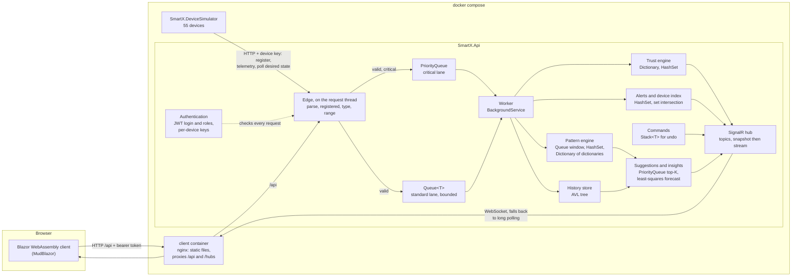

# Smart-X

An IoT telemetry ingestion and mesh-management system, built as a university Portfolio of Evidence. **Part 1** ingests sensor
readings without boxing and scores each node's trust. **Part 2** adds a device simulator that reports over HTTP, FIFO and priority
ingestion queues, commands with undo, history, alerts, real-time push, a prediction engine and authentication. **Part 3** (network
topology) is not built; its menu entry is visibly disabled.

## Contents

- [Architecture](#architecture)
- [Quick start](#quick-start)
- [Docker](#docker)
- [Authentication](#authentication)
- [Running without Docker](#running-without-docker)
- [Testing the Part 2 data structures](#testing-the-part-2-data-structures)
- [Tests](#tests)
- [Where each concept lives](#where-each-concept-lives)
- [Configuration](#configuration)
- [Troubleshooting](#troubleshooting)
- [Design notes](#design-notes): [the device shadow](#the-device-shadow),
  [undo](#undo-restores-the-previous-state-it-does-not-do-the-opposite), [snapshot plus stream](#snapshot-plus-stream), [why
  predictions are not random](#why-predictions-are-not-random)

## Architecture



Everything the browser sees arrives through nginx on one origin. The simulator is not a special case: it talks to the API over the
compose network, as a device talks to a gateway. Rejected readings never enter a queue; they are answered at the edge and still
count against the node's trust.

| Project | What it is |
| --- | --- |
| `src/SmartX.Shared` | Every type that crosses the wire (`TelemetryPacket<T>`, zones and their recursive validator, registrations, trust, commands). No dependencies. |
| `src/SmartX.Api` | ASP.NET Core Minimal API. Owns all server-side behaviour: ingestion, trust, history, alerts, commands, real-time, predictions, authentication. |
| `src/SmartX.Client` | Blazor WebAssembly (MudBlazor): trust panel, sensors, telemetry, Command Stream. Talks to the API over HTTP only. |
| `src/SmartX.DeviceSimulator` | A fleet of 55 simulated ESP32-style devices that register and report over HTTP. |
| `tests/SmartX.Tests` | xUnit, bUnit and in-memory API tests (`WebApplicationFactory`). |

The client and the simulator reference only `SmartX.Shared`, never the API, so the compiler enforces the split and the client
deploys on its own (static files behind nginx). The simulator stands in for hardware, which can only send HTTP requests to a
gateway, not call into its code.

## Quick start

No `.env` file is needed and nothing needs installing but Docker (Compose v2).

```bash
git clone https://github.com/UsmarTayler/smartx-poe.git
cd smartx-poe
docker compose up -d --build
```

The first build takes a few minutes. Open <http://localhost:8080> and sign in:

| Login | Password | Role |
| --- | --- | --- |
| `operator` | `smartx-operator-demo` | Operator: reads and changes everything |
| `viewer` | `smartx-viewer-demo` | Viewer: read-only (controls are disabled and say why) |

The dashboard fills in about half a minute: 55 devices, and **Suggested Actions** is not empty from the first moment because the
engine starts with a labelled, seeded operator history. Check it is up with `docker compose ps` (three containers, the API
`healthy`) and `curl http://localhost:5266/api/health` (`{"status":"ok"}`). The pages are `/` (trust panel), `/sensors`,
`/telemetry` and `/command-stream`.

## Docker

| Service | Runs | Host port |
| --- | --- | --- |
| `client` | nginx: serves the WebAssembly app, falls back to `index.html` for client routes, forwards `/api/` and `/hubs/` to the API | `8080` |
| `api` | the API (Release build, non-root). Its health check is `/api/health`, and the simulator waits for it. | `5266` |
| `simulator` | the device fleet; publishes no port, only makes requests to `http://api:8080` | none |

The browser only talks to nginx, so there is one origin and no CORS. Compose starts the simulator once the API is healthy, and the
simulator also retries with backoff, because real devices power on before their gateway does.

Every variable is optional; put the ones you want in a `.env` (copy `.env.example`) or set them on the command line:

| Variable | Default | Effect |
| --- | --- | --- |
| `SMARTX_CLIENT_PORT` / `SMARTX_API_PORT` | `8080` / `5266` | Host ports |
| `SMARTX_DEVICE_COUNT` | `55` | Devices run, from the top of the list. Fewer than 55 drops the hydroponics bay (the last seven), which is where the demo suggestions come from. |
| `SMARTX_SCENARIO_MIX` | `Demo` | `Nominal` starts every device healthy |
| `SMARTX_RATE`, `SMARTX_TICK` | `1`, `00:00:00.500` | How many times faster the fleet reports, and how often it wakes (lower the tick as the rate rises) |
| `SMARTX_PROCESS_DELAY` | `00:00:00` | Simulated per-reading cost of a slow gateway, to build a queue backlog |
| `SMARTX_QUEUE_DEPTH` | `10000` | Standard queue bound before the API answers `503` |
| `SMARTX_SEED_HISTORY` | `true` | `false` leaves the suggestion engine knowing only what it has observed |
| `SMARTX_PATTERN_WINDOW` | `00:10:00` | How soon after an event an operator action counts as a response |
| `SMARTX_AUTH_SIGNING_KEY`, `SMARTX_FLEET_SECRET`, `SMARTX_ATTACHMENT_KEY` | published development values | Secrets. The API warns at start-up for each default still in use. |
| `SMARTX_DEMO_USERS` | `true` | `false` removes the two demo logins |

```bash
docker compose down                  # stop; attachments are kept in a volume
docker compose down -v               # stop and also delete the volume (a full reset)
docker compose restart simulator     # re-registers the fleet, without touching the API
```

## Authentication

Every endpoint except health and login needs a token. **Operators** read and change, **Viewers** only read (a write is `403`), and
devices use a per-device key. The demo logins (see Quick start) are published, so they protect nothing. In PowerShell use
`curl.exe`.

```bash
TOKEN=$(curl -s -X POST http://localhost:5266/api/auth/login -H "Content-Type: application/json" -d '{"username":"operator","password":"smartx-operator-demo"}' | sed -E 's/.*"token":"([^"]+)".*/\1/')   # once: every curl below sends it
curl -H "Authorization: Bearer $TOKEN" http://localhost:5266/api/auth/me     # {"username":"operator","role":"Operator",...}
```

## Running without Docker

You need the .NET 10 SDK (`dotnet --version` should print `10.0.x`). Run each program in its own terminal, from the repository
root.

```bash
dotnet build
dotnet test
dotnet user-secrets set "Attachments:EncryptionKey" "jk8ISNL3b2INdPgIONnlaaf0nycILpHni4khrvGdBlg=" --project src/SmartX.Api   # once; the published development key
dotnet run --project src/SmartX.Api -- --Zones:Hierarchy=Demo      # terminal 1: http://localhost:5266
dotnet run --project src/SmartX.Client                             # terminal 2: http://localhost:5131
dotnet run --project src/SmartX.DeviceSimulator                    # terminal 3 (optional): registers 55 devices, then keeps them reporting
```

Sign in with the same demo logins. The simulator waits and retries until the API answers, so the order does not matter. HTTPS
profiles are `https://localhost:7059` (API) and `https://localhost:7258` (client): add `--launch-profile https` and run
`dotnet dev-certs https --trust` once.

## Testing the Part 2 data structures

Each recipe is steps, then the expected result. They assume the Docker stack is running and `$TOKEN` is set (see
[Authentication](#authentication)).

### `Queue<T>`: the standard lane

The standard lane is a bounded FIFO: `Queue<QueuedReading>` behind a lock, drained by one background worker.

1. Send an ordinary reading, then read the pipeline's figures:

   ```bash
   curl -H "Authorization: Bearer $TOKEN" -X POST http://localhost:5266/api/telemetry -H "Content-Type: application/json" -d '{"macAddress":"B8:27:EB:10:00:0F","value":120}'
   curl -H "Authorization: Bearer $TOKEN" http://localhost:5266/api/pipeline/stats
   ```

2. To see the **bound**, give the worker a cost and shrink the queue:
   `SMARTX_QUEUE_DEPTH=50 SMARTX_PROCESS_DELAY=00:00:00.01 SMARTX_RATE=50 SMARTX_TICK=00:00:00.05 docker compose up -d`

**Expect:** `202` with `"lane":"standard"` and a `queuePosition`; `processed` climbing and `depth` near 0. With the bound, depth
reaches 50 and further readings answer `503` with `Retry-After` (counted in `rejectedWhenFull`): backpressure, nothing silently
dropped. Run `docker compose up -d` plain to go back. Tests: `IngestionQueueTests`.

### `PriorityQueue`: the critical lane

Readings that cross a critical threshold at the edge go into a `PriorityQueue<QueuedReading, (int Severity, long Sequence)>` that
the worker drains first. The composite priority makes it stable, and a valve lets one standard reading through after every 20
critical ones so the standard lane cannot starve.

**How to simulate a high-priority alert.** With curl, send power above 180 kW (the device's range is 0 to 450, so it is valid),
then an ordinary reading:

```bash
curl -H "Authorization: Bearer $TOKEN" -X POST http://localhost:5266/api/telemetry -H "Content-Type: application/json" -d '{"macAddress":"B8:27:EB:10:00:0F","value":200}'
curl -H "Authorization: Bearer $TOKEN" -X POST http://localhost:5266/api/telemetry -H "Content-Type: application/json" -d '{"macAddress":"B8:27:EB:10:00:0F","value":120}'
```

**Expect:** `202` with `"lane":"critical"` for 200 and `"lane":"standard"` for 120; `/api/pipeline/stats` shows the critical
lane's `processed` rising with a wait of a fraction of a millisecond.

From the page: open `/command-stream`, choose a device under **Simulate on** and press **Simulate critical event**. **Expect:**
within about five seconds the reading is pinned at the top of the live stream, marked Critical. **Back to normal** undoes it.

With the defaults both lanes are empty, which shows nothing. To watch it jump a backlog, build one:
`SMARTX_PROCESS_DELAY=00:00:00.004 SMARTX_RATE=50 SMARTX_TICK=00:00:00.050 docker compose up -d`, then press **Simulate critical
event** again. Measured both ways:

| | Critical reading | Normal reading |
| --- | --- | --- |
| Unit test: 5,000 normal readings queued, 0.3 ms per reading | waited **0.4 ms** | waited **1,691 ms** (about 4,500× longer) |
| Docker, 4 ms per reading, fleet at 50× | average wait **47 ms** | average wait **19,183 ms** ("408.7× sooner", 430 readings refused with `503`) |

Tests: `CriticalLaneOrderTests` (order, which does not depend on machine speed), `IngestionQueueTests` (stability and the valve).
The same structure ranks suggestions, capped at K: see [the predictive engine](#the-predictive-engine).

### `Stack<T>`: undo

Every command that changes an actuator pushes what it replaced onto a bounded `Stack<UndoEntry>` (20 deep). **Undo** pops the top
and restores the previous state.

```bash
curl -H "Authorization: Bearer $TOKEN" -X POST http://localhost:5266/api/commands -H "Content-Type: application/json" -d '{"macAddress":"B8:27:EB:10:00:2B","action":"ValveClose"}'
curl -H "Authorization: Bearer $TOKEN" http://localhost:5266/api/commands/undo-stack
curl -H "Authorization: Bearer $TOKEN" -X POST http://localhost:5266/api/commands/undo
```

**Expect:** the stack lists the close with the valve's previous state; the undo is accepted, a restore command is sent to that
valve, and the stack is one shorter. In the page, the **Undo stack** panel shows the same ("n of up to 20 actions", **Undo
last**); "Apply to zone" (for example Zone 3, **Close valve**) is one entry that undoes every child. Why undo is not "the opposite
action": [Design notes](#undo-restores-the-previous-state-it-does-not-do-the-opposite). Tests: `CommandServiceTests`,
`CompositeCommandTests`.

### `Dictionary`: lookups and learned counts

The trust engine keeps a `Dictionary<string, NodeState>` by MAC (one lookup per packet), the device index a
`Dictionary<TKey, HashSet<string>>` per search facet, and the pattern engine a
`Dictionary<TriggerKey, Dictionary<ActionKey, DecayedCount>>`.

```bash
curl -H "Authorization: Bearer $TOKEN" http://localhost:5266/api/trust/B8:27:EB:10:00:0F
curl -H "Authorization: Bearer $TOKEN" "http://localhost:5266/api/patterns?mac=B8:27:EB:10:00:32&includeWeak=true"
curl -H "Authorization: Bearer $TOKEN" "http://localhost:5266/api/devices/search?category=Actuator&actuatorKind=Valve&zone=zone-3"
```

**Expect:** (1) the node's score, band and reason. (2) A first association: a low-level crossing on Moisture Sensor B followed by
`PumpOn` on Pump A, at the `Specific` level, `qualified: true`, `times` 7 of a `triggerTimes` that starts at 10 (7 and 8 of them
seeded), lift about 10; then a `General` association for "% sensor in Zone 6". Decimals drift as counts decay. (3) The valves in
Zone 3 and its sub-zones, found by intersecting sets and not by scanning devices. Tests: `PatternEngineTests`, `TrustEngineTests`,
`DeviceIndexTests`.

### `SortedDictionary`: the history store

History is a dictionary of nodes, each owning a `SortedDictionary<HistoryKey, HistoryEntry>` keyed by `(Timestamp, Sequence)`, so
a time range comes back in order.

```bash
curl -H "Authorization: Bearer $TOKEN" "http://localhost:5266/api/sensors/B8:27:EB:10:00:0C/timeline?maxPoints=20"
```

**Expect:** `"shape":"Buckets"`, at most 20 buckets in time order with `min`, `max`, `average` and `count`; a spike survives
downsampling as a bucket's `max`. In the page, open a device on `/command-stream` for the chart, with commands, alerts and trust
changes as markers. A range read walks from the start of a node's keys (a `SortedDictionary` cannot seek): on 200,000 entries the
oldest 100 take about 18 µs and the newest 100 about 10.8 ms. That cost is why Part 3 replaced it with an AVL tree, which is now
the default store (`History:Store`); the dictionary store stays selectable for comparison. Tests:
`SortedDictionaryHistoryStoreTests` (through the shared contract suite), `TimelineBuilderTests`.

### AVL tree vs SortedDictionary

`AvlHistoryStore` keeps the same layout and key, with a hand-written `AvlTree<TKey, TValue>` ([`AvlTree.cs`](src/SmartX.Shared/Collections/AvlTree.cs))
in place of the dictionary. A range query descends to the first key at or after `from` and reads forward until it passes `to`, so it
costs O(log n + k). Try it on a registered sensor, with the window ends required and `to` excluded:

```bash
curl -H "Authorization: Bearer $TOKEN" "http://localhost:5266/api/history/B8:27:EB:10:00:0C/range?from=2026-03-01T14:00:00Z&to=2026-03-01T16:00:00Z&limit=100"
curl -H "Authorization: Bearer $TOKEN" http://localhost:5266/api/history/stats
```

**Expect:** readings oldest first with `truncated` and `nextFrom` when more match; from `stats`, each tree's `height` next to
`minimumHeight` (⌈log₂(n+1)⌉), which stay equal or one apart. Benchmark (Release, one node, a hundred readings returned,
microseconds per query, AVL / `SortedDictionary`):

| Entries | Oldest window | Middle window | Newest window |
| ---: | ---: | ---: | ---: |
| 10,000 | 1.5 / 1.3 | 1.7 / 16.6 | 1.4 / 43.1 |
| 100,000 | 2.1 / 1.3 | 1.3 / 184.8 | 1.5 / 440.6 |
| 1,000,000 | 1.4 / 1.8 | 1.3 / 3,841.4 | 1.9 / 8,704.7 |

Insert cost, nanoseconds per insert, AVL / `SortedDictionary`:

| Entries | Arriving in time order | Arriving shuffled |
| ---: | ---: | ---: |
| 10,000 | 70 / 111 | 139 / 216 |
| 100,000 | 92 / 124 | 303 / 453 |
| 1,000,000 | 138 / 189 | 1,109 / 1,201 |

The tree's query time does not move with the size of the history or where the window sits, because it pays one comparison per
level (20 at a million entries, which is also the best a tree of that size can do), while the dictionary pays for every key before
the window, so it grows with the amount of history. The dictionary ties or wins only on the oldest window, by under a microsecond,
because it starts there and never has to seek. Inserts are somewhat cheaper on the tree in these runs and the two converge when
keys arrive shuffled; the dictionary was not faster anywhere by enough to matter, but treat differences under about 30 % as noise.
Run it with `dotnet test -c Release --settings tests/SmartX.Tests/benchmark.runsettings --filter "FullyQualifiedName~AvlHistoryBenchmarkTests" --logger "console;verbosity=detailed"`.
Tests: `AvlTreeTests` (invariants after every operation, the four rotations, ranges against a sorted list), `AvlHistoryStoreContractTests`
(the whole contract suite, unchanged), `HistoryRangeEndpointTests`.

### `HashSet`: duplicates and "already done"

An alert is a `readonly record struct AlertKey(Mac, Kind)`. A firing condition calls `HashSet<AlertKey>.Add`: `true` is a new
alert, `false` is a repeat, which is counted and shown as "suppressed ×N".

```bash
curl -H "Authorization: Bearer $TOKEN" http://localhost:5266/api/alerts      # run it, wait a few seconds, run it again
curl -H "Authorization: Bearer $TOKEN" http://localhost:5266/api/alerts/stats
```

**Expect:** the same alerts (one per device and kind) with `suppressedCount` higher the second time, and `suppressed` far larger
than `raised` in the stats. The Alerts panel shows "suppressed ×N" on each row. The pattern engine uses the same idea to count a
response once, and to drop a suggestion once its action is taken. Tests: `AlertTrackerTests`, `PatternEngineTests`.

### The predictive engine

It learns what operators do after what, ranks the likely next action (a `PriorityQueue` capped at K), and forecasts nodes heading
for Fault (a least-squares fit).

1. Open `/command-stream`. **Expect:** **Suggested Actions** lists "Turn on Pump A" and "Open Pump A" (Moisture Sensor B dropped
   below 20 %), each with its evidence ("Operators did this 7 of the last 8 times (7 from seeded history). 12× more likely than
   usual.") and one button. The second number grows as the sensor dips again; the seeded 7 stays.
2. The same data: `curl -H "Authorization: Bearer $TOKEN" http://localhost:5266/api/suggestions` and `.../api/insights`.
3. Press **Open Pump A**. **Expect:** it disappears without a reload (its action is done), and the pattern's count does not rise:
   an accepted suggestion counts at weight zero, so the engine cannot train on its own advice.
4. Press **Not useful** on another. **Expect:** it moves under "Marked not useful" at weight 85 % (never below 50 %), and **Take
   back** restores it exactly.
5. Look at **Automated Insights**. **Expect:** *Anticipated* entries for nodes whose trust is falling in a straight line (for
   example "…trust falling, projected to reach Fault in about 2 minutes") before they are in Fault, then *Now* entries for nodes
   already in Fault with an open investigation.

A straight line cannot know that a fall will level off, so a projection is a prompt to look, not a promise: the trust band stays
the authority on what is a Fault. Tests: `SuggestionServiceTests`, `TrustForecasterTests`, `InsightServiceTests`,
`SuggestionsTopicTests`. Why a pattern needs more than a high confidence: [Design notes](#why-predictions-are-not-random).

## Tests

```bash
dotnet test                                                                                                   # the whole suite: 1,414 cases
dotnet test --filter "FullyQualifiedName~SuggestionServiceTests"                                              # one class
dotnet test --settings tests/SmartX.Tests/benchmark.runsettings --filter "Category=Benchmark" --logger "console;verbosity=detailed"   # the benchmarks
```

Timing benchmarks are excluded from the default run: they assert thresholds on a wall clock, which a cold or busy machine can miss
for no fault of the code, and the behaviour they measure is covered by order in the default run.

| Area | Test methods (rough) | Main test class |
| --- | --- | --- |
| Part 1: packets, generics, zones, buffers, trust formula | about 130 | `NumericPacketTests`, `ZoneValidatorTests`, `RingBufferTests` |
| `Queue<T>` and `PriorityQueue` (ingestion) | about 45 | `IngestionQueueTests`, `CriticalLaneOrderTests` |
| `Stack<T>` (commands and undo) | about 90 | `CommandServiceTests` |
| `Dictionary` (trust, device index, patterns) | about 80 | `TrustEngineTests`, `PatternEngineTests` |
| `SortedDictionary` (history) | about 65 | `HistoryStoreContract` (run as `SortedDictionaryHistoryStoreTests`) |
| AVL tree (history) | about 73 | `AvlTreeTests`, `AvlHistoryStoreContractTests` (the same contract), `HistoryRangeEndpointTests` |
| `HashSet` (alerts, search) | about 55 | `AlertTrackerTests` |
| Predictive engine | about 160 | `SuggestionServiceTests`, `TrustForecasterTests` |
| Real-time push (hub, client feeds) | about 95 | `RealtimeHubTests`, `ClientRealtimeTests` |
| Authentication | about 120 | `AuthenticationTests`, `EndpointProtectionTests` |
| Command Stream page and accessibility (bUnit) | about 130 | `CommandStreamComponentTests` |
| Device simulator | about 20 | `DeviceSimulatorTests` |
| Attachments (streamed, encrypted) | about 35 | `AttachmentUploadTests` |

Counts are `[Fact]` and `[Theory]` methods; theory rows bring the suite to 1,414 cases. The API tests boot the real API in memory
with `WebApplicationFactory`, and the browser components are tested with bUnit on a fake hub, a fake API and a fake clock.

## Where each concept lives

| Concept | Where | What to look at |
| --- | --- | --- |
| Generics without boxing | [`TelemetryPacket.cs`](src/SmartX.Shared/Packets/TelemetryPacket.cs) | `TelemetryPacket<T> where T : struct`; the class comment explains how the constraint avoids boxing |
| Generic math | [`NumericPacket.cs`](src/SmartX.Shared/Packets/NumericPacket.cs) | `NumericPacket<T> where T : struct, INumber<T>` |
| Generic conversion at the boundary | [`ValueRange.cs`](src/SmartX.Shared/Sensors/ValueRange.cs) | `Contains<T>(T value)` uses `double.CreateChecked`, not `Convert.ToDouble(object)` |
| Generic results on the client | [`ApiResult.cs`](src/SmartX.Client/Services/ApiResult.cs), [`SmartXApiClient.cs`](src/SmartX.Client/Services/SmartXApiClient.cs) | `ApiResult<T>` as a `readonly record struct`, and `SendReadingAsync<T>` |
| Operator overloading, arithmetic and comparison | [`NumericPacket.cs`](src/SmartX.Shared/Packets/NumericPacket.cs) | `+`, `-`, `>`, `<`, `==`, `!=` |
| Operator overloading, logical | [`StatePacket.cs`](src/SmartX.Shared/Packets/StatePacket.cs) | `\|`, `&`, `==`, `!=` |
| Operator guard | [`TelemetryPacket.cs`](src/SmartX.Shared/Packets/TelemetryPacket.cs) | `EnsureCombinable`, which rejects mismatched units or categories |
| Recursion, walking up | [`ZoneValidator.cs`](src/SmartX.Shared/Zones/ZoneValidator.cs) | `Ascend`, with its base case, cycle guard and depth guard |
| Recursion, walking down | [`ZoneTree.cs`](src/SmartX.Shared/Zones/ZoneTree.cs) | `Descend` (sensors beneath a zone) and `BuildNode` (the nested tree) |
| Jagged arrays | [`TelemetryStagingBuffer.cs`](src/SmartX.Shared/Collections/TelemetryStagingBuffer.cs) | the `T[][] _windows` field, `Stage` and `Drain`; the class comment covers jagged versus rectangular |
| Custom collection | [`TelemetryRingBuffer.cs`](src/SmartX.Shared/Collections/TelemetryRingBuffer.cs) | `TelemetryRingBuffer<T>`: O(1) `Add` that overwrites the oldest, an indexer, and a struct `Enumerator` so `foreach` allocates nothing |
| Lists | [`TelemetryStagingBuffer.cs`](src/SmartX.Shared/Collections/TelemetryStagingBuffer.cs), [`TelemetryRingBuffer.cs`](src/SmartX.Shared/Collections/TelemetryRingBuffer.cs) | `Drain` returns a pre-sized `List<T>`, and `ToList` copies a node's history out as a pre-sized list |
| Stack for undo | [`CommandService.cs`](src/SmartX.Api/Commands/CommandService.cs) | `Stack<UndoEntry> _undo` behind a lock: `Push` (with the bounded-depth trim), `Undo`, and the class comment on why undo restores the previous state instead of doing the opposite |
| Command lifecycle | [`CommandService.cs`](src/SmartX.Api/Commands/CommandService.cs), [`CommandStore.cs`](src/SmartX.Api/Commands/CommandStore.cs) | states and transitions; `Collect` hands each command over once; `TryTransition` is the compare-and-swap |
| Recursion, reused | [`CommandService.cs`](src/SmartX.Api/Commands/CommandService.cs), [`ZoneTree.cs`](src/SmartX.Shared/Zones/ZoneTree.cs) | `IssueForZone` calls the same `NodesBeneath` walk as Part 1 to find every actuator under a zone, and the device search asks `ZoneIdsBeneath`, which shares the same private `Descend` |
| Sorted dictionary | [`SortedDictionaryHistoryStore.cs`](src/SmartX.Api/History/SortedDictionaryHistoryStore.cs), [`HistoryKey.cs`](src/SmartX.Api/History/HistoryKey.cs) | a dictionary of nodes, each owning a `SortedDictionary<HistoryKey, HistoryEntry>`; the key is `(Timestamp, Sequence)` so equal timestamps cannot collide, and the class comment states the cost of a range query honestly |
| AVL tree | [`AvlTree.cs`](src/SmartX.Shared/Collections/AvlTree.cs), [`AvlHistoryStore.cs`](src/SmartX.Api/History/AvlHistoryStore.cs) | a generic tree with the height stored in each node, four rotations (LL, RR, LR, RL), and `Range`, `Floor`, `Ceiling`, `Min`, `Max`; the default history store, whose range query is O(log n + k) |
| Downsampling | [`TimelineBuilder.cs`](src/SmartX.Api/History/TimelineBuilder.cs) | one pass into at most `maxPoints` buckets with min, max, average and count, so a spike survives |
| HashSet for duplicate prevention | [`AlertTracker.cs`](src/SmartX.Api/Alerts/AlertTracker.cs), [`AlertKey.cs`](src/SmartX.Shared/Alerts/AlertKey.cs) | `HashSet<AlertKey>` where `Add` returning `false` is the suppress decision; the key is a `readonly record struct` so value equality works |
| Secondary indexes and set intersection | [`DeviceIndex.cs`](src/SmartX.Api/Search/DeviceIndex.cs) | `Dictionary<TKey, HashSet<string>>` per category, kind, band, alert and zone; `Search` intersects the smallest set first, and `FindInconsistencies` is what the consistency test runs |
| Idempotent delivery | [`SimulatedDevice.cs`](src/SmartX.DeviceSimulator/SimulatedDevice.cs) | `ApplyCommand` remembers applied command ids |
| FIFO queue | [`TelemetryIngestionQueue.cs`](src/SmartX.Api/Ingestion/TelemetryIngestionQueue.cs) | `Queue<QueuedReading> _standard`, with the lock, the `SemaphoreSlim` signal and the bound; the class comment explains the trade-off against `Channel<T>` |
| Priority queue | [`TelemetryIngestionQueue.cs`](src/SmartX.Api/Ingestion/TelemetryIngestionQueue.cs) | `PriorityQueue<QueuedReading, (int Severity, long Sequence)>`: the composite priority that makes it stable, and `DequeueAsync`'s starvation valve |
| Classifying at the edge | [`CriticalClassifier.cs`](src/SmartX.Api/Ingestion/CriticalClassifier.cs), [`TelemetryEndpoints.cs`](src/SmartX.Api/Endpoints/TelemetryEndpoints.cs) | `IsCritical` against configured rules; `Enqueue` and `QueueFull` (503 with `Retry-After`) |
| Asynchronous processing | [`TelemetryProcessor.cs`](src/SmartX.Api/Ingestion/TelemetryProcessor.cs) | the `BackgroundService` that drains the queues, and why there is one worker |
| Device shadow | [`SimulationEndpoints.cs`](src/SmartX.Api/Endpoints/SimulationEndpoints.cs), [`DeviceShadowStore.cs`](src/SmartX.Api/Storage/DeviceShadowStore.cs) | desired state with a version; `GET /api/devices/{mac}/desired` |
| Device simulator | [`DeviceFleet.cs`](src/SmartX.DeviceSimulator/DeviceFleet.cs), [`GatewayClient.cs`](src/SmartX.DeviceSimulator/GatewayClient.cs) | registration, backfill, backoff, and applying desired state, all over HTTP |
| SignalR hub and groups | [`TelemetryHub.cs`](src/SmartX.Api/Realtime/TelemetryHub.cs), [`ITelemetryClient.cs`](src/SmartX.Api/Realtime/ITelemetryClient.cs) | topics as groups, a typed client interface, and the transport readable through `GetTransport` |
| Batching, coalescing and immediate sends | [`RealtimeBroadcaster.cs`](src/SmartX.Api/Realtime/RealtimeBroadcaster.cs) | the class comment explains which messages are which and why; one loop sends, so messages leave in numbered order |
| Snapshot plus stream | [`RealtimeFeed.cs`](src/SmartX.Client/Realtime/RealtimeFeed.cs) | join, snapshot, then apply only pushes newer than the snapshot; reference-counted start and stop |
| Debounce with out-of-order answers | [`DeviceSearchService.cs`](src/SmartX.Client/CommandStream/DeviceSearchService.cs) | `Request` cancels the wait of the one before it; `SearchAsync` numbers each request and only the newest may set the result |
| Queue for a sliding window | [`PatternEngine.cs`](src/SmartX.Api/Patterns/PatternEngine.cs) | `Queue<TriggerInstance> _window`: triggers in time order, expired from the front, so an action is paired with the triggers in the window and nothing is searched; the same FIFO structure as the ingestion lane, doing a different job |
| HashSet to count once | [`PatternEngine.cs`](src/SmartX.Api/Patterns/PatternEngine.cs) | `HashSet<(long Instance, ActionKey Action)> _paired`: `Add` returning false is why four opens of one pump after one moisture drop are one response |
| Dictionaries of dictionaries | [`PatternEngine.cs`](src/SmartX.Api/Patterns/PatternEngine.cs) | `Dictionary<TriggerKey, Dictionary<ActionKey, DecayedCount>>`: how often each action followed each trigger, with support, confidence and lift worked out from it |
| Value-type keys, no boxing | [`PatternKeys.cs`](src/SmartX.Api/Patterns/PatternKeys.cs) | `TriggerKey` and `ActionKey` as `readonly record struct`s, so a lookup on every event allocates nothing |
| Lazy decay in a struct | [`PatternEngine.cs`](src/SmartX.Api/Patterns/PatternEngine.cs) | `DecayedCount`: a count that remembers when it last changed and is faded only when read, changed in place through `CollectionsMarshal` |
| Priority queue, for ranking | [`SuggestionService.cs`](src/SmartX.Api/Patterns/SuggestionService.cs) | `PriorityQueue<Candidate, (double Score, string Id)>` capped at K: the same structure as the critical lane, used to keep the best K and not to hand out the most urgent |
| Least squares and R² | [`TrustForecaster.cs`](src/SmartX.Api/Patterns/TrustForecaster.cs) | the line, the fit, the bars a forecast has to clear, and the check that a fall is not flattening |
| Dictionary and HashSet | [`TrustEngine.cs`](src/SmartX.Api/Trust/TrustEngine.cs) | `_nodes`, keyed by MAC for O(1) lookup per packet, and `_degraded`, where each failing node appears once |
| Background services | [`HeartbeatMonitor.cs`](src/SmartX.Api/Trust/HeartbeatMonitor.cs), [`TelemetryProcessor.cs`](src/SmartX.Api/Ingestion/TelemetryProcessor.cs), [`DeviceFleet.cs`](src/SmartX.DeviceSimulator/DeviceFleet.cs) | `PeriodicTimer` driven by an injected `TimeProvider`; a worker that survives one bad reading |
| Async all the way down | [`SmartXApiClient.cs`](src/SmartX.Client/Services/SmartXApiClient.cs), [`ISensorRegistry.cs`](src/SmartX.Api/Storage/ISensorRegistry.cs) | no `.Result`, `.Wait()` or `GetAwaiter().GetResult()` anywhere |
| Authentication policies on groups | [`Policies.cs`](src/SmartX.Api/Security/Policies.cs), [`Program.cs`](src/SmartX.Api/Program.cs) | five named policies applied to endpoint groups; `ConsoleAccessHandler` makes a read a Viewer's and everything else an Operator's, so a new endpoint is safe by default |
| Every endpoint must be protected | [`EndpointProtectionTests.cs`](tests/SmartX.Tests/EndpointProtectionTests.cs) | reads `EndpointDataSource` and fails on any endpoint without authorization, other than health and login |
| JWT login, lockout, rate limit | [`AuthEndpoints.cs`](src/SmartX.Api/Endpoints/AuthEndpoints.cs), [`TokenService.cs`](src/SmartX.Api/Security/TokenService.cs), [`LoginThrottle.cs`](src/SmartX.Api/Security/LoginThrottle.cs) | one message for every failure, an unknown name still costs a hash, and the token is checked for algorithm, issuer, audience and expiry |
| Hashed passwords | [`UserDirectory.cs`](src/SmartX.Api/Security/UserDirectory.cs) | `PasswordHasher<T>`; only hashes in the source |
| Derived device keys | [`DeviceKeys.cs`](src/SmartX.Shared/Auth/DeviceKeys.cs), [`DeviceKeyAuthentication.cs`](src/SmartX.Api/Security/DeviceKeyAuthentication.cs) | `HMAC-SHA256(fleetSecret, MAC)`, never stored, and `DeviceScope` limits a device to its own MAC |
| Streamed, encrypted I/O | [`AttachmentUploader.cs`](src/SmartX.Api/Attachments/AttachmentUploader.cs), [`AesGcmEncryptingStream.cs`](src/SmartX.Api/Attachments/AesGcmEncryptingStream.cs) | `MultipartReader`, not `IFormFile`, and chunked AES-256-GCM |

## Configuration

Settings are the usual ASP.NET Core order (`appsettings.json`, user secrets in Development, environment variables, command line);
an environment variable uses `__` for `:` (`Trust:HalfLife` is `Trust__HalfLife`). In Docker use the variables in the
[Docker](#docker) table. What a marker is most likely to change:

| Setting | Default | What it does |
| --- | --- | --- |
| `Simulator:DeviceCount` | `55` | How many demo devices run |
| `Simulator:Mix` | `Demo` | `Demo` gives each device a scenario; `Nominal` starts all healthy |
| `Simulator:ReportingRateMultiplier` | `1` | How many times faster the fleet reports |
| `SeededHistory:Enabled` | `false` (Docker: `true`) | Replays a labelled operator history so the suggestion engine is not empty |
| `Ingestion:SimulatedGatewayCost` | `00:00:00` | Per-reading delay in the worker, to build a backlog |
| `Ingestion:MaxQueueDepth` | `10000` | Bound of the standard queue |
| `Commands:MaxUndoDepth` | `20` | Depth of the undo stack |
| `History:Store` | `Avl` | `Avl` or `SortedDictionary`: which store holds history |
| `Auth:SigningKey`, `Auth:FleetSecret` | published development values | Required outside Development; at least 32 and 16 bytes |
| `Auth:SeedDemoUsers` | `true` in Development and Docker | The `operator` and `viewer` logins |
| `Auth:TokenLifetime` | `01:00:00` | How long a login lasts |
| `Attachments:EncryptionKey` | published development key (Docker) | Base64 256-bit key attachments are encrypted with |

## Troubleshooting

**The address is already in use.** `5266` or `8080` is held by an earlier run, or by the Docker stack while you run locally (both
use `5266`). Find the owner (`Get-NetTCPConnection -LocalPort 5266` on Windows, `lsof -i :5266` elsewhere) and stop it, or move
the Docker ports with `SMARTX_API_PORT` and `SMARTX_CLIENT_PORT`.

**Login fails, or everything is `401`.** The demo logins are `operator` / `smartx-operator-demo` and `viewer` /
`smartx-viewer-demo`. Five failures in a row lock a name for a minute and ten attempts a minute from one address are refused
(`429`). A token lasts an hour, and a restart with a different signing key invalidates it: sign in again. A `403` means a Viewer
tried to change something. Tokens cannot be revoked before they expire, users are held in memory, and the browser keeps the token
in `sessionStorage`, which script in the page can read.

**Docker does not start.** Check Docker Desktop is running, then `docker compose ps` and `docker compose logs api`. If the
simulator stops, `docker compose logs simulator` says why (the API never came up, or it rejected the device key). If `client`
keeps restarting with a `bad interpreter` error, a script was checked out with Windows line endings: `git add --renormalize .`,
then rebuild.

**The build fails with MSB3030 "Could not copy the file … webcil" (Windows).** The clone's path is too long for the 260-character
limit. Clone somewhere short such as `C:\src\smartx-poe`, or enable long paths once from an administrator PowerShell and restart
the terminal:
`New-ItemProperty -Path "HKLM:\SYSTEM\CurrentControlSet\Control\FileSystem" -Name LongPathsEnabled -Value 1 -PropertyType DWORD -Force`.

**The page looks stale after a rebuild.** The browser cached the old WebAssembly files. Hard-refresh (Ctrl+F5) or open a private
window; `docker compose up -d --build` replaces the client image, but your browser may still hold the old one.

**The dashboard is empty.** The simulator backfills about ten minutes of history on start, so give it half a minute. If it stays
empty, `docker compose logs simulator` should say "Registered 55 devices"; if the API restarted since,
`docker compose restart simulator` registers the fleet again. Running locally, start the API with `--Zones:Hierarchy=Demo`, or the
demo devices have no zones to register into.

## Design notes

Four decisions a marker is most likely to ask about.

### The device shadow

The simulator is a separate program, so the API cannot (and should not) reach into it to change what a device does: that would
mean the gateway holding a connection open to every device. Real IoT platforms solve this with a **device shadow** (AWS IoT) or
**device twin** (Azure IoT): the platform stores the state an operator *wants*, each device polls for its own, applies it, and
reports back, and the device is the only thing that ever changes the device.

`POST /api/simulation/{mac}/scenario` writes the desired state. It answers `202 Accepted`, not `200`, because nothing has happened
yet: the device applies it on its next poll, within about five seconds. The desired state carries a version that rises on every
change, so a device that finds a version it has already applied does nothing.

Commands ride the same channel. A device makes **one check-in**, `GET /api/devices/{mac}/desired`, and the response carries the
desired scenario and any pending commands together, so a real ESP32 makes one cheap call, not two. Fetching a command moves it to
`Delivered` and the API never hands it over again; the device applies it and `POST`s an acknowledgement with success or failure
and the resulting state. A device with nothing asked of it gets `404`, which it reads as "carry on".

Two consequences are deliberate. A device that is switched off simply never collects, so its command ends as `TimedOut` after 30
seconds, which is exactly what happens to hardware that is off (a good demo: send `RelayOn` to the silent relay
`B8:27:EB:10:00:20`). And because delivery can repeat, the device remembers the command ids it has applied, so a duplicate of an
old "close" never shuts a valve that has since been opened. The check-in is device-key authenticated and a device can only read
its own shadow.

### Undo restores the previous state. It does not do the opposite.

The obvious design gives every command an opposite: `ValveOpen` is undone by `ValveClose`. That is wrong. If a valve is **already
open** and someone sends `ValveOpen`, the "opposite" would close it, a state it was never in. So every command records **the state
it replaced**, taken from the actuator's latest observed state when the command is issued, and undo returns to that. Open an
already-open valve, undo, and it stays open. For a dimmer the recorded state is the previous level; if a command is issued while
another is in flight, it records that one's target, so two quick commands undo in the right order.

Undo pops a `Stack<T>` and acts according to how far that command got:

| State of the popped command | Undo does |
| --- | --- |
| `Pending` | Cancels it: nothing reached the device. |
| `Delivered` | Queues a restore command behind it; a delivered command cannot be recalled. |
| `Acknowledged` | Issues a restore command to the recorded previous state. |
| `TimedOut` / `Failed` | **Refuses.** |

It refuses a timed-out or failed command because the device's real state is **unknown**: it may or may not have applied the
command, and "restoring" a state we are only guessing at could do harm. The same rule refuses a command whose previous state was
never observed. A restore command is an ordinary command with a `revertsCommandId` link and is **not** pushed onto the stack, so
undo cannot undo itself and bounce an actuator back and forth. A refused entry is still removed, because offering it again would
only repeat the refusal and block the actions beneath it.

The stack is bounded at 20 (`Commands:MaxUndoDepth`): the record of "what it was" gets staler every minute, and restoring an
hour-old state can do harm. Undo is for "I just did the wrong thing". A zone-wide command is one entry that undoes each child to
its *own* recorded state, and partial success is normal: if three of four valves acknowledge and one times out, undo reverts the
three and refuses the one, naming it. The stack sits behind a lock rather than being a `ConcurrentStack<T>`, because the
operations are compound (pop, then act; push, then trim) and one lock makes each atomic in one place.

### Snapshot plus stream

The dashboard is pushed to, not polled: one SignalR connection per tab, with topics as groups (`trust`, `alerts`, `commands`,
`stream`, `suggestions`, `device:{mac}`). A client joins a topic, **fetches a snapshot** over HTTP that says which sequence number
it is as of, and then applies pushes. What is batched is decided by how often it happens and how much it matters:

| Message | Sent | Why |
| --- | --- | --- |
| Readings (`stream`, `device:{mac}`) | **batched**, every 250 ms | Highest volume in the system; one message per reading would be a firehose. Readings beyond the buffer are dropped and the batch says how many. |
| Trust scores | **coalesced**, every 250 ms | A node's score moves on every packet; ten changes in a window are one message with the latest state. |
| Alerts, command changes, critical readings, suggestions | **immediate** | Rare, and the point of the system. Holding a critical reading for a batch would undo the priority lane the ingestion queue exists to provide. |

Every message carries a **per-topic sequence number**, assigned by the one loop that sends, so messages leave in numbered order.
Without a rule, a message sent just before the snapshot was taken can reach the client just after the snapshot does and overwrite
newer state with older. So pushes that arrive *while the snapshot is in flight* are held; when it lands, those at or below its
sequence are discarded as already included and the rest applied in order; from then on a push is applied only if it is **newer
than the last one applied**. The server makes the rule sound: a message's content is read before it takes its sequence number, and
a snapshot reads its sequence number before its data, so a snapshot as of N contains everything up to N. The baseline is always
the latest snapshot's sequence, not a running maximum, so a server that restarts and numbers from 1 again is handled by the next
snapshot. A test forces exactly that interleaving by holding the snapshot response back.

If WebSockets are blocked the connection falls back to long polling, and the page says which transport it is on (a proxy that
drops the upgrade breaks nothing visibly, which is exactly why it is shown). Measured through nginx: an ordinary reading reaches
the browser in a median of 134 ms (mostly the batch window) and a critical one in 3 ms.

### Why predictions are not random

The engine learns "after *this* event, operators do *that*". Two numbers decide whether a pattern is real. **Confidence** is the
share of times the trigger happened that the action followed. **Lift** is confidence divided by how likely that action is
*anyway*, in a window of the same length. Confidence alone is fooled by something that is simply always happening.

The seeded history has exactly that device. **Pump B is opened every four minutes for a day and a half**, about 540 times. It
follows every moisture dip, so its confidence is near 1, and a confidence-only engine would recommend "open Pump B" after
everything. Its lift is about 1: opening it was going to happen with or without the trigger, so the trigger tells us nothing. Pump
A is opened on rounds and on a schedule too, but in 7 of 8 moisture dips it is opened *because* of the dip, which makes it about
ten times more likely than usual. A pattern must clear both thresholds to be offered: support of at least 3 (one is an anecdote,
two a coincidence) and lift of at least 1.5. Pump B is learned, shown with `?includeWeak=true` as `qualified: false`, and never
suggested.

The baseline is the share of *time* that falls within a window of the action, not a count of how many times it happened: a burst
of three opens in ten seconds covers one window, and constant activity covers all of it. (Counting occurrences made the brief's
own example come out with a lift of 0.65, which is how that was found.) The cost is that an engine which has only just started
cannot show much lift for anything: it needs enough time to see what is ordinary, hours at the default window. An action is
credited to the latest trigger of each kind in the window, so one click after a noisy sensor fired twelve times is one response,
not twelve. Counts fade with a half-life (seven days by default) computed from when an event *happened*, so seeded history can be
backdated. The seeded events are labelled, counted separately and said so in the evidence ("7 from seeded history"), and an
accepted suggestion counts at weight zero, so the engine cannot train on its own advice. A "similar devices" pattern is learned at
a second level (a kind of device in a zone), with its own baseline per zone, so a pump opened constantly in another zone cannot
make every pump look as if it follows everything.
