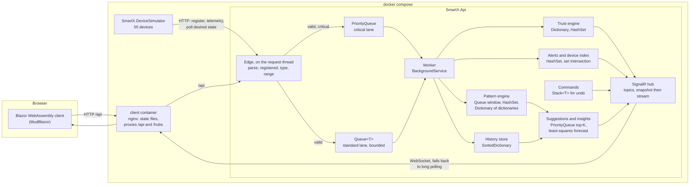

# Smart-X

[](https://github.com/UsmarTayler/smartx-poe/actions/workflows/ci.yml)

An IoT telemetry ingestion and mesh-management system, built as a university Portfolio of Evidence.

## What Smart-X is

Smart-X sits between a field network of sensors and the people who operate it. **Part 1** registers sensors into a hierarchy of
facilities and zones (each registration checked against every level above it), passes their readings through a staged ingestion
pipeline that turns raw JSON into strongly typed packets without boxing, scores every node's trust on recent behaviour, and shows a
dashboard that ranks the mesh worst first, with encrypted attachments per sensor. **Part 2** adds real-time processing and device
management on top, without replacing any of it: a separate device simulator that reports over HTTP like real hardware, two
ingestion queues (a FIFO lane and a priority lane for critical alerts, with backpressure), commands to actuators with an undo
stack, a time-ordered history with timelines, de-duplicated alerts and set-intersection search, everything pushed to the browser
over SignalR, and a predictive engine that learns what operators do after what, suggests the next action, and warns of a node
heading for Fault before it gets there. **Part 3** (Network Topology and Mesh Routing) is not built: its entry in the navigation
is visibly disabled and marked "Part 3".

## Contents

- [What Smart-X is](#what-smart-x-is)
- [Architecture](#architecture)
- [Quick start](#quick-start) (Docker, no `.env` needed)
- [Running without Docker](#running-without-docker)
- [Testing the Part 2 data structures](#testing-the-part-2-data-structures)
  - [`Queue<T>`](#queuet-the-standard-lane), [`PriorityQueue`](#priorityqueue-the-critical-lane) (how to simulate a high-priority alert), [`Stack<T>`](#stackt-undo), [`Dictionary`](#dictionary-lookups-and-learned-counts), [`SortedDictionary`](#sorteddictionary-the-history-store), [`HashSet`](#hashset-duplicates-and-already-done), [the predictive engine](#the-predictive-engine)
- [Where each concept lives](#where-each-concept-lives)
- [Measurements](#measurements)
- [Configuration reference](#configuration-reference)
- [Troubleshooting](#troubleshooting)
- [Design notes](#design-notes): the device simulator, ingestion queues, commands and undo, history and alerts, real-time push, the Command Stream page, pattern analysis, suggestions, the feature walkthrough, the API reference, attachments and the test suite

## Architecture



Everything the browser sees arrives through nginx on one origin. The simulator is not a special case: it talks to the API over the
compose network, as a device would talk to a gateway. Rejected readings never enter a queue; they are answered at the edge and
still count against the node's trust.

### Layout

```text
SmartX.sln
src/
  SmartX.Shared/     contracts: packets, zones, sensors, trust and attachment models
  SmartX.Api/        ASP.NET Core Minimal API: ingestion, validation, trust, storage
  SmartX.Client/     Blazor WebAssembly app (MudBlazor), served as static files
  SmartX.DeviceSimulator/  a fleet of simulated ESP32 devices that report to the API over HTTP
tests/
  SmartX.Tests/      xUnit: unit tests and in-memory API tests
docs/
  UPDATES.md         ledger of changes made in response to review
docker-compose.yml   the API, the client and the simulator together
```

| Project | What it does |
| --- | --- |
| `SmartX.Shared` | Holds every type that crosses the wire: `TelemetryPacket<T>` and its operators, the zone hierarchy and its recursive validator, sensor registrations and their validation rules, trust bands, and attachment metadata. It has no dependencies. |
| `SmartX.Api` | Owns all server-side behaviour. It registers sensors and validates them against their zone ancestry, runs readings through the staging buffer into per-node ring buffers, scores each node's trust, watches for missed heartbeats, and streams encrypted attachments to and from disk. Part 2 adds the ingestion queues, commands and undo, the history store, alerts and device search, the SignalR hub, and the pattern, suggestion and insight engines. |
| `SmartX.Client` | Runs in the browser. It has the trust panel, sensors, telemetry, a sensor profile and the Command Stream page, and it talks to the API only over HTTP through one typed client, `SmartXApiClient`. |
| `SmartX.DeviceSimulator` | A console app that behaves like a fleet of ESP32s. It registers its devices with `POST /api/sensors`, posts telemetry at each device's interval, backfills history on first start, waits for the API with backoff if it isn't up yet, and polls the API for the scenario an operator wants each device to run. It references `SmartX.Shared` only. |
| `SmartX.Tests` | Unit tests for the shared types, and API tests that boot the real API in memory with `WebApplicationFactory`. |

**Why the client and the simulator don't reference the API.** Each of them references `SmartX.Shared`, but
none of them references the API, and the API references none of them. The client can only use the contracts and a base URL, never the API's stores,
engine or internal types, so the split is enforced by the compiler and not just by folder layout. The
client can also be deployed on its own. In Docker it is plain static files behind nginx with no .NET
runtime. The simulator follows the same rule for a plainer reason: it stands in for hardware, and hardware
cannot call into the gateway's code, only send it HTTP requests. The one exception is the test project,
which references all of them so it can check their behaviour against the real API.

## Quick start

**No `.env` file is needed.** Every setting has a default, including the attachment encryption key (the published development key,
which protects nothing and which the API warns about when it is used outside Development). You need Docker with Compose v2
(Docker Desktop, or Engine 24+), and nothing else: not the .NET SDK, not Node.

```bash
git clone https://github.com/UsmarTayler/smartx-poe.git
```

```bash
cd smartx-poe
```

```bash
docker compose up -d --build
```

The first build downloads the .NET SDK and nginx images and takes a few minutes; later builds reuse cached layers. Three
containers start: the API first, then the simulator once the API reports healthy, then the client. Open <http://localhost:8080>.
The dashboard fills within about half a minute, and **Suggested Actions** is not empty from the first moment, because the engine
starts with a labelled, seeded operator history (see [Suggestions](#suggestions-anticipation-and-insights)).

Check it is up:

```bash
docker compose ps
```

```bash
curl http://localhost:5266/api/health
```

That prints `{"status":"ok"}`. The fleet is 55 devices, including the hydroponics bay (the last seven), and the engine already
has something to suggest:

```bash
curl http://localhost:5266/api/suggestions
```

The first suggestion is **Turn on Pump A**, with evidence such as "Operators did this 7 of the last 8 times (7 from seeded
history)". The second number grows by one each time the sensor dips again, and the seeded 7 stays. The pages are `/` (trust panel), `/sensors`, `/telemetry` and `/command-stream`; refreshing any of them works.

**Try a high-priority alert** (the full walkthrough is under [`PriorityQueue`](#priorityqueue-the-critical-lane)). A power
reading above the critical threshold takes the priority lane; an ordinary one takes the standard lane:

```bash
curl -X POST http://localhost:5266/api/telemetry -H "Content-Type: application/json" -d '{"macAddress":"B8:27:EB:10:00:0F","value":200}'
```

The response is `202` with `"lane":"critical"`. The same device with `"value":120` answers `"lane":"standard"`.

To stop (uploaded attachments are kept in the `smartx_attachments` volume and survive `down`, restarts and rebuilds):

```bash
docker compose down
```

Add `--volumes` to delete the attachments as well.

### Changing a setting

Copy `.env.example` to `.env` (it is gitignored) and change what you need, for example the number of devices, whether every
device starts healthy, the pattern window, or the host ports. The variables are listed under [Docker Compose
settings](#docker-compose-settings). `.env` is optional, and a wrong value in it is the only way it can break the defaults.

macOS, Linux or Git Bash:

```bash
cp .env.example .env
```

PowerShell:

```powershell
Copy-Item .env.example .env
```

### How the containers fit together

| Service | Image | Listens on | Host port | Runs as |
| --- | --- | --- | --- | --- |
| `client` | nginx serving the published WebAssembly files | 8080 | `8080` | `nginx` (non-root) |
| `api` | ASP.NET Core runtime, Release build | 8080 | `5266` | `app` (non-root) |
| `simulator` | .NET runtime, Release build | none | none | `app` (non-root) |

The simulator talks to `http://api:8080` over the compose network, exactly as a device would talk to a gateway. It publishes no
port, because it only makes requests.

Compose starts the simulator only once the API's health check passes (`condition: service_healthy`). That narrows the start-up race
but doesn't remove it, so the simulator also waits and retries with backoff on its own. The API's health check is a request to
`/api/health` made from inside the container with bash, because the runtime image has no `curl`. The client and the simulator
define no health check of their own: nginx is up when it is serving, and the simulator retries rather than reporting.

The browser only talks to the client container. nginx serves the app, falls back to `index.html` for any path that is not a file
(so a refresh on `/command-stream` works), and forwards `/api/` and `/hubs/` to the `api` service, so the client's
`ApiBaseAddress` is just `/`. Because the browser sees one origin, no CORS is involved. nginx streams uploads straight through
without buffering them or applying its own size limit, and the API enforces the real limit. The API's host port is published so
`curl` and the scenario endpoint can reach it directly.

Both images are multi-stage. The SDK stage restores and publishes in Release, and only the output is copied into the runtime
image, so neither image contains source or a compiler.

## Running without Docker

This runs the three programs directly with the .NET SDK, which is what to use to debug or to change the code. It needs no Docker.

### Prerequisites

| Tool | Version | Needed for | Check it with |
| --- | --- | --- | --- |
| .NET SDK | 10.0.x | Building, testing and running locally | `dotnet --version` |
| Git | any recent | Cloning | `git --version` |
| Docker Desktop, or Docker Engine with Compose v2 | Engine 24+ | The Docker path only | `docker --version` and `docker compose version` |

Download the SDK from <https://dotnet.microsoft.com/download/dotnet/10.0>. `dotnet --version` should
print `10.0.` followed by a patch number, for example `10.0.400`. To see every installed SDK:

```bash
dotnet --list-sdks
```

You don't need Docker to run Smart-X locally, and you don't need the .NET SDK to run it with Docker.

Every command runs from the repository root.

### 1. Get the code (skip it if you have already cloned)

```bash
git clone https://github.com/UsmarTayler/smartx-poe.git
```

```bash
cd smartx-poe
```

### 2. Restore, build and test

```bash
dotnet restore
```

```bash
dotnet build
```

```bash
dotnet test
```

The build should finish with `0 Warning(s)` and `0 Error(s)`, and every test should pass. The suite
takes a few seconds.

**Benchmarks are left out of that run.** A few tests measure speed and assert a threshold on a wall clock
(a critical reading overtaking a backlog, a range query on the history store, a search over 20,000 devices).
A threshold can be missed on a cold or busy machine for no fault of the code, so those tests carry
`[Trait("Category", "Benchmark")]` and `tests/SmartX.Tests/default.runsettings` excludes them from a bare
`dotnet test`. The behaviour they measure is still proved in the default run by *order*, which does not depend on
how fast the machine is (`CriticalLaneOrderTests`). To run the benchmarks on purpose and see their numbers:

```bash
dotnet test --settings tests/SmartX.Tests/benchmark.runsettings --filter "Category=Benchmark" --logger "console;verbosity=detailed"
```

Some other tests wait for a real timer or a background service, and those poll for the result against a
generous deadline instead of asserting how long it took.

### 3. Set the development encryption key (once per machine)

```bash
dotnet user-secrets set "Attachments:EncryptionKey" "jk8ISNL3b2INdPgIONnlaaf0nycILpHni4khrvGdBlg=" --project src/SmartX.Api
```

This stores the key in your user profile, outside the repository. See [the encryption
key](#the-encryption-key) for what this key is, and why it's safe to publish here.

### 4. Run the API (terminal 1)

```bash
dotnet run --project src/SmartX.Api
```

It is ready when it prints `Now listening on: http://localhost:5266`. Check it:

```bash
curl http://localhost:5266/api/health
```

That should return `{"status":"ok"}`.

The API starts empty, with the brief's four-zone hierarchy. To fill it with the larger demo deployment
and 55 simulated devices, start it with the demo zones, then run the [device simulator](#the-device-simulator)
in a third terminal (step 6):

```bash
dotnet run --project src/SmartX.Api -- --Zones:Hierarchy=Demo
```

### 5. Run the client (terminal 2)

```bash
dotnet run --project src/SmartX.Client
```

Open <http://localhost:5131>. The status in the app bar shows whether the client reached the API.

### 6. Run the device simulator (terminal 3, optional)

The API must be running with `--Zones:Hierarchy=Demo`, as in step 4.

```bash
dotnet run --project src/SmartX.DeviceSimulator
```

It registers 55 devices, posts about ten minutes of history so the dashboard is not empty, and keeps them
reporting. Start it before the API if you like: it waits and retries until the API answers.

### Ports

| Application | HTTP | HTTPS profile |
| --- | --- | --- |
| `SmartX.Api` | <http://localhost:5266> | <https://localhost:7059> |
| `SmartX.Client` | <http://localhost:5131> | <https://localhost:7258> |

The HTTP profile is the default. For HTTPS, add `--launch-profile https` to either command and trust the
development certificate once with `dotnet dev-certs https --trust`.

## Testing the Part 2 data structures

Each subsection is a short recipe: the steps, then what you should see. They assume the Docker stack from the [quick start](#quick-start)
is running, and use the API on port 5266 and the page on 8080. Each also names the automated tests that hold the behaviour in place
(`dotnet test --filter "FullyQualifiedName~Name"` runs one). The design behind each is in the [design notes](#design-notes).

### `Queue<T>`: the standard lane

The standard lane is a bounded FIFO, `Queue<QueuedReading>` behind a lock, drained by one background worker.

1. Send an ordinary reading:

   ```bash
   curl -X POST http://localhost:5266/api/telemetry -H "Content-Type: application/json" -d '{"macAddress":"B8:27:EB:10:00:0F","value":120}'
   ```

2. Read the pipeline's own figures:

   ```bash
   curl http://localhost:5266/api/pipeline/stats
   ```

**Expect:** `202 Accepted` with `"lane":"standard"` and a `queuePosition`. In the stats, the `standard` lane's `processed` count keeps
climbing and its `depth` is normally 0, because the worker keeps up. Readings leave in the order they arrived.

To see the **bound** (backpressure), give the worker a per-reading cost, speed the fleet up and shrink the queue:

```bash
SMARTX_QUEUE_DEPTH=50 SMARTX_PROCESS_DELAY=00:00:00.01 SMARTX_RATE=50 SMARTX_TICK=00:00:00.05 docker compose up -d
```

**Expect:** the standard queue's depth climbs to 50 (the "Standard queue" panel on `/command-stream`, or `depth` in the stats), and
further readings are answered `503 Service Unavailable` with a `Retry-After` header and counted in `rejectedWhenFull`; nothing is
silently dropped and memory does not grow. Run `docker compose up -d` without the variables to go back. Tests: `IngestionQueueTests`,
`SimulatedGatewayCostTests`.

The pattern engine reuses the same structure for its sliding window (a `Queue<TriggerInstance>` expired from the front); see
[the predictive engine](#the-predictive-engine) below.

### `PriorityQueue`: the critical lane

Critical readings are decided at the edge and go into a `PriorityQueue<QueuedReading, (int Severity, long Sequence)>`. The worker drains
it first. The composite priority makes it stable (equal severities leave in arrival order), and a starvation valve lets one standard
reading through after every 20 critical ones.

**How to simulate a high-priority alert.**

*With curl.* A reading above the critical threshold for its category and unit takes the priority lane (power above 180 kW here; the
other thresholds are in [Ingestion queues](#ingestion-queues)). The device's registered range is 0 to 450 kW, so the reading is valid:

```bash
curl -X POST http://localhost:5266/api/telemetry -H "Content-Type: application/json" -d '{"macAddress":"B8:27:EB:10:00:0F","value":200}'
```

```bash
curl http://localhost:5266/api/pipeline/stats
```

**Expect:** `202` with `"lane":"critical"`, and in the stats the `critical` lane's `processed` count goes up and its average wait is a
fraction of a millisecond. The same device with `"value":120` answers `"lane":"standard"`.

*From the page.* Open `/command-stream`. In the "Critical lane" strip choose a device under **Simulate on** and press **Simulate critical
event**. The simulator reads the new scenario from the device's shadow within five seconds and the device reports a critical reading.
**Expect:** the reading is pinned at the top of the live stream, marked Critical and announced assertively, and the strip's sentence names
it and how much sooner it was processed. **Back to normal** undoes it.

*To see it jump a backlog* (with the defaults both lanes are empty, which shows nothing), build one on purpose:

```bash
SMARTX_PROCESS_DELAY=00:00:00.004 SMARTX_RATE=50 SMARTX_TICK=00:00:00.050 docker compose up -d
```

Press **Simulate critical event** again. **Expect:** the standard lane's average wait in the tens of seconds and the critical lane's in
tens of milliseconds, and the strip reporting the ratio ("408.7× sooner" when measured). Run `docker compose up -d` without the
variables to return to the defaults. Tests: `CriticalLaneOrderTests` (order, which does not depend on the machine's speed),
`IngestionQueueTests` (stability and the valve); `CriticalBypassMeasurementTests` is the measurement.

The same structure ranks suggestions, capped at K; see [the predictive engine](#the-predictive-engine).

### `Stack<T>`: undo

Every command that changes an actuator pushes what it replaced onto a bounded `Stack<UndoEntry>`; **Undo** pops the most recent entry and
sends the device its previous state (not the opposite of the command).

1. Close a valve:

   ```bash
   curl -X POST http://localhost:5266/api/commands -H "Content-Type: application/json" -d '{"macAddress":"B8:27:EB:10:00:2B","action":"ValveClose"}'
   ```

2. Look at the stack, then undo:

   ```bash
   curl http://localhost:5266/api/commands/undo-stack
   ```

   ```bash
   curl -X POST http://localhost:5266/api/commands/undo
   ```

**Expect:** the stack lists the close with the valve's previous state on top; the undo is accepted, a restore command is sent to that
valve, and the stack is shorter by one. Undo again with nothing to undo and the API says so. The stack holds at most 20 actions. In the
page, the "Undo stack" panel shows the same, with "n of up to 20 actions" and an **Undo last** button; a zone-wide command ("Apply to
zone", for example Zone 3 and **Close valve**) is one entry that undoes every child. Tests: `CommandServiceTests`,
`CompositeCommandTests`, `UndoPanelComponentTests`.

### `Dictionary`: lookups and learned counts

Three dictionaries do the work you can see. The trust engine keeps `Dictionary<string, NodeState>` keyed by MAC, so each packet is one
lookup. The device index keeps a `Dictionary<TKey, HashSet<string>>` per search facet. The pattern engine keeps a
`Dictionary<TriggerKey, Dictionary<ActionKey, DecayedCount>>`: how often each action followed each trigger.

1. A per-packet lookup by key:

   ```bash
   curl http://localhost:5266/api/trust/B8:27:EB:10:00:0F
   ```

2. The nested dictionary, for Moisture Sensor B (every association the engine holds, including the weak ones):

   ```bash
   curl "http://localhost:5266/api/patterns?mac=B8:27:EB:10:00:32&includeWeak=true"
   ```

3. A search that intersects the index's sets:

   ```bash
   curl "http://localhost:5266/api/devices/search?category=Actuator&actuatorKind=Valve&zone=zone-3"
   ```

**Expect:** (1) the node's score, band and reason. (2) A first association whose trigger is a low-level crossing on Moisture Sensor B and
whose action is `PumpOn` on Pump A, at the `Specific` level, with `qualified: true`, `times` 7 of a `triggerTimes` that starts at 10 and grows as the sensor dips (7 and 8 of them
seeded), a lift of roughly 10, and then a `General` association for "% sensor in Zone 6". The decimals drift as the counts decay. (3) The
valves in Zone 3 (and its sub-zones), found by intersecting sets and not by scanning devices.

To watch it learn from scratch, run `scripts/demo-patterns.sh` (about eight minutes with a short window; the instructions are in
[Pattern analysis](#pattern-analysis-and-investigations)). Tests: `PatternEngineTests`, `TrustEngineTests`, `DeviceIndexTests`.

### `SortedDictionary`: the history store

History is a dictionary of nodes, each owning a `SortedDictionary<HistoryKey, HistoryEntry>` keyed by `(Timestamp, Sequence)`, so a time
range is read in order.

```bash
curl "http://localhost:5266/api/sensors/B8:27:EB:10:00:0C/timeline?maxPoints=20"
```

**Expect:** `"shape":"Buckets"`, at most 20 buckets in time order, each with `start`, `end`, `min`, `max`, `average` and `count`, and a
`readingCount` for the whole range. A spike survives downsampling as a bucket's `max` even when the average hides it. In the page, open
a device on `/command-stream` to see the same data as a chart with the commands, alerts and trust changes in the range as markers, and
**Show as table** for the numbers. A range read walks from the start of the node's keys (a `SortedDictionary` cannot seek); the cost of
that is measured in [Measurements](#measurements). Tests: `SortedDictionaryHistoryStoreTests` (through the shared contract suite),
`TimelineBuilderTests`.

### `HashSet`: duplicates and "already done"

An alert is identified by a `readonly record struct AlertKey(Mac, Kind)`. A condition that fires calls `HashSet<AlertKey>.Add`, and the
answer is the whole decision: `true` is a new alert, `false` is a repeat, which is counted and shown as "suppressed ×N".

1. Look at the alerts, wait a few seconds, look again:

   ```bash
   curl http://localhost:5266/api/alerts
   ```

2. Then the totals:

   ```bash
   curl http://localhost:5266/api/alerts/stats
   ```

**Expect:** the same alerts (one per device and kind) with `suppressedCount` higher the second time, and in the stats `suppressed` far
larger than `raised`. In the page, the Alerts panel shows "suppressed ×N" on each row. The same idea counts a pattern once
(`HashSet<(long Instance, ActionKey)>`: four opens of one pump after one moisture drop are one response) and tracks which actions have
been taken since a trigger, so a suggestion disappears once its action is done. Tests: `AlertTrackerTests`, `PatternEngineTests`.

### The predictive engine

The engine learns what operators do in what situations, ranks the likely next action, and forecasts which nodes are heading for Fault. It
uses a `Queue` (the window), a `HashSet` (count once, "already done"), dictionaries of dictionaries (the counts), a `PriorityQueue` capped
at K (the ranking), and a least-squares fit (the forecast).

1. Open `/command-stream`. **Expect:** **Suggested Actions** lists "Turn on Pump A" and "Open Pump A" (Moisture Sensor B dropped below
   20 %), each with the evidence ("Operators did this 7 of the last 8 times (7 from seeded history). 12× more likely than usual."), where
   it came from ("This device's own pattern", or "Similar devices: …"), and one button. The same top three appear on the trust panel.
2. The same data, as the page receives it:

   ```bash
   curl http://localhost:5266/api/suggestions
   ```

   ```bash
   curl http://localhost:5266/api/insights
   ```

3. Press **Open Pump A** (or open Pump A yourself from the device list). **Expect:** the suggestion disappears without a reload, because
   its action has been taken; and the pattern's count does not go up, because an accepted suggestion counts at weight zero (otherwise the
   engine would train on its own advice).
4. Press **Not useful** on another. **Expect:** the card moves under "Marked not useful", its weight becomes 85 % (never below 50 %), and
   **Take back** restores it exactly.
5. Look at **Automated Insights**. **Expect:** *Anticipated* entries for nodes whose trust is falling and fitted to a line well enough
   (for example "…trust falling, projected to reach Fault in about 2 minutes"), before they are in Fault, followed by *Now* entries for nodes
   already in Fault with an open investigation. Each has "Open" and "Review the investigation".
6. Moisture Sensor B dries out on a cycle (the `DryOut` scenario). **Expect:** when it next crosses below 20 %, the two suggestions
   reappear marked **New**, with "Arrived … ms after the trigger", without a reload.

Tests: `SuggestionServiceTests` (ranking, top-K, suppression, feedback, no self-reinforcement), `TrustForecasterTests` (a falling series
projects the right time; noise, a flattening fall and a reversal do not), `InsightServiceTests`, `SuggestionsTopicTests` (snapshot then
stream), `SuggestedActionsPanelTests`, `InsightsPanelTests` and `InvestigationCardTests` (the cards, the one-click calls and the verdict buttons). The design is in
[Suggestions, anticipation and insights](#suggestions-anticipation-and-insights).

### Running all the tests

```bash
dotnet test
```

The default run excludes the speed benchmarks, which assert thresholds on a wall clock; the behaviour they measure is covered by order in
the default run. See [Measurements](#measurements) for how to run the benchmarks.

## Where each concept lives

Parts 1 and 2, in one table.

| Concept | Where | What to look at |
| --- | --- | --- |
| Generics without boxing | [`TelemetryPacket.cs`](src/SmartX.Shared/Packets/TelemetryPacket.cs) | `TelemetryPacket<T> where T : struct`; the class comment explains how the constraint avoids boxing |
| Generic math | [`NumericPacket.cs`](src/SmartX.Shared/Packets/NumericPacket.cs) | `NumericPacket<T> where T : struct, INumber<T>` |
| Generic conversion at the boundary | [`ValueRange.cs`](src/SmartX.Shared/Sensors/ValueRange.cs) | `Contains<T>(T value)` uses `double.CreateChecked`, not `Convert.ToDouble(object)` |
| Generic results on the client | [`ApiResult.cs`](src/SmartX.Client/Services/ApiResult.cs), [`SmartXApiClient.cs`](src/SmartX.Client/Services/SmartXApiClient.cs) | `ApiResult<T>` as a `readonly record struct`, and `SendReadingAsync<T>` |
| Operator overloading, arithmetic and comparison | [`NumericPacket.cs`](src/SmartX.Shared/Packets/NumericPacket.cs) | `+`, `-`, `>`, `<`, `==`, `!=` |
| Operator overloading, logical | [`StatePacket.cs`](src/SmartX.Shared/Packets/StatePacket.cs) | `\|`, `&`, `==`, `!=` |
| Operator guard | [`TelemetryPacket.cs`](src/SmartX.Shared/Packets/TelemetryPacket.cs) | `EnsureCombinable`, which rejects mismatched units or categories |
| Recursion, walking up | [`ZoneValidator.cs`](src/SmartX.Shared/Zones/ZoneValidator.cs) | `Ascend`, with its base case, cycle guard and depth guard |
| Recursion, walking down | [`ZoneTree.cs`](src/SmartX.Shared/Zones/ZoneTree.cs) | `Descend` (sensors beneath a zone) and `BuildNode` (the nested tree) |
| Jagged arrays | [`TelemetryStagingBuffer.cs`](src/SmartX.Shared/Collections/TelemetryStagingBuffer.cs) | the `T[][] _windows` field, `Stage` and `Drain`; the class comment covers jagged versus rectangular |
| Custom collection | [`TelemetryRingBuffer.cs`](src/SmartX.Shared/Collections/TelemetryRingBuffer.cs) | `TelemetryRingBuffer<T>`: O(1) `Add` that overwrites the oldest, an indexer, and a struct `Enumerator` so `foreach` allocates nothing |
| Lists | [`TelemetryStagingBuffer.cs`](src/SmartX.Shared/Collections/TelemetryStagingBuffer.cs), [`TelemetryRingBuffer.cs`](src/SmartX.Shared/Collections/TelemetryRingBuffer.cs) | `Drain` returns a pre-sized `List<T>`, and `ToList` copies a node's history out as a pre-sized list |
| Stack for undo | [`CommandService.cs`](src/SmartX.Api/Commands/CommandService.cs) | `Stack<UndoEntry> _undo` behind a lock: `Push` (with the bounded-depth trim), `Undo`, and the class comment on why undo restores the previous state instead of doing the opposite |
| Command lifecycle | [`CommandService.cs`](src/SmartX.Api/Commands/CommandService.cs), [`CommandStore.cs`](src/SmartX.Api/Commands/CommandStore.cs) | states and transitions; `Collect` hands each command over once; `TryTransition` is the compare-and-swap |
| Recursion, reused | [`CommandService.cs`](src/SmartX.Api/Commands/CommandService.cs), [`ZoneTree.cs`](src/SmartX.Shared/Zones/ZoneTree.cs) | `IssueForZone` calls the same `NodesBeneath` walk as Part 1 to find every actuator under a zone, and the device search asks `ZoneIdsBeneath`, which shares the same private `Descend` |
| Sorted dictionary | [`SortedDictionaryHistoryStore.cs`](src/SmartX.Api/History/SortedDictionaryHistoryStore.cs), [`HistoryKey.cs`](src/SmartX.Api/History/HistoryKey.cs) | a dictionary of nodes, each owning a `SortedDictionary<HistoryKey, HistoryEntry>`; the key is `(Timestamp, Sequence)` so equal timestamps cannot collide, and the class comment states the cost of a range query honestly |
| Contract tests | [`HistoryStoreContract.cs`](tests/SmartX.Tests/HistoryStoreContract.cs) | an abstract suite over `IHistoryStore`, run by a subclass, so a replacement store is proven by adding one more subclass |
| Downsampling | [`TimelineBuilder.cs`](src/SmartX.Api/History/TimelineBuilder.cs) | one pass into at most `maxPoints` buckets with min, max, average and count, so a spike survives |
| HashSet for duplicate prevention | [`AlertTracker.cs`](src/SmartX.Api/Alerts/AlertTracker.cs), [`AlertKey.cs`](src/SmartX.Shared/Alerts/AlertKey.cs) | `HashSet<AlertKey>` where `Add` returning `false` is the suppress decision; the key is a `readonly record struct` so value equality works |
| Secondary indexes and set intersection | [`DeviceIndex.cs`](src/SmartX.Api/Search/DeviceIndex.cs) | `Dictionary<TKey, HashSet<string>>` per category, kind, band, alert and zone; `Search` intersects the smallest set first, and `FindInconsistencies` is what the consistency test runs |
| Idempotent delivery | [`SimulatedDevice.cs`](src/SmartX.DeviceSimulator/SimulatedDevice.cs) | `ApplyCommand` remembers applied command ids |
| FIFO queue | [`TelemetryIngestionQueue.cs`](src/SmartX.Api/Ingestion/TelemetryIngestionQueue.cs) | `Queue<QueuedReading> _standard`, with the lock, the `SemaphoreSlim` signal and the bound; the class comment explains the trade-off against `Channel<T>` |
| Priority queue | [`TelemetryIngestionQueue.cs`](src/SmartX.Api/Ingestion/TelemetryIngestionQueue.cs) | `PriorityQueue<QueuedReading, (int Severity, long Sequence)>`: the composite priority that makes it stable, and `DequeueAsync`'s starvation valve |
| Classifying at the edge | [`CriticalClassifier.cs`](src/SmartX.Api/Ingestion/CriticalClassifier.cs), [`TelemetryEndpoints.cs`](src/SmartX.Api/Endpoints/TelemetryEndpoints.cs) | `IsCritical` against configured rules; `Enqueue` and `QueueFull` (503 with `Retry-After`) |
| Asynchronous processing | [`TelemetryProcessor.cs`](src/SmartX.Api/Ingestion/TelemetryProcessor.cs) | the `BackgroundService` that drains the queues, and why there is one worker |
| Device shadow | [`SimulationEndpoints.cs`](src/SmartX.Api/Endpoints/SimulationEndpoints.cs), [`DeviceShadowStore.cs`](src/SmartX.Api/Storage/DeviceShadowStore.cs) | desired state with a version; `GET /api/devices/{mac}/desired` |
| Device simulator | [`DeviceFleet.cs`](src/SmartX.DeviceSimulator/DeviceFleet.cs), [`GatewayClient.cs`](src/SmartX.DeviceSimulator/GatewayClient.cs) | registration, backfill, backoff, and applying desired state, all over HTTP |
| SignalR hub and groups | [`TelemetryHub.cs`](src/SmartX.Api/Realtime/TelemetryHub.cs), [`ITelemetryClient.cs`](src/SmartX.Api/Realtime/ITelemetryClient.cs) | topics as groups, a typed client interface, and the transport readable through `GetTransport` |
| Batching, coalescing and immediate sends | [`RealtimeBroadcaster.cs`](src/SmartX.Api/Realtime/RealtimeBroadcaster.cs) | the class comment explains which messages are which and why; one loop sends, so messages leave in numbered order |
| Snapshot plus stream | [`RealtimeFeed.cs`](src/SmartX.Client/Realtime/RealtimeFeed.cs) | join, snapshot, then apply only pushes newer than the snapshot; reference-counted start and stop |
| One connection, reconnect and fallback | [`RealtimeConnection.cs`](src/SmartX.Client/Realtime/RealtimeConnection.cs) | the state machine: Live, Reconnecting, Polling, and the upgrade back |
| Bounded buffers on the client | [`LiveStream.cs`](src/SmartX.Client/CommandStream/LiveStream.cs) | two `TelemetryRingBuffer<StreamRow>`: one for the stream and one for readings held while paused; resume moves the held ones in arrival order, and the class comment explains why a critical reading pins even while paused |
| Debounce with out-of-order answers | [`DeviceSearchService.cs`](src/SmartX.Client/CommandStream/DeviceSearchService.cs) | `Request` cancels the wait of the one before it; `SearchAsync` numbers each request and only the newest may set the result |
| Chart as data, then markup | [`TimelineChartModel.cs`](src/SmartX.Client/CommandStream/TimelineChartModel.cs), [`TimelineChart.razor`](src/SmartX.Client/Components/CommandStream/TimelineChart.razor) | the model works out the band, line, ticks and markers as numbers and strings, away from the component that draws them; gaps stay gaps |
| Rules shared by server and client | [`CommandRules.cs`](src/SmartX.Shared/Commands/CommandRules.cs) | `WhyNotUndoable` and `StatusOf`: the server refuses with these words and the client explains with the same ones |
| Redraw only on change | [`LiveStreamPanel.razor`](src/SmartX.Client/Components/CommandStream/LiveStreamPanel.razor) | `ShouldRender` returns a dirty flag that only the stream, the search and the catalogue set |
| Component tests | [`CommandStreamComponentTests.cs`](tests/SmartX.Tests/CommandStreamComponentTests.cs), [`StreamComponentKit.cs`](tests/SmartX.Tests/StreamComponentKit.cs) | bUnit against the real feeds on a fake hub, a fake API and a fake clock |
| Queue for a sliding window | [`PatternEngine.cs`](src/SmartX.Api/Patterns/PatternEngine.cs) | `Queue<TriggerInstance> _window`: triggers in time order, expired from the front, so an action is paired with the triggers in the window and nothing is searched; the same FIFO structure as the ingestion lane, doing a different job |
| HashSet to count once | [`PatternEngine.cs`](src/SmartX.Api/Patterns/PatternEngine.cs) | `HashSet<(long Instance, ActionKey Action)> _paired`: `Add` returning false is why four opens of one pump after one moisture drop are one response |
| Dictionaries of dictionaries | [`PatternEngine.cs`](src/SmartX.Api/Patterns/PatternEngine.cs) | `Dictionary<TriggerKey, Dictionary<ActionKey, DecayedCount>>`: how often each action followed each trigger, with support, confidence and lift worked out from it |
| Value-type keys, no boxing | [`PatternKeys.cs`](src/SmartX.Api/Patterns/PatternKeys.cs) | `TriggerKey` and `ActionKey` as `readonly record struct`s, so a lookup on every event allocates nothing |
| Lazy decay in a struct | [`PatternEngine.cs`](src/SmartX.Api/Patterns/PatternEngine.cs) | `DecayedCount`: a count that remembers when it last changed and is faded only when read, changed in place through `CollectionsMarshal` |
| Hysteresis | [`ReadingTriggerDetector.cs`](src/SmartX.Api/Patterns/ReadingTriggerDetector.cs) | a watch level fires once and is re-armed only past a margin, so a hovering reading is one trigger |
| Recursion over the zone tree, reused | [`DeviceDirectory.cs`](src/SmartX.Api/Patterns/DeviceDirectory.cs) | walks up `ParentId` to the depth the general level groups at, so "the same zone" is the Part 1 hierarchy |
| The escalation seam, used | [`InvestigationService.cs`](src/SmartX.Api/Patterns/InvestigationService.cs) | subscribes to `FaultEntered` and `FaultCleared`; a verdict adjusts a node's sensitivity through `ITrustEngine.AdjustSensitivity`, bounded by a floor |
| Priority queue, for ranking | [`SuggestionService.cs`](src/SmartX.Api/Patterns/SuggestionService.cs) | `PriorityQueue<Candidate, (double Score, string Id)>` capped at K: the same structure as the critical lane, used to keep the best K and not to hand out the most urgent |
| HashSet of what is done | [`SuggestionService.cs`](src/SmartX.Api/Patterns/SuggestionService.cs) | `LiveTrigger.Taken`, a `HashSet<ActionKey>` of the actions taken since a trigger fired, so "already done" is one lookup |
| Backdated events, decay from event time | [`PatternEngine.cs`](src/SmartX.Api/Patterns/PatternEngine.cs) | `DecayedCount.Add` fades the amount forward when it is older than the count; `Replay` pairs a history with itself in a window of its own |
| Seeded, labelled history | [`SeededHistory.cs`](src/SmartX.Api/Patterns/SeededHistory.cs) | a pure function of the clock and the options; every event is `EventSource.Seeded` |
| Least squares and R² | [`TrustForecaster.cs`](src/SmartX.Api/Patterns/TrustForecaster.cs) | the line, the fit, the bars a forecast has to clear, and the check that a fall is not flattening |
| The sorted history store doing analysis | [`InsightService.cs`](src/SmartX.Api/Patterns/InsightService.cs) | `GetRange` for each node's trust samples, which `TrustSampler` stores as `HistoryKind.TrustSample` |
| Not training on its own advice | [`SuggestionService.cs`](src/SmartX.Api/Patterns/SuggestionService.cs), [`PatternEngine.cs`](src/SmartX.Api/Patterns/PatternEngine.cs) | `Accept` and `TakeAcceptance` mark an action `FromSuggestion`; the engine weights it by `AcceptedSuggestionWeight`, zero |
| Dictionary and HashSet | [`TrustEngine.cs`](src/SmartX.Api/Trust/TrustEngine.cs) | `_nodes`, keyed by MAC for O(1) lookup per packet, and `_degraded`, where each failing node appears once |
| The ingestion pipeline, stage by stage | [`TelemetryEndpoints.cs`](src/SmartX.Api/Endpoints/TelemetryEndpoints.cs) | `IngestBatchAsync`, with each stage numbered in comments, and `TryCreatePacket` |
| Polymorphic JSON | [`ITelemetryPacket.cs`](src/SmartX.Shared/Packets/ITelemetryPacket.cs) | `[JsonDerivedType]` over the packet types |
| Trust formula | [`TrustFormula.cs`](src/SmartX.Shared/Trust/TrustFormula.cs) | `Score` (Laplace smoothing), `DecayWeight` (half-life), `Classify` |
| Background services | [`HeartbeatMonitor.cs`](src/SmartX.Api/Trust/HeartbeatMonitor.cs), [`TelemetryProcessor.cs`](src/SmartX.Api/Ingestion/TelemetryProcessor.cs), [`DeviceFleet.cs`](src/SmartX.DeviceSimulator/DeviceFleet.cs) | `PeriodicTimer` driven by an injected `TimeProvider`; a worker that survives one bad reading |
| Async all the way down | [`SmartXApiClient.cs`](src/SmartX.Client/Services/SmartXApiClient.cs), [`ISensorRegistry.cs`](src/SmartX.Api/Storage/ISensorRegistry.cs) | no `.Result`, `.Wait()` or `GetAwaiter().GetResult()` anywhere |
| Streamed, encrypted I/O | [`AttachmentUploader.cs`](src/SmartX.Api/Attachments/AttachmentUploader.cs), [`AesGcmEncryptingStream.cs`](src/SmartX.Api/Attachments/AesGcmEncryptingStream.cs) | `MultipartReader`, not `IFormFile`, and chunked AES-256-GCM |

## Measurements

These are numbers already gathered in earlier parts, on the development machine, gathered here so they can be found in one place. Each
row links to the section that explains how it was measured. They move with the machine; the shapes do not.

| What | Result | Where it is measured |
| --- | --- | --- |
| Critical reading versus an ordinary one behind a 5,001-deep backlog | 0.4 ms against 1,691 ms, about 4,500× sooner | `CriticalBypassMeasurementTests` |
| Same, in the Docker stack at 50× with a 4 ms per-reading cost | critical lane average wait 47 ms, standard lane 19,183 ms ("408.7× sooner"), 430 readings refused with 503 | [Seeing a critical reading overtake the standard queue](#seeing-a-critical-reading-overtake-the-standard-queue) |
| Starvation valve: 2,000 critical readings over 200 queued normal ones | 102 normal readings processed by the time 1,028 critical ones were | `CriticalBypassMeasurementTests` |
| History range query, 200,000 entries for one node, the same 100 entries | oldest 100 in about 18 µs, newest 100 in about 10.8 ms (about 600×): the cost of a `SortedDictionary` that cannot seek | `HistoryRangeCostMeasurementTests` |
| Reading, accepted to browser (through nginx over WebSockets) | p50 134 ms, p95 243 ms; includes the 0 to 250 ms batch window | [Real-time push](#real-time-push) |
| Critical reading, accepted to browser | p50 3 ms, p95 7 ms | [Real-time push](#real-time-push) |
| HTTP requests from an idle trust panel | about 37 a minute when polling, 0 with push | [Real-time push](#real-time-push) |
| Command Stream main thread (13 s long-task observer, readings processed a second) | 0 long tasks at 10× (78), 50× (412), 100× (826) and 150× (1,213); 133 at 250× (1,650) | [Responsiveness under load](#responsiveness-under-load) |
| Pattern engine, worst case (window full at 5,000 triggers) | record a trigger 1.4 µs; a first-seen action paired with 5,000 triggers 16.9 ms; predict for a sensor 39 µs | `PatternBenchmarkTests` |
| Suggestion service | trigger with a pattern, ranked and announced 150 to 250 µs; trigger with no pattern about 70 µs; an operator action re-ranked about 22 µs | `SuggestionBenchmarkTests` |
| Trust forecast pass | 55 nodes with an hour of history 1.8 ms; with a day each (1.7 million entries) 45 ms; 4,800 nodes with ten minutes each 50 ms | `SuggestionBenchmarkTests` |
| Trigger fired to suggestion in a client | median 15 ms, p95 16 ms in memory; 11 ms in the Docker stack through nginx | [Suggestions: Measured](#measured-suggestions-and-the-forecast) |
| Suggestion topic at 100× | about one message every three seconds, down from about twelve a second before time-only changes were announced once a second and queued messages coalesced; 0 long tasks at 100× and 150× | [Suggestions: Measured](#measured-suggestions-and-the-forecast) |

### The benchmark command

The benchmarks assert thresholds on a wall clock, so they carry `[Trait("Category", "Benchmark")]` and a bare `dotnet test` leaves them
out (`tests/SmartX.Tests/default.runsettings`). To run them all on purpose and print their numbers:

```bash
dotnet test --settings tests/SmartX.Tests/benchmark.runsettings --filter "Category=Benchmark" --logger "console;verbosity=detailed"
```

To run one family, filter by class name, for example `FullyQualifiedName~SuggestionBenchmarkTests`, `PatternBenchmarkTests`,
`CriticalBypassMeasurementTests` or `HistoryRangeCostMeasurementTests`. The real-time figures were measured against the Docker stack and
are reproduced with the recipes in the sections linked above.

## Configuration reference

The API reads configuration in the standard ASP.NET Core order: `appsettings.json`, then
`appsettings.{Environment}.json`, then user secrets (Development only), then environment variables, then
command-line arguments. Later sources win. An environment variable uses `__` for each `:` in a setting
name, so `Trust:HalfLife` becomes `Trust__HalfLife`. The `Attachments`, `Zones`, `Commands`, `History`, `Alerts`, `Ingestion`, `Telemetry` and
`Trust` sections are validated at startup, and a bad value stops the API with a message naming the
setting.

### API: `Attachments`

| Setting | Default | What it does |
| --- | --- | --- |
| `Attachments:StoragePath` | `App_Data/attachments` (`/data/attachments` in Docker) | Where encrypted files and their index entries are written. A relative path is resolved against the API's content root. |
| `Attachments:MaxFileBytes` | `104857600` (100 MiB) | The largest file accepted. It is enforced byte by byte while the upload streams, and published to the client at `/api/attachments/limits`. |
| `Attachments:EncryptionKey` | *(none)* | Base64-encoded 256-bit AES key. See [the encryption key](#the-encryption-key). |

### API: `Zones`

| Setting | Default | What it does |
| --- | --- | --- |
| `Zones:Hierarchy` | `Brief` | Which deployment hierarchy the API manages. `Brief` is the four zones from the brief, and what the tests expect. `Demo` is the 16-zone, two-facility hierarchy the simulated fleet is deployed into. |

### API: `Commands`

| Setting | Default | What it does |
| --- | --- | --- |
| `Commands:PendingTimeout` | `00:00:30` | How long a command may wait for its device to collect it before it becomes `TimedOut`. |
| `Commands:DeliveredTimeout` | `00:00:30` | How long a delivered command may wait for the device's acknowledgement. |
| `Commands:SweepInterval` | `00:00:01` | How often the timeout service looks for stale commands. |
| `Commands:MaxUndoDepth` | `20` | How many operator actions the undo stack remembers. Older ones fall off the bottom. |

### API: `History`

| Setting | Default | What it does |
| --- | --- | --- |
| `History:RetentionWindow` | `24:00:00` | How long any history entry is kept: readings, commands, alerts, trust transitions and searches. |
| `History:EvictionInterval` | `00:01:00` | How often retention runs. It runs on a timer and not on every append. |
| `History:DefaultTimelineWindow` | `01:00:00` | How far back a timeline, the event stream or the activity record looks when `from` is omitted. |
| `History:DefaultMaxPoints` | `200` | Buckets in a timeline when `maxPoints` is omitted. |
| `History:MaxPointsLimit` | `2000` | The most buckets a caller may ask for. More is a `400`. |
| `History:DefaultEventLimit` | `500` | Events in the stream when `limit` is omitted. |
| `History:MaxEventLimit` | `5000` | The most events a caller may ask for. |

### API: `Alerts`

| Setting | Default | What it does |
| --- | --- | --- |
| `Alerts:DisconnectedAfterIntervals` | `3` | How many of a node's own heartbeat intervals it may stay silent before it is called disconnected. |
| `Alerts:ClearAfterValidReadings` | `3` | How many valid readings in a row end an out-of-range or wrong-type alert. |

### API: `Patterns`

| Setting | Default | What it does |
| --- | --- | --- |
| `Patterns:Window` | `00:10:00` | How soon after a trigger an action counts as following it. Also the bound on what an action costs. |
| `Patterns:MinimumSupport` | `3` | How many times, weighted and faded, an action must have followed a trigger before it counts as a pattern. |
| `Patterns:SupportTolerance` | `0.98` | The share of the minimum that a faded count must reach, so three pairings do not fail the test a minute after they are made. |
| `Patterns:MinimumLift` | `1.5` | How many times more often than chance it must follow. At 1 the trigger tells you nothing. |
| `Patterns:HalfLife` | `7.00:00:00` | How long until a pairing counts half as much. |
| `Patterns:SearchWeight` | `0.4` | What a search that narrowed to a few devices counts for, against 1 for opening a device or sending a command. |
| `Patterns:MaxSearchResultsForAction` | `3` | The most devices a search can return and still be read as being about them. |
| `Patterns:MaxTriggersInWindow` | `5000` | The most triggers held in the window. The oldest are dropped past it. |
| `Patterns:MaxLearnedPairs` | `250000` | The most (trigger, action) pairs remembered. Past it, the most faded are forgotten first. |
| `Patterns:WatchLowFraction` / `WatchHighFraction` | `0.20` / `0.80` | Where a sensor's low and high watch levels sit, as a fraction of its registered range. |
| `Patterns:RearmMargin` | `0.05` | How far back past a level a reading must come before it can fire again (hysteresis). |
| `Patterns:GeneralZoneDepth` | `1` | The depth in the zone tree that devices are grouped under at the general level. |

| `Patterns:AcceptedSuggestionWeight` | `0` | What an action counts for when the operator did it by accepting a suggestion, against 1 for one of their own. Zero stops the engine training on its own advice. |

### API: `Investigations`

| Setting | Default | What it does |
| --- | --- | --- |
| `Investigations:MaxRetained` | `200` | How many are kept. The oldest closed ones go first; an open one is never dropped to make room. |
| `Investigations:MaxReadings` | `60` | The most readings kept in one, the latest in its window. |
| `Investigations:DismissFactor` | `0.85` | What a node's weight for a failure is multiplied by each time a fault caused by it is dismissed. |
| `Investigations:SensitivityFloor` | `0.5` | The lowest the scale can reach. Detection can be dulled and never switched off. |

### API: `Suggestions`

| Setting | Default | What it does |
| --- | --- | --- |
| `Suggestions:MaxSuggestions` | `5` | How many are kept: the top K of the ranking. |
| `Suggestions:LiftWeight` / `ConfidenceWeight` / `SeverityWeight` / `RecencyWeight` | `0.35` / `0.25` / `0.25` / `0.15` | The weights of the ranking formula. Normalised, so only their balance matters. |
| `Suggestions:LiftCap` | `10` | The lift at which the lift term is full. |
| `Suggestions:Severity:ThresholdCrossing` / `AlertRaised` / `Degrading` / `CriticalReading` / `Fault` | `0.4` / `0.6` / `0.6` / `0.9` / `1.0` | How severe each kind of trigger is, from 0 to 1. |
| `Suggestions:MaxLiveTriggers` | `500` | The most live triggers held. Bounds the cost of a recomputation. |
| `Suggestions:MaxDevicesPerGeneralSuggestion` | `3` | How many devices a "similar devices" pattern is turned into. |
| `Suggestions:SweepInterval` | `00:00:05` | How often live triggers are checked for having aged out. |
| `Suggestions:NotUsefulFactor` | `0.85` | What a pattern's weight is multiplied by each time "Not useful" is pressed. |
| `Suggestions:NotUsefulFloor` | `0.5` | The lowest the weight can go. |
| `Suggestions:MaxDismissedRetained` | `20` | How many dismissed suggestions are kept so the mark can be taken back. |
| `Suggestions:AcceptanceExpiry` | `00:00:30` | How long an accepted suggestion waits for the action it announced. |

### API: `Forecast`

| Setting | Default | What it does |
| --- | --- | --- |
| `Forecast:Enabled` | `true` | Whether trust is sampled and forecast at all. |
| `Forecast:Horizon` | `00:15:00` | How far ahead a projected fault is worth announcing. |
| `Forecast:Lookback` | `00:04:00` | How much recent history the line is fitted to. |
| `Forecast:MinSamples` | `8` | The fewest samples a line is fitted to. |
| `Forecast:MinRSquared` | `0.8` | How much of the samples' movement the line must explain before it is believed. |
| `Forecast:MinFallPerMinute` | `0.005` | How steep the fall must be, in trust per minute. |
| `Forecast:MinRecentFallRatio` | `0.5` | How much of the whole window's rate the last third must still show, for the fall to count as continuing. |
| `Forecast:SampleInterval` | `00:00:10` | How often a node's trust score is stored. |
| `Forecast:Interval` | `00:00:05` | How often the forecast runs over every node. |
| `Forecast:EtaChange` | `00:00:45` | How far a projected time can move before it is announced again. |
| `Forecast:CurrentHold` | `00:00:30` | How long a problem that is only an alert stays listed after it clears. |

### API: `SeededHistory`

| Setting | Default | What it does |
| --- | --- | --- |
| `SeededHistory:Enabled` | `false` (`true` in Docker) | Whether to replay the synthetic operator history at start-up. |
| `SeededHistory:Days` | `5` | How far back it reaches. |
| `SeededHistory:RandomSeed` | `7312` | The seed, so the same configuration is always the same history. |
| `SeededHistory:BriefTriggers` / `BriefResponses` | `8` / `7` | How often Moisture Sensor B dropped, and how often Pump A was opened and turned on after it. |
| `SeededHistory:OtherHabitTriggers` | `6` | How often each of the other two habits happened. |
| `SeededHistory:PumpARounds` / `PumpAScheduledRuns` | `48` / `40` | Pump A opened on rounds and turned on on a schedule, so lift is a ratio and not infinity. |
| `SeededHistory:RandomOpens` / `UnansweredTriggers` | `80` / `30` | Background noise. |
| `SeededHistory:ConstantOpenEvery` | `00:04:00` | How often the one device that is always open is opened, for a day and a half. |
| `SeededHistory:WaitForDevices` | `00:03:00` | How long to wait for the devices the habits are about to register before replaying what can be. |

### API: `Realtime`

| Setting | Default | What it does |
| --- | --- | --- |
| `Realtime:FlushInterval` | `00:00:00.250` | How often batched and coalesced topics (readings, trust, alert repeat counts) are flushed. |
| `Realtime:PipelineInterval` | `00:00:01` | How often pipeline statistics are pushed to clients that asked. |
| `Realtime:MaxBufferedReadings` | `10000` | The most readings held for the next flush. More are dropped, and the batch reports how many. |
| `Realtime:TrustScoreEpsilon` | `0.005` | How far a score must move to be worth a message, when nothing else about the node changed. |
| `Realtime:RecentPriorityAlerts` | `20` | Critical readings carried by an alerts snapshot. |
| `Realtime:SnapshotCommands` | `100` | Commands carried by a commands snapshot. |
| `Realtime:MaxQueuedMessages` | `20000` | Immediate messages queued at once. Beyond it the newest are dropped and logged. |

### Client: `Realtime`

In `src/SmartX.Client/wwwroot/appsettings.json`. Every value is optional.

| Setting | Default | What it does |
| --- | --- | --- |
| `Realtime:ReconnectingFallbackAfter` | `00:00:15` | How long a dropped connection may stay reconnecting before the feeds poll. |
| `Realtime:UpgradeRetryInterval` | `00:00:15` | How often a connection that could not be made tries again, while polling. |
| `Realtime:PollInterval` | `00:00:03` | How often a polling feed (other than trust) asks for a snapshot. |
| `Realtime:SnapshotRetryInterval` | `00:00:03` | How long a feed waits before retrying a snapshot that failed. |

### API: `Ingestion`

| Setting | Default | What it does |
| --- | --- | --- |
| `Ingestion:MaxQueueDepth` | `10000` | The most readings the standard lane holds. When it is full, the API answers `503` with `Retry-After`. |
| `Ingestion:MaxCriticalQueueDepth` | `1000` | The most readings the critical lane holds, bounded separately so a full standard lane never blocks an alert. |
| `Ingestion:RetryAfterSeconds` | `5` | The value of the `Retry-After` header on a `503`. |
| `Ingestion:MaxConsecutiveCritical` | `20` | After this many critical readings in a row, the worker takes one normal reading if one is waiting. The starvation valve. |
| `Ingestion:SimulatedGatewayCost` | `00:00:00` | Simulates the per-reading processing cost of a resource-constrained gateway: how long the worker pauses after each reading. Zero is an unconstrained gateway. A few milliseconds builds a backlog, as a small board would, so the critical lane can be seen overtaking it. |
| `Ingestion:CriticalRules` | see [Ingestion queues](#ingestion-queues) | The thresholds that make a reading critical: category, unit, an upper and/or lower limit, a severity (lower is more urgent) and a reason. Set as a list in `appsettings.json`. |

### Simulator: `Simulator`

Bound by `SmartX.DeviceSimulator`, from `src/SmartX.DeviceSimulator/appsettings.json` or the environment
(`Simulator__ApiBaseUrl` and so on).

| Setting | Default | What it does |
| --- | --- | --- |
| `Simulator:ApiBaseUrl` | `http://localhost:5266` (`http://api:8080` in Docker) | Where the API is. |
| `Simulator:DeviceCount` | `55` | How many of the demo devices to run, from the top of the list. |
| `Simulator:Mix` | `Demo` | `Demo` gives each device its own scenario, for a spread of bands. `Nominal` starts every device healthy. |
| `Simulator:Scenarios:<mac>` | none | Starts one device in a named scenario, on top of the mix. A MAC contains colons, which can't be in an environment variable name, so write it with underscores: `Simulator__Scenarios__B8_27_EB_10_00_01=Critical`. |
| `Simulator:BackfillDuration` | `00:10:00` | How much history is posted on first start. `00:00:00` turns backfill off. |
| `Simulator:BackfillConcurrency` | `8` | How many backfill requests may be in flight at once. |
| `Simulator:ShadowPollInterval` | `00:00:05` | How often each device asks the API what it should be doing. Also how long a scenario change takes to appear. |
| `Simulator:TickInterval` | `00:00:00.5` | How often the fleet checks which devices are due to report. Must be well under a fifth of the shortest heartbeat, which is five seconds in the demo fleet. |
| `Simulator:RandomSeed` | `1729` | Seeds the generated values, so two runs produce the same readings. |
| `Simulator:CommandFailureRate` | `0` | The chance, from 0 to 1, that an actuator fails to apply a command. Zero by default so demos are predictable; raise it to see `Failed` commands. |
| `Simulator:StartupTimeout` | `00:05:00` | How long to keep retrying while the API isn't answering before giving up. |

### API: `Telemetry`

| Setting | Default | What it does |
| --- | --- | --- |
| `Telemetry:RetentionPerNode` | `256` | Readings kept per sensor in its ring buffer before the oldest is overwritten. |

### API: `Trust`

| Setting | Default | What it does |
| --- | --- | --- |
| `Trust:SuccessWeight` | `1` | Added to successes for each valid, in-range reading. |
| `Trust:RangeViolationWeight` | `1` | Added to failures for a reading outside its range. |
| `Trust:SchemaFailureWeight` | `2` | Added to failures for a wrong-typed reading. |
| `Trust:MissedHeartbeatWeight` | `3` | Added to failures for each heartbeat interval that passes in silence. |
| `Trust:HalfLife` | `00:10:00` | The age at which an outcome counts half as much as a fresh one. |
| `Trust:OutcomeWindow` | `256` | Recent outcomes retained per node for scoring. |
| `Trust:HistoryLength` | `120` | Trust samples retained per node for its full history. |
| `Trust:HistorySampleInterval` | `00:00:10` | Minimum spacing between history samples. A band change is always sampled. |
| `Trust:SnapshotHistoryPoints` | `30` | Recent samples included with each node in `/api/trust`, for its sparkline. |
| `Trust:NominalThreshold` | `0.75` | The lowest score that counts as Nominal. |
| `Trust:FaultThreshold` | `0.5` | Scores below this are Fault. |
| `Trust:DefaultHeartbeatInterval` | `00:01:00` | The heartbeat assumed for a sensor registered without one. |
| `Trust:HeartbeatCheckInterval` | `00:00:05` | How often the heartbeat monitor looks for silent nodes. |

### API: `Cors`

| Setting | Default | What it does |
| --- | --- | --- |
| `Cors:AllowedOrigins` | `http://localhost:5131` and `https://localhost:7258`, set in `appsettings.Development.json` only | The client origins allowed to call the API from a browser. It isn't needed in Docker, where nginx puts the client and the API on one origin. |

### Client: `src/SmartX.Client/wwwroot/appsettings.json`

| Setting | Default | What it does |
| --- | --- | --- |
| `ApiBaseAddress` | `http://localhost:5266/` | Where the client sends API requests. It can be absolute, or relative to the page (Docker uses `/`). |
| `TrustFeed:PollIntervalSeconds` | `3` | How often the trust panel refreshes. Each refresh is two requests, however many nodes there are. |
| `CommandStream:SearchDebounce` | `00:00:00.300` | How long typing must pause before a device search is sent. |
| `CommandStream:StreamCapacity` | `500` | The most readings the live stream keeps, and the most it holds while paused. |
| `CommandStream:PinDuration` | `00:00:30` | How long a critical reading stays pinned if nobody acknowledges it. |
| `CommandStream:MaxPinned` | `20` | The most critical readings pinned at once. |

In Docker these two come from the client container's `API_BASE_ADDRESS` and
`TRUST_POLL_INTERVAL_SECONDS` environment variables. They are written into `appsettings.json` when the
container starts, so the image never needs rebuilding to point somewhere else.

### Docker Compose settings

These go in `.env`, which is optional (every one has a default):

| Variable | Default in `.env.example` | What it does |
| --- | --- | --- |
| `SMARTX_ATTACHMENT_KEY` | the development key | Becomes `Attachments__EncryptionKey` for the API. Optional: without it Compose uses the published development key. |
| `SMARTX_ZONE_HIERARCHY` | `Demo` | Becomes `Zones__Hierarchy` for the API. |
| `SMARTX_QUEUE_DEPTH` | `10000` | Becomes `Ingestion__MaxQueueDepth`. |
| `SMARTX_DEVICE_COUNT` | `55` | Becomes `Simulator__DeviceCount`. |
| `SMARTX_SCENARIO_MIX` | `Demo` | Becomes `Simulator__Mix`: `Demo` or `Nominal`. |
| `SMARTX_BACKFILL` | `00:10:00` | Becomes `Simulator__BackfillDuration`. |
| `SMARTX_RATE` | `1` | Becomes `Simulator__ReportingRateMultiplier`: how many times faster than normal the fleet reports. |
| `SMARTX_TICK` | `00:00:00.500` | Becomes `Simulator__TickInterval`: how often the simulator wakes to send what is due. Lower it as the rate rises. |
| `SMARTX_PROCESS_DELAY` | `00:00:00` | Becomes `Ingestion__SimulatedGatewayCost`: the simulated per-reading cost of a constrained gateway; see [the Command Stream page](#seeing-a-critical-reading-overtake-the-standard-queue). |
| `SMARTX_PATTERN_WINDOW` | `00:10:00` | Becomes `Patterns__Window`. A short one, such as `00:01:00`, lets the pattern example be shown in minutes. |
| `SMARTX_PATTERN_HALFLIFE` | `7.00:00:00` | Becomes `Patterns__HalfLife`. |
| `SMARTX_SEED_HISTORY` | `true` | Becomes `SeededHistory__Enabled`. `false` leaves the suggestion engine knowing only what it has observed. |
| `SMARTX_CLIENT_PORT` | `8080` | Host port for the client. Open this one in the browser. |
| `SMARTX_API_PORT` | `5266` | Host port for the API, for `curl` and the scenario endpoint. |

### The encryption key

Attachments are encrypted at rest with AES-256-GCM, using a 256-bit key supplied as base64.

**The key is never in source code, or in any settings file the API loads.** It reaches the API in one of
three ways:

| Where the API runs | How the key is supplied |
| --- | --- |
| Locally, `dotnet run` | User secrets, which live in your user profile outside the repository (`dotnet user-secrets set …`, see [step 3](#3-set-the-development-encryption-key-once-per-machine)) |
| Docker Compose | `SMARTX_ATTACHMENT_KEY` in your gitignored `.env`; without one, the published development key |
| Anywhere else | The environment variable `Attachments__EncryptionKey`, set by the host or a secret store |

**The development key.** The key in this README and in `.env.example` is
`jk8ISNL3b2INdPgIONnlaaf0nycILpHni4khrvGdBlg=`. It is fixed so that attachments uploaded while developing
or recording a demo are still readable after a restart. It is **published, and so it protects nothing**.
Anyone with this repository can decrypt what it encrypts. The API recognises it by fingerprint and logs a
warning whenever it runs outside the Development environment with it.

To use a private key instead, generate one.

macOS, Linux or Git Bash:

```bash
openssl rand -base64 32
```

PowerShell:

```powershell
$key = New-Object byte[] 32; [Security.Cryptography.RandomNumberGenerator]::Create().GetBytes($key); [Convert]::ToBase64String($key)
```

**If no key is set:**

- In the Development environment, the API generates a temporary key for that run and logs a warning.
  Everything works until you restart, after which those attachments can't be read.
- In any other environment, the API refuses to start and names the missing setting.

**If the key changes,** attachments encrypted under the old key are hidden from lists, not shown as
downloads that would fail. They are not deleted, so restoring the old key brings them back.

#### What this does and does not demonstrate

This demonstrates the *encryption mechanism*, not production key management.

- **Demonstrated:**
  - streamed authenticated encryption with a random nonce per file
  - tamper detection on every chunk, before any plaintext is released
  - no plaintext written to disk at any point
  - a key supplied through configuration, never code
  - a fingerprint of the key recorded with each file, so a key change is detected rather than failing at
    download
- **Not demonstrated:**
  - A real deployment would fetch the key from a managed key vault (Azure Key Vault, AWS KMS, HashiCorp
    Vault), keep it out of the process environment, and audit every access.
  - Keys would be rotated, re-encrypting or re-wrapping existing files. The key fingerprint shows which
    files a rotation would have to touch, but no rotation is implemented.
  - Envelope encryption, where each file gets its own data key, itself encrypted by a master key, is the
    usual approach, and is not implemented here.

## Troubleshooting

### The indicator says "Polling" and never goes Live

The browser could not open the push connection, so the app is polling and retrying every 15 seconds. Hover the chip, or
open the browser's network tab and look for `/hubs/telemetry`. The usual cause is a proxy between the browser and the API
that does not pass WebSocket upgrades; SignalR then falls back to long polling and the indicator may say "Live" while the
tooltip says "over LongPolling". In the Docker stack the `/hubs/` location in `src/SmartX.Client/nginx/default.conf`
needs `proxy_http_version 1.1` and the `Upgrade` and `Connection` headers. Another proxy in front needs the same.

### The address is already in use

`dotnet run` fails with `Failed to bind to address http://127.0.0.1:5266: address already in use`, or
Docker reports `port is already allocated`.

Find what is holding the port.

PowerShell:

```powershell
Get-NetTCPConnection -LocalPort 5266 | Select-Object OwningProcess
```

macOS or Linux:

```bash
lsof -i :5266
```

Usually it's an earlier run of the same app, or the Docker stack while you run locally (both use
`5266`). Stop that first. To move a port instead:

- **Locally:** change `applicationUrl` in the project's `Properties/launchSettings.json`, then update the
  other half to match. `ApiBaseAddress` in the client's `wwwroot/appsettings.json` must point at the
  API's port, and `Cors:AllowedOrigins` in the API's `appsettings.Development.json` must list the client's
  origin.
- **Docker:** change `SMARTX_CLIENT_PORT` or `SMARTX_API_PORT` in `.env`.

### The build fails with "file is locked by SmartX.Api"

A running API or client holds its own executable. Stop it (Ctrl+C in its terminal, or stop debugging in
Visual Studio) and build again.

### The client build fails with MSB3030 "Could not copy the file … webcil"

This happens on Windows when the repository is cloned somewhere with a long path. The Blazor build writes
files several folders deep under `src/SmartX.Client/obj`, and once the full path passes Windows'
260-character limit the copy fails. Either clone to a shorter path such as `C:\src\smartx-poe`, or
enable long paths once from an administrator PowerShell and restart the terminal:

```powershell
New-ItemProperty -Path "HKLM:\SYSTEM\CurrentControlSet\Control\FileSystem" -Name LongPathsEnabled -Value 1 -PropertyType DWORD -Force
```

### The browser console shows a CORS error

The error reads `blocked by CORS policy: No 'Access-Control-Allow-Origin' header`. The client is being
served from an origin the API doesn't allow.

- Check which address is in the browser's address bar. If you used the HTTPS profile, or changed a port,
  that origin has to be in `Cors:AllowedOrigins` in `src/SmartX.Api/appsettings.Development.json`.
- The CORS list is only in the Development settings. If the API was started with
  `ASPNETCORE_ENVIRONMENT=Production` while the client runs on its own port, pass the origin explicitly:
  `dotnet run --project src/SmartX.Api -- --Cors:AllowedOrigins:0=http://localhost:5131`.
- In Docker there is no cross-origin request. If you see this error there, the client's
  `API_BASE_ADDRESS` has been set to an absolute URL. Leave it as `/`.

### "The API could not be reached"

The client loaded, but nothing answered at `ApiBaseAddress`.

1. Check the API is running. `curl http://localhost:5266/api/health` should return `{"status":"ok"}`.
2. Check the address in `src/SmartX.Client/wwwroot/appsettings.json` matches the port the API printed.
3. In Docker, check both containers are up with `docker compose ps`, and read the API's log with
   `docker compose logs api`.

### The API won't start: missing or invalid encryption key

The message is `Attachments:EncryptionKey is required outside Development` or `must be a base64-encoded
256-bit (32-byte) key`.

- **Locally:** set the key with the user-secrets command in [step
  3](#3-set-the-development-encryption-key-once-per-machine). User secrets are only read in the
  Development environment, which is what `dotnet run` uses by default.
- **Docker:** compose needs no `.env` and uses the development key when `SMARTX_ATTACHMENT_KEY` is unset, so this only happens
  if your `.env` sets it to something that is not a key. A key must decode to exactly 32 bytes, which is 44 base64 characters
  ending in `=`. Delete the line to use the default.

### Attachments disappeared after a restart

- The API log says `No Attachments:EncryptionKey is configured`: the run used a temporary key. Set the
  development key, and upload again.
- The API log says `stored attachments were encrypted with a different key and are hidden`: the key has
  changed since they were uploaded. Set the previous key again and they reappear.
- **Docker:** check the volume still exists with `docker volume ls`. `docker compose down --volumes`
  deletes it.

### The sensor page says "Sensor not found" after a restart

Sensors are held in memory, so a restarted API has forgotten every sensor. Register them again, or restart
the device simulator, which re-registers its whole fleet on start.

### After restarting the API, some devices are missing

The API holds its device list in memory, so a restart empties it. Devices that are reporting notice, register
themselves again and are back within seconds. Devices running the `Disconnect` scenario send nothing, so
nothing tells them the API forgot them, and they stay unregistered until they reconnect. Restarting the
simulator (`docker compose restart simulator`) re-registers the whole fleet at once.

### A command ended as TimedOut

Nothing collected it. Either the device is silent (the `Disconnect` scenario, or real hardware that is off or out
of range), or it collected the command and never confirmed it. `GET /api/commands/{id}` shows which: a command
that was never collected has no `deliveredAt`. A timed-out command can't be undone, because its effect on the
device is unknown. Bring the device back, look at its state, and issue a new command.

### Undo was refused

The response is a `409` and its `items` say why for each command. A command that timed out or failed can't be
undone, since the device's real state is unknown and restoring an unknown state could do harm. A command whose
previous state was never observed can't be undone either, because there is nothing recorded to return to; the
actuator has to report in once before a command can record what it replaced. A refused entry is removed from the
stack, so the next undo reaches the action beneath it.

### A command is refused with "registered without an actuator kind"

The device is an actuator that was registered before actuator kinds existed, or without one. Register it with
`actuatorKind` set (or through the form, which asks for it) so the API knows which commands it understands.

### Telemetry returns 503

The ingestion queue is full: the API is receiving readings faster than it processes them. The response's
`Retry-After` header says how long to wait. See `GET /api/pipeline/stats` for the queue depth. If it happens
under a normal load, raise `Ingestion:MaxQueueDepth`; if a device is flooding the API, that is what the
limit is for.

### The dashboard is empty when running the simulator

- The API must be started with `--Zones:Hierarchy=Demo` (or `SMARTX_ZONE_HIERARCHY=Demo` in Docker). With the
  default hierarchy, the API refuses the demo devices' zones and the simulator stops with a message naming
  the first device it could not register.
- The simulator logs `Waiting for the gateway` while the API isn't answering, and gives up after
  `Simulator:StartupTimeout`. Check the API is running and `Simulator:ApiBaseUrl` is right.
- In Docker, read the simulator's log with `docker compose logs simulator`.

### A scenario change doesn't take effect straight away

That is expected. The API records the desired state and the device applies it on its next poll, which is
every `Simulator:ShadowPollInterval` (five seconds by default). Trust then takes a few heartbeats to
move.

### The Docker client container keeps restarting

Run `docker compose logs client`. If you see `not found` or `bad interpreter` for
`40-smartx-client-config.sh`, the script was checked out with Windows line endings. The repository's
`.gitattributes` prevents that on a fresh clone. For an existing checkout, run `git add --renormalize .`,
then check the script back out and rebuild with `docker compose up --build`.

## Design notes

The long-form explanation behind each part, in the order it was built. The recipes above are the way to test; these are the way to
understand and defend the design. Sections: [the device simulator](#the-device-simulator), [ingestion queues](#ingestion-queues),
[commands and undo](#commands-and-undo), [history, timelines, alerts and search](#history-timelines-alerts-and-search),
[real-time push](#real-time-push), [the Command Stream page](#the-command-stream-page),
[pattern analysis and investigations](#pattern-analysis-and-investigations),
[suggestions, anticipation and insights](#suggestions-anticipation-and-insights), [the feature walkthrough](#feature-walkthrough),
[the API reference](#api-reference), [attachments](#attachments-design-notes-and-limits) and [the test suite](#tests).

## The device simulator

`SmartX.DeviceSimulator` behaves like a fleet of ESP32s, and everything it does crosses the network. It
replaced Part 1's seeder, which ran inside the API and called its services directly. That was convenient,
but it proved nothing about the API under real traffic and it wasn't what the brief asks for: simulated data
has to hit the API like a device would.

**What it does**

1. **Waits for the API**, retrying with backoff from a quarter of a second up to five seconds. Compose
   starts containers in parallel, and real devices power on before their gateway does, so a simulator that
   crashed because it won the race would be wrong.
2. **Registers its devices** with `POST /api/sensors`. A `409` means the device is already registered and
   counts as success, so restarting the simulator is safe. Any other refusal stops it, loudly, because a fleet
   that half-registered isn't the fleet it claims to be.
3. **Backfills history** by posting timestamped readings, so the dashboard isn't empty. Each device reports
   normally until its scenario began a few minutes ago and follows the scenario after that, which is what
   gives each sparkline a bend.
4. **Reports** at each device's registered interval, a little inside it (at 80%) so a late tick can't be
   what makes a healthy device miss its heartbeat, and with jitter so fifty-five devices don't all report in the
   same millisecond.
5. **Polls for its desired state** every five seconds, and applies any change.
6. **Re-registers if the API forgets it.** The API keeps its device list in memory, so restarting it while the
   simulator runs empties the list. A device that gets a `404` on a report registers itself again and resends,
   so the fleet recovers within a few seconds without being restarted.

The 55 devices and their zones live in the demo deployment: two facilities, 17 zones, three levels deep
(Facility → Zone → Sub-Zone), with constraints at every level. The zones stay in the API, selected with
`Zones:Hierarchy=Demo`, because a deployment hierarchy is gateway configuration and not something a device
carries. The devices come only from the simulator.

### Scenarios

| Scenario | Behaviour | What it exercises | Demo fleet |
| --- | --- | --- | --- |
| `Nominal` | In-range readings at the registered interval | Successes | 35 devices |
| `Drift` | Readings walk toward the top of the range, then hover across it | Range violations, gradually | 4 |
| `Spike` | Mostly normal, with occasional values well outside the range | Range violations, intermittently | 4 |
| `TypeViolation` | Mostly normal, with occasional wrong-typed payloads (`"ERR"`, `21.5` to an integer meter, `1` instead of `true`) | Schema failures | 4 |
| `Critical` | Occasional extreme but valid readings: a power spike or a moisture crash | The priority queue | 2 |
| `Disconnect` | Stops reporting entirely | Missed heartbeats | 4 |
| `DryOut` | A cycle of falling slowly through the sensor's low watch level and recovering, every reading in range | The pattern engine's trigger, with no trust cost | 1 |
| `Fouling` | A probe going bad: the share of wrong readings climbs from none to all over about seven minutes, holds, then clears | A trust fall steady enough to forecast | 1 |

`Drift`, `Spike`, `Critical` and `DryOut` are about a measurement, and the hydroponics bay (Zone 6, seven devices) is where `DryOut` runs, on Moisture Sensor B. An actuator measures nothing (its
state is whatever it was last commanded to), so an actuator can only run `Nominal`, `TypeViolation` or
`Disconnect`.

Twenty-two of the 55 devices are actuators (six pumps, five relays, six valves and five dimmers), spread across the
zones so a zone-wide command has something to reach. See [Commands and undo](#commands-and-undo).

`Critical` differs from the others in one respect worth noticing. The device does not label its reading as an
alert. It sends a real value near the edge of its range, which passes validation, and the API decides from
its configured thresholds that the value is an emergency. A reading *outside* the registered range is a
different thing entirely: it is invalid and is rejected.

### Changing a scenario live: the device shadow

The simulator is a separate program, so the API can't reach into it to change a scenario, and shouldn't try:
that would mean the gateway holding a connection open to every device. Real IoT platforms solve this with a
**device shadow** (AWS IoT) or **device twin** (Azure): the platform stores the state an operator *wants*,
each device polls for its own and applies it, and the device is the only thing that ever changes the device.

`POST /api/simulation/{mac}/scenario` writes the desired state. It answers `202 Accepted`, not `200`,
because the change hasn't happened yet: the device applies it on its next poll, within about five seconds.

macOS, Linux or Git Bash:

```bash
curl -X POST http://localhost:5266/api/simulation/B8:27:EB:10:00:01/scenario -H "Content-Type: application/json" -d "{\"scenario\":\"Critical\"}"
```

PowerShell:

```powershell
Invoke-RestMethod -Method Post -Uri http://localhost:5266/api/simulation/B8:27:EB:10:00:01/scenario -ContentType application/json -Body '{"scenario":"Critical"}'
```

The response is the desired state, with a version that increases on every change. A device that finds a
version it has already applied does nothing. To see what has been asked of every device:

```bash
curl http://localhost:5266/api/simulation
```

The device's own endpoint is `GET /api/devices/{mac}/desired`, which answers `404` when nothing has been
asked of it. A device reads that as "carry on as you are", which keeps the common case a single cheap request.
Part 3's command acknowledgement uses the same polling channel.

**Useful devices for a demo:**

| MAC | Device | Starts as |
| --- | --- | --- |
| `B8:27:EB:10:00:01` | Server room thermometer, 18–32 °C, `Real` | `Nominal`, a good one to fail on camera |
| `B8:27:EB:10:00:04` | Server room humidity, 30–70 %RH | `Critical`, a moisture crash |
| `B8:27:EB:10:00:0C` | Compressor, 0–7500 W, `Integer` | `Critical`, a power spike |
| `B8:27:EB:10:00:06` | CRAC unit, `State` | `Nominal` |
| `B8:27:EB:10:00:13` | Switchgear feeder, 0–200 kW | `Disconnect`, a good one to reconnect with `Nominal` |

## Ingestion queues

A valid reading is validated while the caller waits and processed after the caller has gone.

```text
device ──HTTP──▶ EDGE (synchronous, on the request thread)
                 parse · is the MAC registered? · right type? · in range?
                    │                                       │
                    │ rejected                              │ valid
                    ▼                                       ▼
           400 / 404 with the reason              classify: critical?
           and scored against trust                 │              │
                                                    │ yes          │ no
                                                    ▼              ▼
                                            PriorityQueue     Queue<T>
                                         (severity, sequence)   (FIFO)
                                                    │              │
                                                    └──────┬───────┘
                                                           ▼
                                        WORKER (BackgroundService, asynchronous)
                                        critical lane first · then storage,
                                        trust scoring and the ring buffer

           ◀── 202 Accepted + receipt (lane, position) ─── returned at enqueue, not at storage
           ◀── 503 + Retry-After ─────────────────────────── when the lane is full
```

**Why validation stays synchronous.** Rejection is cheap, and the caller needs the answer now. The
telemetry page still says `21.5 rejected: sensor is registered as Integer…` the moment you send it, with the
same status code and the same text as in Part 1. Processing is the expensive part, and it belongs behind the
queue. A rejected reading never enters a queue, and still counts against the node's trust.

**The standard lane is `Queue<T>`.** Guarded by a lock, because `Queue<T>` isn't thread-safe and requests
arrive on many threads, and signalled to the worker with a `SemaphoreSlim`, because a lock can't make a
worker *wait* for an item. `System.Threading.Channels.Channel<T>` is what production .NET would use: it is
bounded, thread-safe and async-aware out of the box. `Queue<T>` is used here because the brief asks for it and
because it keeps the FIFO mechanics visible. The cost is that the locking is this project's own code to get
right, which is what the tests around it are for.

**It is bounded.** When a lane is full, the API answers `503 Service Unavailable` with a `Retry-After`
header instead of silently dropping the reading or growing until it runs out of memory. That is backpressure,
and it is what a real gateway does. The simulator honours it: it waits, tries once more, and if the gateway is
still busy drops that reading, which is what a device with no storage of its own would do.

**Critical readings use a `PriorityQueue`.** A reading is critical if it crosses a configured threshold for its
category and unit, decided at the edge, so the alert never waits behind the backlog it is meant to bypass. The
worker always drains the priority lane first. Defaults (all configurable):

| Category | Unit | Critical when | Reason |
| --- | --- | --- | --- |
| `PowerConsumption` | W | above 5000 | power spike |
| `PowerConsumption` | kW | above 180 | power spike |
| `Environmental` | %RH | below 35 | moisture crash |
| `Environmental` | °C | above 40 or below −27 | temperature excursion |
| `Environmental` | ppm | above 2200 | air quality |

**Two subtleties, both handled.**

1. **`PriorityQueue` isn't stable.** It's a binary heap, and .NET doesn't promise to keep elements of equal
   priority in insertion order. Two alerts of the same severity could be processed out of the order they
   arrived. The fix is a composite priority, `(severity, sequenceNumber)`, where the sequence number is a
   counter that only increases. Every priority is then unique, and arrival order survives. A test asserts it,
   and a second test shows that without the sequence number the framework's heap really does reorder equal
   priorities.
2. **Starvation.** If critical readings never stop arriving, a strict priority lane would leave the standard
   lane untouched until it filled and started refusing readings, and ordinary telemetry would stop at
   exactly the moment the mesh was busiest. After `Ingestion:MaxConsecutiveCritical` alerts in a row
   (default 20) the worker takes one normal reading, if one is waiting. Twenty keeps alerts effectively
   immediate, because the detour costs one normal reading's processing time, while guaranteeing the
   standard lane always moves. Pure priority would also be defensible, but only if argued; not thinking about it
   would not be.

### Measured: critical versus normal under load

Rather than claim that critical alerts are faster, `CriticalBypassMeasurementTests` measures it. It runs the real
worker against a store made deliberately slow (0.3 ms per reading, a wall-clock busy-wait so the cost is the same
on any machine), queues 5,000 ordinary readings behind it, and then sends one critical and one normal reading
at the same instant.

| | Wait before being processed |
| --- | --- |
| Critical reading | **0.4 ms** |
| Normal reading, behind a 5,001-deep backlog | **1,691 ms** |
| Difference | the critical reading was processed **about 4,500 times sooner** |

The alert was processed while almost all of the backlog was still waiting. A second test covers the other
side of the trade-off: with 2,000 critical readings arriving over 200 queued normal ones and the valve set to
10, the worker had processed 102 normal readings by the time it had processed 1,028 critical ones, so
ordinary telemetry keeps moving. The exact figures vary a little from run to run. Run them yourself:

```bash
dotnet test --filter "FullyQualifiedName~CriticalBypassMeasurementTests" --logger "console;verbosity=detailed"
```

### Watching the pipeline

`GET /api/pipeline/stats` reports the depth of each lane, readings processed per lane, the average and
maximum wait per lane, and how many readings were refused with `503`. Critical is listed first.

```bash
curl http://localhost:5266/api/pipeline/stats
```

## Commands and undo

An IoT command is not a value flipped in the API's memory. It is an instruction sent to a device that may or may
not receive it, may or may not apply it, and may or may not say so. So a command has a life.

### Actuators

Only actuators take commands, and registration records what kind each one is, so a valve command can't be sent
to a relay.

| Kind | State | Commands |
| --- | --- | --- |
| `Pump` | on / off | `PumpOn`, `PumpOff` |
| `Relay` | on / off | `RelayOn`, `RelayOff` |
| `Valve` | open / closed | `ValveOpen`, `ValveClose` |
| `Dimmer` | a level, 0 to 100 | `SetLevel` with a `level` |

`actuatorKind` is an optional field on `POST /api/sensors`, and ignored unless the category is `Actuator`.
Part 1 requests never carried it and still work: an actuator registered without one reports telemetry as
before, but a command aimed at it is refused with that reason. The registration form asks for a kind only when
Actuator is chosen. A mismatched action (`PumpOn` to a valve) is a `400` that says why.

### The lifecycle

```text
Pending ──▶ Delivered ──▶ Acknowledged
   │            │
   │            └──▶ Failed
   ├──▶ Cancelled
   └──▶ TimedOut            (a Delivered command can time out too)
```

| State | Meaning |
| --- | --- |
| `Pending` | Issued, and not yet collected by the device. |
| `Delivered` | The device has fetched it. The API never sends it again. |
| `Acknowledged` | The device confirmed it applied the command. |
| `Failed` | The device reported that it couldn't apply it. |
| `TimedOut` | Nobody collected or confirmed it within the window. |
| `Cancelled` | Withdrawn before delivery. |

**Issuing** answers `202 Accepted`: the API has taken responsibility, and nothing has happened to the device yet.

**Delivery uses the shadow channel.** Devices already poll `GET /api/devices/{mac}/desired`, and its response now
carries pending commands next to the desired scenario. A real ESP32 makes one check-in call, not two. Fetching a
command moves it to `Delivered`. The device applies it, then `POST /api/commands/{id}/ack` with success or
failure and the resulting state. Its next telemetry reports the new state, and the API keeps the latest observed
state of every actuator, because a command records the state it is about to replace.

**Timeouts.** A background service moves stale `Pending` and `Delivered` commands to `TimedOut`, after
`Commands:PendingTimeout` and `Commands:DeliveredTimeout` (30 seconds each). That gives a demo moment: send a
command to a `Disconnect` device and watch it time out, because nothing is there to collect it.

### Delivery can repeat, and that is handled twice

A device can poll twice before its acknowledgement lands, and networks repeat messages. This is *at-least-once
delivery made safe by idempotency*, the standard IoT name for the problem:

- **The API never re-sends a delivered command.** Collecting moves it out of the pending set under a lock, so
  two check-ins arriving together can't both be given it.
- **The device remembers the command ids it has applied.** A repeat is not applied again; the device returns
  what it said the first time. This matters most for an out-of-order repeat: close, then open, then a duplicate
  of the close must not shut the valve again.
- **Acknowledgements are safe to repeat too.** The API answers the same acknowledgement with the same result, and
  the device keeps an acknowledgement until the API has taken it.

A command that was delivered but whose response was lost is never re-sent, so it ends as `TimedOut` instead of
staying "delivered" for ever. That is a deliberate trade-off, and why the delivered timeout exists.

### Undo restores the previous state. It does not do the opposite.

The obvious design gives every command an opposite: `ValveOpen` is undone by `ValveClose`. That is wrong. If a
valve is already open and someone sends `ValveOpen`, the "opposite" would *close* it, a state it was never in.

So every command records **the state it replaced**, taken from the actuator's latest observed state when the
command is issued, and undo returns to that recorded state. Open an already-open valve, undo, and it stays
open. For a dimmer the recorded state is the previous level. If a command is issued while another is still in
flight, it records that command's target as its previous state, so two quick commands undo in the right order.
If the previous state was never observed, the command says so, and undoing it is refused rather than guessed.

Undo pops the top of a `Stack<T>` and acts according to how far that command got:

| State of the popped command | Undo does |
| --- | --- |
| `Pending` | Cancels it. Nothing reached the device. |
| `Delivered` | Issues a restore command queued behind it. It can't be recalled. |
| `Acknowledged` | Issues a restore command to the recorded previous state. |
| `TimedOut` / `Failed` | **Refuses.** The device's real state is unknown, and "restoring" an unknown state could do harm. |

Cases beyond the table: a `Delivered` or `Acknowledged` command whose previous state was never observed is
refused too; a command already `Cancelled` reports "nothing to undo"; and a `Pending` command that a device
collects between being read and being cancelled is handled as `Delivered`, because the cancel is a
compare-and-swap that fails if the state has moved.

A **restore command** is an ordinary command with a `revertsCommandId` link. It is *not* pushed onto the undo
stack, so undo can't undo itself and bounce an actuator back and forth for ever. A refused entry is still
removed from the stack, because offering it again would only repeat the refusal and block the actions beneath it.

**Depth.** The stack is bounded at `Commands:MaxUndoDepth` (20). Undo means "return to the state recorded when
the command was issued", and that record gets staler every minute: after an hour the device may have been
commanded, failed over or replaced, and restoring an hour-old state can do harm. Undo is for "I just did the
wrong thing". Beyond the last few actions, issue an explicit command after looking at the device.
`Stack<T>` can only drop its newest entry, so dropping the oldest means taking everything off and putting all
but one back. That is O(n), which at twenty is nothing; a deque would be the right structure for a much larger
bound. The stack is guarded by a lock rather than being a `ConcurrentStack<T>`, because the operations are
compound (pop, then act; push, then trim) and a lock makes each one atomic in a single place.

### Zone-wide commands: "shut down all valves"

`POST /api/commands/zone` takes a zone and an action, and fans out to every matching actuator in that zone and
everywhere beneath it. It finds them with the **same recursive downward walk** Part 1 uses to collect every
node under a zone, so the recursion is doing a second job: "every valve under Zone 3" has to reach the Chiller
and Freezer bays two levels down, and the walk already knows how to descend without looping on a malformed
tree.

The whole fan-out is **one undo entry**. Undo reverts every child to its *own* recorded previous state, so if
two valves were open and two were already closed, they go back exactly like that.

Partial success is normal in IoT. If three of four valves acknowledge and one times out, the composite is
`PartiallyApplied`. Undo reverts the three that applied, refuses the one it can't, and the response names it:

```text
Partly undid: ValveClose on 4 Valve devices under Zone 3 – Cold Store. 3 being restored to their previous state;
1 refused (B8:27:EB:10:00:2C).
```

### The command log

Every command is recorded as it happens (issued, delivered, acknowledged, failed, timed out, cancelled,
reverted) with a timestamp and the **target's trust band at that moment**, not now. Whether a device was
already faulty when it was commanded is exactly what an operator asks afterwards. The log lives in the
[history store](#history-timelines-alerts-and-search), so it shares the retention window with everything else
and no longer grows without bound. Each entry also carries the alerts that were active across the mesh at that
moment, which cannot be reconstructed afterwards.

### Trying it

With the API and simulator running (`--Zones:Hierarchy=Demo`), close one valve, then undo it:

```bash
curl -X POST http://localhost:5266/api/commands -H "Content-Type: application/json" -d "{\"macAddress\":\"B8:27:EB:10:00:2B\",\"action\":\"ValveClose\"}"
```

```bash
curl -X POST http://localhost:5266/api/commands/undo
```

Shut every valve under Zone 3:

```bash
curl -X POST http://localhost:5266/api/commands/zone -H "Content-Type: application/json" -d "{\"zoneId\":\"zone-3\",\"action\":\"ValveClose\"}"
```

The **timeout demo**: `B8:27:EB:10:00:20` is a relay that starts silent (`Disconnect`). Send it `RelayOn` and
read `GET /api/commands` half a minute later: it is `TimedOut`, because nothing was there to collect it. Then
switch it to `Nominal` with `POST /api/simulation/B8:27:EB:10:00:20/scenario` and send `RelayOn` again: this time
it is acknowledged. A silent device can always be brought back, because the simulator's *control plane* (polling
its shadow) is kept separate from what the simulated device is *sending* (telemetry) and keeps running.

## History, timelines, alerts and search

Everything the gateway sees is also written to a time-ordered **history**: every accepted reading, every command
event, every alert raised or cleared, every change of trust band, and every search an operator runs. Timelines,
the alert set and device search are built on it.

### The history store

```text
Dictionary<string, SortedDictionary<HistoryKey, HistoryEntry>>      one tree per node, found by MAC
SortedDictionary<HistoryKey, HistoryEntry>                          the mesh-wide event stream
```

- The **outer dictionary** finds a node's history in O(1) by MAC. Every append and every query starts from "this
  node", and a hash lookup costs the same for ten nodes or ten thousand.
- The **inner sorted dictionary** keeps that node's entries in time order as they are written, so a timeline is a
  walk and never a sort, and the oldest entries (the ones retention removes) are at the front.
- The **event stream** is a second sorted dictionary holding only the non-reading entries (commands, alerts, trust
  transitions, searches), by reference. "What happened across the mesh in the last hour" reads that small
  structure instead of walking every node's readings to find the few events among them.

**Why the key is a pair.** A `SortedDictionary<DateTimeOffset, …>` is wrong the first time two readings share a
timestamp: `Add` throws, and the indexer silently overwrites the first reading. The key is a
`readonly record struct HistoryKey(Timestamp, Sequence)` that implements `IComparable<HistoryKey>`, ordered by
timestamp and then by the arrival sequence number the ingestion queue assigns to every reading. The sequence is
never reused, so no two entries share a key, and two readings with the same timestamp come back in the order they
arrived. `Append` uses `TryAdd`, so even a repeated sequence number refuses rather than overwrites. A test stores
three readings at one instant and reads all three back in order, and another shows the naive key losing one.

**What a range query costs, honestly.** `SortedDictionary` has no range-seek: there is no way to ask the tree for
"the first entry at or after 14:00". `GetRange(mac, from, to)` walks from the oldest entry, skips everything
before `from`, collects until it passes `to`, and stops. That is **O(n) to reach the start of the range**, plus O(k)
for the k entries returned. It is not the O(log n + k) a balanced tree gives. Stopping early means a query for an
old window is cheap and a query for the newest window walks everything. `GetLatest` has the same limit. This is the
stated reason the next part of the project builds its own balanced tree.

It is measured, not just argued: `HistoryRangeCostMeasurementTests` holds 200,000 entries for one node and asks for
the same 100 entries twice. On the development machine the oldest 100 took about 18 microseconds and the newest
100 about 10.8 milliseconds, roughly 600 times as much for an identical answer. The numbers move with the
machine, the shape does not.

**The interface is the contract.** `IHistoryStore` (append, `GetRange`, `GetLatest`, `GetEvents`,
`EvictOlderThan`) is what everything depends on. Ranges are half-open, `[from, to)`: `from` is included and `to`
is excluded, so adjacent ranges tile without overlap. The tests are an abstract class,
`HistoryStoreContract`, run against the sorted-dictionary store by a one-line subclass. The balanced tree is
proven a safe replacement by adding one more subclass to the same suite.

**Retention** is time-based (`History:RetentionWindow`, default 24 hours) and runs on a timer, not on every
append. Eviction removes from the front of each node's tree, which is where the oldest entries are, so its cost is
the number removed and not the number kept. The command log now lives in this store, so it shares the retention
window and can no longer grow without bound.

**Not the Part 1 ring buffer.** The ring buffer behind trust scoring keeps a fixed *count* of the most recent
outcomes and forgets the rest, because trust only needs recent behaviour. History keeps everything inside a *time
window*, in order, because timelines and analysis need to ask what happened between two moments.

### Timelines

`GET /api/sensors/{mac}/timeline?from=&to=&maxPoints=` walks the range once and buckets it into at most
`maxPoints` buckets (default 200). A day of readings is tens of thousands of points and a chart is a few hundred
pixels wide, so sending every point makes the response large and the chart slow to draw detail no screen can show.

Each bucket carries **min, max, average and count**, not just the average. One reading of 900 among fifty-nine of
20 averages to about 34, which looks like a warm afternoon; the bucket's max says 900. A test downsamples an hour
of readings to sixty buckets and checks the spike survives in `max`. The bucket width is the range divided by
`maxPoints`, rounded up, so the number of buckets can never exceed the limit, and a gap in the data is a gap in
the list and not a run of zeros.

A **state sensor** (a valve, a relay) returns its transitions instead: the state at the first reading and each
change after it, so a valve that has been shut for an hour is one step and not three thousand points.

`from` is inclusive, `to` is exclusive, and omitting them gives the last hour. Command, alert and trust-transition
events in the range come back alongside as `markers` for the chart to draw. `GET /api/timeline/events?from=&to=&limit=`
is the mesh-wide stream of the same events in time order, returning the most recent ones and `truncated: true`
when the range holds more than `limit`.

### Alerts

An alert is identified by an `AlertKey`, a `readonly record struct (Mac, Kind)`, and the kinds are `Disconnected`,
`OutOfRange`, `TypeViolation`, `Fault` and `CommandTimedOut`. A record struct has value equality and a matching
hash code, which is what a `HashSet` needs. A plain class compares by reference, so every `new AlertKey(...)`
would look unique and nothing would ever be suppressed.

**Duplicate prevention is the set.** A condition that fires asks `HashSet<AlertKey>.Add` to add its key, and the
answer is the whole decision: `true` means a new alert, `false` means a repeat, which is counted and nothing else.
The counter is what makes the set visible: `GET /api/alerts` shows "Disconnected on B8:27:EB:10:00:0B,
suppressed ×14" and not fourteen alerts.

| Condition | Raised by | Cleared when |
| --- | --- | --- |
| `Disconnected` | the heartbeat monitor, once a node has been silent for `Alerts:DisconnectedAfterIntervals` of its own heartbeat intervals. It runs on every sweep, so each sweep that finds it still silent counts as a repeat | the node sends a reading (straight away, from the ingestion path), or the next sweep finds it fresh |
| `OutOfRange` | a reading rejected for being outside the registered range | `Alerts:ClearAfterValidReadings` valid readings in a row. Another bad reading restarts the count, so a flapping node is one alert and not a hundred |
| `TypeViolation` | a reading rejected for the wrong type | the same streak |
| `Fault` | the trust engine's existing `FaultEntered` event | the existing `FaultCleared` event. A fault whose evidence merely decays to nothing is not a recovery, so its alert stays until something real clears it |
| `CommandTimedOut` | a command nobody collected or confirmed in time | the device acknowledges a later command |

Three more sets sit beside the active set. `HashSet<string>` of **disconnected MACs** is maintained by the
heartbeat monitor and kept in step with the active `Disconnected` alerts. `HashSet<AlertKey>` of **acknowledged**
alerts is what an operator has seen: `POST /api/alerts/acknowledge` with the alert key marks it, and does *not*
clear the condition, because the node is still disconnected whether or not anyone has noticed. An acknowledgement
belongs to one occurrence, so the next time the alert is raised it is unacknowledged again.
`GET /api/alerts/stats` gives raised, suppressed and cleared totals.

There is **no second mechanism**. Fault alerts come from the trust engine's own fault events, and the device index
and the history of trust transitions come from a new `BandChanged` event on the same engine, so nothing recomputes
what "faulted" means. A test checks that the index's idea of degrading and faulted nodes equals the engine's
`DegradedNodes` set after every step of a random run.

### Device search

`GET /api/devices/search` takes any combination of `q` (text over MAC, room and node id), `category`,
`actuatorKind`, `zone`, `band` and `alert`. The enum filters are case-insensitive, an unknown value is a `400`
that lists the choices, and an unknown zone is a `404`.

A search is a **set intersection**, not a loop over every device. The index holds a set of device MACs for each
category, each actuator kind, each trust band, each kind of alert and each zone. A query picks the sets its
filters name and intersects them starting from the smallest, because `HashSet.IntersectWith` costs about the
size of the set being whittled down. Only the text filter scans, and only over what survived the other filters.
The `zone` filter finds devices in every sub-zone beneath it: it asks the Part 1 recursive walk
(`ZoneTree.ZoneIdsBeneath`) which zones are beneath, over a handful of zones and not over devices, and unions
their sets.

**Keeping the indexes honest.** An index that disagrees with reality is worse than none, because it returns
confident wrong answers. The primary facts about each device (its band and its active alerts) live in one place,
every index is derived from them, and every change updates the fact and the index sets together under one lock.
The alert set shares that lock, so an alert appearing and the device becoming findable by it are a single step. A
test makes thousands of random band and alert changes, and after every hundred checks every index against one
rebuilt from scratch and a handful of random searches against a brute-force scan of every device.

### What the operator did

Every search is recorded as a history event: the filters, the result count and the **alerts active at that
moment**. Command entries carry the same snapshot, and so does opening a device in the Command Stream (`POST
/api/activity/selection`). The [pattern analysis](#pattern-analysis-and-investigations) learns from what
operators do in what situations, and neither the search nor the alerts that were active can be reconstructed
afterwards, so recording starts now. `GET /api/activity?from=&to=` returns searches and the commands an operator
caused (issued, cancelled, undone) in time order. The server records the searches it receives, and assumes the
client waits for a pause in typing before asking, so that "pump" is one search and not four.

### Trying it

With the API and simulator running on the demo hierarchy, the alerts are real: a few devices start silent and a
few send bad readings.

```bash
curl http://localhost:5266/api/alerts
```

Run it twice a few seconds apart and watch `suppressedCount` climb on the disconnected devices while the number of
alerts stays the same. The totals:

```bash
curl http://localhost:5266/api/alerts/stats
```

The valves in Zone 3 that are in the fault band, combining a category, a band and a zone:

```bash
curl "http://localhost:5266/api/devices/search?category=Actuator&actuatorKind=Valve&zone=zone-3"
```

A downsampled timeline for the compressor, with its spike still visible as a maximum:

```bash
curl "http://localhost:5266/api/sensors/B8:27:EB:10:00:0C/timeline?maxPoints=20"
```

## Real-time push

The dashboard is pushed to rather than polling. The client keeps **one** SignalR connection for its whole life, every
page subscribes to the feeds it needs, and navigating between pages never drops the connection or loses state.

```text
domain events              broadcaster                 hub groups              client feeds
TrustEngine.NodeEvaluated ─┐
AlertTracker.Changed ──────┤                           trust    ───────────►  SignalRTrustFeed
CommandService.Changed ────┼─► RealtimeBroadcaster ──► alerts   ───────────►  AlertFeed
ProcessedReadings.Processed┤   (one loop, one lock,    commands ───────────►  CommandFeed
IngestionQueue.Stats() ────┘    numbered messages)     stream   ───────────►  TelemetryStream
                                                       pipeline ───────────►  PipelineFeed
                                                       device:{mac}
```

### SignalR stays out of the domain

The trust engine, the alert set, the command service, the ingestion worker, the history and the search index do not
reference SignalR. They raise ordinary events (`BandChanged`, `NodeEvaluated`, `Changed`, `Processed`, and the
existing `FaultEntered` and `FaultCleared`), as they would if nobody were listening. One class,
[`RealtimeBroadcaster`](src/SmartX.Api/Realtime/RealtimeBroadcaster.cs), subscribes to them and forwards through
`IHubContext`. The domain stays testable without a hub, and the transport can change again (it already has, from
polling to push) without touching the code that decides when a node is faulty or an alert is raised. Tests enforce it
three ways: what the assemblies reference, what the domain types expose in their signatures, and what the source
files import.

### Topics

A client joins a topic by name with `Subscribe(topic)` and leaves with `Unsubscribe(topic)`. Topics are SignalR
groups, so a client receives only what it joined; nothing is filtered on the client.

| Topic | Carries | Sent |
| --- | --- | --- |
| `trust` | the nodes whose trust changed, each at its latest state, and the mesh summary | **coalesced**, every flush window |
| `alerts` | alerts raised, acknowledged and cleared; critical readings | **immediately** |
| `commands` | command state changes | **immediately** |
| `stream` | every accepted reading | **batched**, every flush window |
| `pipeline` | ingestion queue statistics | periodic, once a second |
| `suggestions` | the ranked suggestions, the insights and the recently dismissed, whole each time | **immediately**, when the set, the order or an occurrence changed; never per reading |
| `device:{mac}` | one device's readings, for a timeline view | **batched** |

### What is batched, coalesced and immediate

The design is meant to hold at 4,800 devices, not only at 48.

- **Readings are batched.** They are the highest-volume thing in the system. One message per reading would be over a
  thousand sends and a thousand client re-renders a second at that scale. They are collected and sent as one message
  every `Realtime:FlushInterval` (250 ms). The buffer is bounded (`MaxBufferedReadings`); anything beyond it is dropped
  and the count travels in the batch, so a stream that is thinning says so.
- **Trust is coalesced.** A node's score moves on every packet. Ten changes to one node inside a window are not ten
  facts but one: where it is now. The broadcaster keeps a set of nodes that changed, and at each flush sends each once, at
  its latest state, and only if its band, reason or counts changed or its score moved by more than
  `TrustScoreEpsilon`. (The heartbeat monitor re-evaluates every node every few seconds, and decay nudges every score;
  without a threshold that is every node, every sweep.) Sending the latest state and not the changes is also what
  makes a lost or reordered message harmless.
- **Alerts, command changes and critical readings are immediate.** They are rare, and they are the point of the
  system. Delaying a critical reading by up to a flush window so it could ride in a batch would undo the priority
  lane the ingestion queue exists to provide: the queue lets an alert overtake a backlog of ordinary readings, and a batch
  timer would make it wait anyway. They go to the front of the line and are sent as soon as the previous send finishes.
  One exception: when an already-active alert's repeat count ticks up, that is a counter and not news, so it is
  coalesced like trust.
- **Nothing is done for a topic nobody has joined.** Events for it are ignored on entry, so an idle gateway pays a
  dictionary lookup per event and the buffers cannot grow.

### Snapshot plus stream: how ordering is enforced

Anything pushed while the connection is down is lost, and reconnecting does not bring it back. So on every connect and
every reconnect a feed does three things in this order:

1. **Subscribes** to the topic, so pushes start arriving.
2. **Fetches a snapshot** over HTTP (`/api/realtime/{topic}`), which says what sequence number it is as of.
3. **Applies pushed messages only if their sequence number is newer** than what it holds.

Every message carries a per-topic sequence number, assigned by the one loop that sends. Without step 3, a message sent
just before the snapshot was taken can reach the client just after the snapshot does, and overwrite newer state with
older. So pushes that arrive *while the snapshot is in flight* are held, not applied; when it lands, those at or below
its sequence are discarded as already included, the rest are applied in sequence order; from then on a push is applied
only if it is above the last one applied. A test forces exactly that interleaving by holding the snapshot response back
while pushes are delivered.

Two details make the rule sound. The server reads a message's *content* before it takes its sequence number, and a
snapshot endpoint reads the *sequence number* before it reads its data; together that means a snapshot as of sequence N
contains everything in messages up to N. And the baseline is always the latest snapshot's sequence, never a running
maximum across snapshots, so a server that restarts and begins numbering from 1 again is handled: the next snapshot
resets the baseline.

### The client connection

[`RealtimeConnection`](src/SmartX.Client/Realtime/RealtimeConnection.cs) owns the one `HubConnection` and is started by
the app layout, not by any page. One connection, not one per feed or per page: a browser allows only a handful of
connections to one host, each connection negotiates and is kept alive separately, and several connections would make
connection state several facts, so the app bar could say "live" while the alerts feed was reconnecting. It is registered
scoped, which in Blazor WebAssembly is one per browser tab for the tab's whole life. Pages never see it; they start and
stop feeds, which are built on it.

The reconnect schedule never ends (0, 1, 2, 5, 10, then every 15 seconds, for ever), where SignalR's default gives up
after four attempts and strands a laptop that slept for an hour.

| State | Meaning | Shown as |
| --- | --- | --- |
| Live | connected, the server pushes | bolt icon, "Live", green |
| Reconnecting | the connection dropped and is coming back; the last known state stays on screen | sync-problem icon, "Reconnecting…", amber |
| Polling | push cannot be had; the feeds poll and the connection keeps trying | update icon, "Polling", blue |
| Unreachable | the API itself is not answering | cloud-off icon, "API unreachable · Retry" |

The tooltip says which transport was negotiated ("over WebSockets"), read from the server's own record of the
connection.

### Fallback when WebSockets are blocked

If the first connection attempt fails (a proxy that blocks WebSockets, an API not yet up), the state is **Polling**: the
trust feed hands over to the original `PollingTrustFeed`, which is kept for this purpose, and every other feed polls its
own snapshot endpoint. The connection retries every `UpgradeRetryInterval` (15 s). The moment it succeeds, polling stops,
each feed rejoins and takes a snapshot, and the dashboard is live again with no reload. If an established connection drops
and stays down for longer than `ReconnectingFallbackAfter` (15 s) the feeds poll for the rest of the outage while the
reconnection carries on. A poll that fails keeps the last known data on screen with a "showing trust as of…" banner and
does not blank it.

### Pages and state

A page subscribes when it opens and unsubscribes when it is disposed, and never opens or closes the connection. Feeds
are reference counted and serialised: two pages can want one feed at once, and a page disposed *after* the next one has
opened (rapid navigation does that) must not take the feed from it. The hub handlers are registered when the first
page starts and removed when the last stops, so there is exactly one handler per message type however a user clicks
around. Stopping a feed stops the traffic, not the cache: coming back to a page renders the feed's last state at once
and the snapshot refreshes it behind the scenes, with no blank frame.

### WebSockets through nginx

[`nginx/default.conf`](src/SmartX.Client/nginx/default.conf) has a `/hubs/` location with three settings, each
needed: `proxy_http_version 1.1` (the upgrade handshake does not exist in HTTP/1.0, nginx's default upstream version),
the `Upgrade` and `Connection` headers passed through (nginx strips both by default because they are hop-by-hop headers,
which is exactly what the upgrade must survive), and a long `proxy_read_timeout` (nginx closes a proxied connection that
carries no data for 60 seconds, and an idle WebSocket is silent between keep-alive pings). Without them SignalR does not
fail: it quietly falls back to long polling, and nobody notices that "push" has become a request held open and repeated.
That is why the hub has a `GetTransport` method.

To check the transport yourself, hover the "Live" chip in the app bar (it says "over WebSockets"), or ask the server
through the proxy with any SignalR client; the response to `GetTransport` is `WebSockets`.

CORS: in development the client is on another origin from the API, and a browser sends SignalR's negotiate request
with credentials. The policy therefore calls `AllowCredentials()`, which is only legal because the allowed origins are
listed by name. A test sends the preflight and the negotiate request from the development origin and checks the headers.

### Measured, in the Docker stack

Measured through nginx over WebSockets with an external client, at 48 simulated devices. The reading latency is the time
from the API accepting a reading to the client receiving the message; the clocks were compared first (the API container
and the host agreed to within 1 ms).

| What | Result |
| --- | --- |
| Reading, accepted to client (600 readings posted at random moments) | p50 **134 ms**, p95 **243 ms**, max 267 ms. This includes the batch window, which adds 0 to 250 ms. |
| Critical reading, accepted to client (60 readings) | p50 **3 ms**, p95 **7 ms**, max 12 ms |
| HTTP requests from an idle trust panel, polling (before) | about **37 per minute** (38 in 62 s) |
| HTTP requests from an idle trust panel, push (after) | **0 per minute** (none in 53 s, after the four at start-up) |

The critical alert is announced about forty times faster than an ordinary reading, which is the priority lane carrying
through to the client. The latency of an ordinary reading is mostly the 250 ms flush window by design; shorten
`Realtime:FlushInterval` to trade messages for latency.

## The Command Stream page

`/command-stream` ("Real-Time Command Stream and History" in the menu) is where Part 2 is visible. It is one page on the
one real-time connection; it adds no connection of its own and its components never call `HttpClient`, only services do.
Everything on it survives leaving and coming back: the search text and filters, the open device, whether the stream is
paused and the timeline range live in `AppState`, and the stream's buffer, the search result and the pinned critical
readings live in scoped services.

| Region | What it shows | Where it comes from |
| --- | --- | --- |
| Ingestion pipeline | Depth, processed per second and average and longest wait for each lane, the 503 count, and the critical lane's advantage over the standard one | `IPipelineFeed`, the lane figures the API measures; the rate is the difference between two samples |
| Live stream | Readings, newest first, in a bounded buffer; critical readings pinned above it until acknowledged or 30 s pass; Pause with a count of held readings and an ordered resume | `ITelemetryStream` into `LiveStream`, which holds two `TelemetryRingBuffer<T>`s |
| Devices | Search (300 ms debounce) and filters (text, category, actuator kind, zone including sub-zones, band, alert kind); a device in detail with its current reading, band, alerts, timeline and controls; zone-wide actions | `/api/devices/search`, `/api/sensors/{mac}/timeline`, the `device:{mac}` topic |
| Undo stack | Actions, top first, with the stack depth; Undo last; the result exactly as the API reports it | `/api/commands/undo-stack`, `/api/commands/undo`, `/api/commands/limits` |
| Alerts | Kind, device, raised-at, "suppressed ×N", acknowledged flag and an Acknowledge button; most severe first, then newest | `IAlertFeed` |
| Suggested Actions | The best five suggestions, each with what, why, evidence, level, one click and "Not useful"; new arrivals outlined and marked New | `ISuggestionFeed`; see [Suggestions](#suggestions-anticipation-and-insights) |
| Automated Insights | Anticipated faults with a countdown that moves, then what is wrong now | `ISuggestionFeed` |
| Investigations | Each open investigation with its decay window, cause and precedent, and Confirm, Dismiss and Relabel | `/api/investigations`, refetched when the insights say the set changed |
| Recent activity | What the operator did, collapsed by default | `/api/activity` |

The layout is three columns on a desktop, two at 768 px and one at 400 px. What to do (Suggested Actions) and what to look at (Automated Insights) come first, then the investigations, then the pipeline, stream and devices. Stacked, the order is suggestions, insights, investigations, alerts, pipeline, device search, stream.
It is decided by container queries on the page, not by the window, so the drawer opening does not break it.

### What each data structure looks like on this page

| Structure | What a marker sees |
| --- | --- |
| `Queue<T>` (the standard lane) | "Standard queue, FIFO": its depth against the 10,000 bound, readings processed per second and the average and longest wait. The "rejected (503)" chip is the bound being hit. |
| `PriorityQueue` (the critical lane) | "Critical lane, priority queue, taken first": the same figures for the lane that jumps the backlog, and the strip's sentence comparing the two waits. |
| `Stack<T>` (undo) | The undo panel: the most recent action on top, "Undo last" pops exactly that one, and "n of up to 20 actions" is the bound. |
| `SortedDictionary` (history) | The timeline chart: a time-ordered range query returned as min, max and average buckets, with the commands, alerts and trust changes that happened in the range as markers. |
| `HashSet` | "suppressed ×N" on an alert: `Add` returned `false` N times, so the repeat was counted and not shown again. The search filters are the same idea, one set per filter, intersected. |
| `TelemetryRingBuffer<T>` | "500 shown of the last 500 kept": the stream is a fixed number of slots and the newest overwrite the oldest, so a stream left open for a day is the same size as one opened a minute ago. |

### Seeing a critical reading overtake the standard queue

With the defaults the worker drains the queue faster than the simulated fleet fills it, so both lanes are empty and the strip says
they take about the same time. That is correct, and it shows nothing. To build a backlog on purpose, give the worker a
per-reading cost, which is also how a resource-constrained gateway behaves (`Ingestion:SimulatedGatewayCost`, zero by default), and speed the fleet up:

```bash
SMARTX_PROCESS_DELAY=00:00:00.004 SMARTX_RATE=50 SMARTX_TICK=00:00:00.050 docker compose up -d
```

1. Open `/command-stream`. The standard queue's depth climbs; the critical lane stays at 0.
2. In the strip choose a device under "Simulate on" (Feeder 1, say) and press **Simulate critical event**. This sets the
   device's scenario through the shadow endpoint; it reports a critical reading from its next poll.
3. Within a few seconds a critical reading is pinned at the top of the live stream, and the strip's wording names it.
   The lane figures are the pipeline's own, not estimates.

Measured this way (4 ms per reading, the fleet at 50×): critical lane average wait **47 ms**, standard lane **19,183 ms**, which the strip
reported as "408.7× sooner", with the standard lane at 9,986 of 10,000 and 430 readings refused with 503. Press **Back to normal**
and run `docker compose up -d` without the variables to return to the defaults.

### A zone-wide command, and undoing it

1. Under "Apply to zone" choose **Zone 3 - Cold Store** and the action **Close valve**, then **Apply to zone...**.
2. The confirmation lists the four valves it will reach (Freezer Glycol Valve, Chiller Valve A, Chiller Valve B, Freezer Valve)
   and says nothing has been sent. The list comes from the server's own recursive walk (`/api/commands/zone/preview`), so what
   is shown is what is sent to. **Cancel** sends nothing.
3. **Send to 4 devices**. Each child appears with its own state, Pending then Acknowledged, and the whole reads **Applied**, or
   **Partly applied** or **Not applied** if some or all did not answer.
4. In the undo stack choose **Undo last**. Each device gets a restore command to its previous state, and the panel shows what happened per device.

To see a refusal: send `RelayOn` to the silent relay `B8:27:EB:10:00:20` (from its detail panel, or with `curl`). After the 30 s
pending timeout it is **Timed out**, and the undo panel already says "Cannot be undone" with the server's reason, and the
button reads "Clear last". Pressing it shows **Refused** with the reason, exactly as the API words it. The reason comes from
`CommandRules`, shared by the API and the client, so the page cannot promise an undo the server refuses.

### The timeline chart

Plain Blazor and SVG, no library and no script. Each bucket is a light min-to-max band, drawn first, with the average as a 2 px
line over it, so a spike that the average hides is still the top of the band. There is one y-axis, gridlines are recessive and
the axis labels are in the secondary text colour. Silence is a gap and is not joined across. Events sit on the time axis as
markers 16 px across, each with its own shape and icon (command: diamond, alert raised: triangle, alert cleared: circle, trust change:
square), so they are told apart without colour. Hovering a bucket, or using the arrow keys, shows a crosshair and a tooltip with
the bucket's time, minimum, maximum, average, count and events. A state sensor is a step line. **Show as table** gives the same data as a table.
The request asks for at most `width / 3` buckets, so a phone gets a few dozen and a wide screen a couple of hundred.

### Responsiveness under load

The simulator's `SMARTX_RATE` multiplies every device's reporting rate (`SMARTX_TICK` is how often it wakes; lower it as the rate goes
up). The page was run against the Docker stack at each rate and the main thread was watched with a `longtask` observer (anything
over 50 ms) for 13 seconds. The API's queue was empty and nothing was refused at any of these rates (no simulated gateway cost).

| Rate | Readings processed per second | Long tasks in 13 s | What it means |
| --- | --- | --- | --- |
| 10× | 78 | 0 | Comfortable |
| 50× | 412 | 0 | Comfortable |
| 100× | 826 | 0 | Comfortable |
| 150× | 1,213 | 0 | Comfortable |
| 250× | 1,650 | 133 (24 s in total, longest 380 ms) | The browser's main thread is saturated |

So the page stays comfortable to about 1,200 readings per second, which is 150 times the 48-device fleet's normal rate, and it stops
being comfortable between that and about 1,650. The API was not the limit: it kept up at 250× with an empty queue
(about 16% CPU in its container). What keeps the page cheap until then: readings arrive in batches every 250 ms and not one message
each; the stream list is virtualised (about 25 rows in the page for 500 kept); the buffers are bounded; and the panels override
`ShouldRender`, so a parent rendering or an unrelated change does not redraw them. One caveat: the browser pane was not on screen
during these runs, so they measure the script and WebAssembly work and not painting.

### Tests

`CommandStreamComponentTests.cs` renders the real components in bUnit on a fake hub, a fake API and a fake clock: rapid typing is one
request after 300 ms; pausing holds readings and resuming applies them in order; the stream and the held queue are bounded; a critical
reading pins, is acknowledged or times out; a command's state chip follows Pending, Delivered, Acknowledged; the undo panel shows
refusal reasons and partial results; the zone confirmation lists its devices before anything is sent; the chart draws the band, the
line and the markers; and leaving the page and coming back restores the filters, the result and the open device.
`CommandStreamModelTests.cs` covers the lane rates, alert order, which commands a device is offered, chart sizing and the chart model.

## Pattern analysis and investigations

The gateway learns which operator actions tend to follow which system events, and uses it two ways: it can say what operators
usually do after something, and when a node falls into fault it opens an investigation that the operator's verdict feeds back
into. This is the analysis. Ranking what it learned, showing it as "Suggested Actions" and delivering it in real time are in [the next section](#suggestions-anticipation-and-insights).

Everything lives in [`src/SmartX.Api/Patterns/`](src/SmartX.Api/Patterns). The engine sits behind `IPatternEngine` and has no
reference to SignalR; one bridge class tells it what the rest of the system is doing and the endpoints ask it.

### Triggers: what happened

A trigger is a system event an operator might respond to. It has a kind, a detail, a device and a time.

| Trigger | Fires when | Detail |
| --- | --- | --- |
| Threshold crossing | a reading crosses a watch level | `Low` or `High` |
| Alert raised | an alert is raised (a Fault alert is not forwarded: the band change that raised it already is the trigger) | the alert kind |
| Trust band | a node's trust moves into Degrading or Fault | the band |
| Critical reading | a device's first critical reading of an episode | the critical rule's reason |

**Watch levels come from the registration.** "Moisture sensor B drops below 20%" needs a 20%, and the sensor's registered range
already says what it reports in, so the low level sits 20% of the way up that range and the high level 80% of the way
(`Patterns:WatchLowFraction`, `WatchHighFraction`). A sensor registered for 0 to 100 has a low level of 20; one registered for
30 to 70, like the demo humidity sensors, has one of 38. Nothing has to be configured per sensor.

**Hysteresis.** A reading hovering around 20 would cross it on every packet. A level fires once, and is not armed again until
the reading is back past it by a margin (`RearmMargin`, 5% of the range): below 20 fires, and the level is not armed again until
the reading is above 25. A reading that wobbles between 19 and 22 is one trigger. A critical episode is one trigger in the same
way: a set of the devices currently critical makes the first reading count and `Add` returning false stops the rest.

### Actions: what the operator did

| Action | Counted as | Weight |
| --- | --- | --- |
| Opened a device in the Command Stream | `Viewed` | 1 |
| Issued a command (action and target) | `Command` | 1 |
| Searched, and the search narrowed to at most three devices | `Searched` | 0.4 |
| Gave a verdict on an investigation | `Verdict` | 1 |

Opening a device is a deliberate click, and the client reports it as it happens (`POST /api/activity/selection`) so it is in
the activity record. A search with no device opened is half an intention, so it is kept as its own kind at a lower weight. A
search that matches many devices is not read as being about any of them. A restore command made by an undo is not counted: it
is the system carrying out the operator's undo, not a new decision.

### How the brief's example is learned

"If a user frequently searches for Pump A right after Moisture Sensor B drops below 20%", step by step:

1. The sensor's reading crosses its low watch level. The detector makes a trigger, `ThresholdCrossing / Low` on that sensor, and
   the engine puts it in a `Queue<T>` of recent triggers in time order. It counts the trigger at two levels: the specific key
   (this sensor) and the general key (a `%RH` sensor in this zone).
2. The operator opens Pump A within the window (`Patterns:Window`, ten minutes). The engine first removes everything older than the
   window from the front of the queue, which is one comparison per entry removed because the oldest is always first. It then
   pairs the action with every trigger still in the queue.
3. Each pairing is counted once. A `HashSet<(trigger instance, action)>` of pairings already counted means opening Pump A four
   times after one drop is one response: `Add` returns false for the rest.
4. The counts are `Dictionary<TriggerKey, Dictionary<ActionKey, DecayedCount>>` (how often each action followed each trigger),
   a count per trigger and a count per action. They are doubles because they fade.
5. A query turns them into three numbers for a trigger T and an action A:
   - **support**: how many times A followed T, weighted and faded;
   - **confidence**: of the times T happened, the share that were followed by A;
   - **lift**: confidence divided by how likely A is in any window of the same length anyway.

Measured in the Docker stack with a 30-second window and five rounds 90 seconds apart (`scripts/demo-patterns.sh`). Rack Row 1's
temperature sensor stands in for the moisture sensor and the CRAC Water Pump for Pump A:

| | Specific | General |
| --- | --- | --- |
| Trigger | Rack Row 1 drops below its low level | a °C sensor in Zone 1 drops below its low level |
| Action | opened the CRAC Water Pump | opened a pump in Zone 1 |
| Support | 8 | 8 |
| Confidence | 1.00 | 1.00 |
| Baseline (how likely anyway) | 0.31 | 0.31 |
| Lift | **3.2** | **3.2** |
| Qualified | yes | yes |

The trigger count is 8 and not 5: five crossings were driven by hand, and the others came from the simulator's own readings for
that sensor, each of which also had a pump opening inside its window. The pump was opened three times in every round, which is
one response each time.

**An action that is always there does not qualify.** The Dock Leveller Pump was opened every ten seconds throughout. It followed
the same trigger just as reliably (support 8, confidence 1.00) and its lift is **1.05**, because it is within a window of an
open 95% of the time anyway, so it is not offered. Across all 25 trigger and action pairs it appears in, none qualified, and the
whole mesh had exactly the two qualified patterns above.

**The general level answers for a sensor with no history.** `GET /api/patterns/for/B8:27:EB:10:00:03` (another °C sensor in the
same zone, which has never crossed a level) answered at the general level: after a low crossing, operators open "a pump in
Zone 1", lift 3.2.

### Support, confidence and lift

**Lift is what separates a habit from a coincidence.** If an operator has Pump A's page open all day, it follows nearly every
trigger and its confidence is near 1, and confidence alone would recommend it everywhere. Lift divides by how likely the action is
anyway, estimated as `1 - exp(-rate x window)` with the rate the action's faded count over the faded time the engine has been
watching, and above 1 means the trigger made a difference. A pattern needs both:

| Threshold | Default | Why |
| --- | --- | --- |
| `MinimumSupport` | 3 | One is an anecdote and two is a coincidence that happens by chance more often than people expect. Three separate occasions is the smallest number that starts to look like a habit. It is weighted and faded, so three views count and nine searches do not, and a habit seen three times last week is worth about two now. A two percent allowance stops three pairings failing the test the minute after they are made. |
| `MinimumLift` | 1.5 | At 1 the trigger tells you nothing. At 1.5 it makes the action half again as likely as it would otherwise be, a clear effect that a handful of observations can still show. Lower admits noise. Much higher needs more history than a shift produces. |

Associations that miss either are not offered by default; `?includeWeak=true` returns them, marked `qualified: false`, for seeing
why something did not make it.

### Decay

Operators change how they work, so pairings fade with a half-life (`Patterns:HalfLife`, seven days): a new habit overtakes an
old one and a pattern that is no longer true stops being offered. It is the same exponential decay as the trust engine, on a longer
clock. It is applied lazily: each count stores when it last changed and is scaled by how long it has been when somebody reads
it, so a count nobody reads costs nothing and no timer walks the table. Counts are structs held in the dictionaries and changed in
place, so adding to one allocates nothing. The table of pairs is bounded (`MaxLearnedPairs`), and when it is over, the most
faded go first.

### Two levels, and which one answers

Every event updates a specific key (this device) and a general one (this kind of device in this zone). A specific pattern knows
only about devices that have already had incidents. A general one learns from every device of that kind in the zone and answers
for one that has never had an incident of its own.

- Specific: `Moisture B below 20%` followed by `opening Pump A`.
- General: `any %RH sensor in Zone 1 below 20%` followed by `a pump in the same zone`.

**Which answers.** A question about a trigger on a device is answered by the specific pattern when it has a qualified association
(enough support and lift), and only then. Otherwise it falls back to the general pattern for the device's kind and zone, and the
answer says which level spoke (`answeredBy`). A device with one coincidental pairing of its own therefore gets what is known about
its kind, and not the coincidence. A general pairing is counted only when the action was on a device in the same group as the
trigger, so "a pump in the same zone" means that.

**Same zone is the Part 1 zone tree.** A device is grouped at the general level under its zone's ancestor at a configured depth
(`GeneralZoneDepth`, 1), found by walking up the parent links the Part 1 validator walks. In the demo hierarchy a sensor in Sub-Zone B
and one directly in Zone 1 are both "in Zone 1", and a sensor in Zone 4 is not.

### Investigations and verdicts

The Part 1 research chose trust-weighted event escalation with an operator feedback loop. The trust engine has raised
`FaultEntered` since Part 1 and only the alert set listened. `InvestigationService` is the subscriber the seam was built for.

When a node enters fault, an investigation opens. It holds:

- the node, its room, the score and the trust engine's reason;
- the kind of failure that weighs most in the score (`causedBy`);
- the **decay window**: from the last moment the node was nominal to the moment it crossed into fault, which is what an
  operator correlates with a power cut or a firmware push;
- the alerts active on the node, its trust samples in the window, and its readings in the window (the count, and the latest few);
- the **precedent**: what operators did the last time this node, or a node like it, faulted, from the pattern engine, saying
  which level answered.

When the fault clears the investigation is resolved automatically, unless the operator already gave a verdict, in which case the
moment they gave it stands.

| Verdict | What it changes |
| --- | --- |
| Confirm | A real fault. Recorded. Detection is unchanged. |
| Dismiss | A false alarm. That node's weight for the kind of failure that caused the fault is multiplied by `DismissFactor` (0.85), never below `SensitivityFloor` (0.5). Per node and per kind of failure; every other node and kind is untouched. |
| Relabel | A real problem with a different cause: Hardware, Network, Power or Environmental. Stored as a label. Detection is unchanged. |

**The bounds.** Dismissing can dull detection and cannot turn it off: at the floor a node that keeps failing still reaches fault, a
little later. The adjustment is reversible: a later verdict replaces an earlier one and gives back what it took, so Dismiss then
Confirm leaves the node as it was. A node nobody has dismissed scores exactly as it did before this feature existed.

Every verdict is also recorded as an operator action, so the pattern engine learns what operators do about faults.

### Trying it

The example, by hand. Start the stack with a short window so that it takes minutes and not a shift (the default is ten minutes):

```bash
SMARTX_PATTERN_WINDOW=00:00:30 docker compose up -d --build
scripts/demo-patterns.sh        # five rounds, about eight minutes; ROUNDS=4 for fewer
```

Or one round with `curl`, five or more times, at least a minute and a half apart:

```bash
# 1. The sensor (registered 18 to 32, low level 20.8) drops below its low level. A second low reading is the same dip.
curl -X POST http://localhost:5266/api/telemetry -H "Content-Type: application/json" -d '{"macAddress":"B8:27:EB:10:00:01","value":19.5}'
# 2. The operator opens the pump: click it in the Command Stream, or tell the gateway.
curl -X POST http://localhost:5266/api/activity/selection -H "Content-Type: application/json" -d '{"macAddress":"B8:27:EB:10:00:06"}'
# 3. The sensor recovers past its re-arm level (21.5), so the next drop is a new crossing.
curl -X POST http://localhost:5266/api/telemetry -H "Content-Type: application/json" -d '{"macAddress":"B8:27:EB:10:00:01","value":26}'
```

Then look at what it learned. The second command shows the associations that did not qualify too, with the reason visible in the
numbers:

```bash
curl "http://localhost:5266/api/patterns?mac=B8:27:EB:10:00:01"
curl "http://localhost:5266/api/patterns?mac=B8:27:EB:10:00:01&includeWeak=true"
curl "http://localhost:5266/api/patterns/for/B8:27:EB:10:00:03"
```

Expect the first to be empty for the first two rounds (support is below three), and to show the pattern from the third or fourth.
An engine that has only just started has watched for too short a time to tell what is ordinary, so give it a few rounds.

**A fault and its investigation.** `scripts/demo-fault.sh` sends enough refused readings to Rack Row 3's temperature sensor to push
it into fault (it keeps its last 256 outcomes, so it takes a few hundred), shows the investigation that opens, and then gives it
verdicts. In the Docker stack the investigation had the window from 21:13:01.657 to 21:13:08.887, the alerts `OutOfRange` and
`Fault`, the cause `RangeViolation` and its trust samples and readings. **Dismiss** moved that node's range-violation scale from 1 to
0.85 and nothing else; changing the verdict to **Confirm** put it back to 1; a **Relabel** without a cause was refused with a 400,
and with `Power` was stored.

### Measured: the pattern engine

`PatternBenchmarkTests` measured the cost per event in the worst case the engine allows: the window full to its bound of 5,000
triggers, spread over a fleet of 5,000 sensors and 100 actuators in 50 zones, on a developer laptop.

| What | Cost |
| --- | --- |
| Recording a trigger | 1.4 µs |
| An action, the first time it is seen, paired with all 5,000 triggers at both levels (the worst case) | 16.9 ms, about 59 per second |
| An action already counted against the window (every pairing is in the set already) | 0.59 ms, about 1,700 per second |
| Predicting for a sensor | 39 µs |
| An action with 500 triggers in the window, on a fresh engine and after twenty days of learning | 0.28 ms and 0.37 ms |

An action costs the triggers in the window and never the history behind it, which is why the window is bounded in time
(`Window`) and in count (`MaxTriggersInWindow`). The ingestion worker only ever records triggers, at 1.4 µs each; an action is
an operator's click, and even the worst case is far faster than anyone can click. Run it with:

```bash
dotnet test tests/SmartX.Tests --settings tests/SmartX.Tests/benchmark.runsettings --filter "FullyQualifiedName~PatternBenchmarkTests" --logger "console;verbosity=detailed"
```

### Tests

`PatternEngineTests`, `PatternTriggerTests`, `TrustSensitivityTests`, `InvestigationTests` and `PatternEndpointTests` cover the
brief's example, the window, counting once, lift, minimum support, decay, both levels and which answers, hysteresis, the investigation's
window, each verdict and its bounds, and the endpoints. `PatternBenchmarkTests` is the benchmark, behind the Benchmark trait.

## Suggestions, anticipation and insights

The pattern analysis above learns what operators do. This is what it is used for: it looks at what has just happened,
says what an operator is likely to want to do about it, and says which devices to look at before anyone has searched for
them. The two halves the brief asks for are here, **Suggested Actions** and **Automated Insights**, at the top of the
[Command Stream page](#the-command-stream-page), and a compact strip of the best suggestions on the trust panel.

### What a fresh `docker compose up` shows

An engine that has observed nothing would show nothing, and "the suggestion engine is not working" and "the suggestion
engine has not met anyone yet" look the same on screen. So on start the API replays a **seeded operator history**: five days
of invented operator behaviour, with backdated times, through the real pattern engine. Within a minute of `docker compose up`,
before anyone has touched anything:

- **Suggested Actions** holds the brief's own example: *Turn on Pump A* and *Open Pump A*, because Moisture Sensor B in the
  hydroponics bay dips below 20 % on a loop, and the history says an operator opens Pump A and turns it on after that.
  Other habits show up as the sensors that trigger them cross their levels.
- **Automated Insights** lists what is already wrong (devices in Fault, with open investigations, or with active alerts), and
  gains an **Anticipated** entry when a node's trust is falling fast enough to be projected into Fault.

### The seeded history is labelled, always

Synthetic data must not pass for observed data. Every seeded event carries `Source = Seeded`; the engine counts seeded and
observed events separately; and the evidence on every suggestion says how much of it is seeded:

> Operators did this 7 of the last 8 times (7 from seeded history). 10× more likely than usual.

Once real operators act, the seeded share falls: "9 of the last 10 times (7 from seeded history)". It is switched by
`SeededHistory:Enabled` (the Docker stack turns it on, `SMARTX_SEED_HISTORY=false` turns it off, and the tests leave it off
unless one turns it on). What is in it, all from [`SeededHistory.cs`](src/SmartX.Api/Patterns/SeededHistory.cs), built from a
fixed random seed so the same configuration is always the same history:

| In the history | How many | Why |
| --- | --- | --- |
| Moisture Sensor B dropping below 20 %, answered by opening Pump A and turning it on | 8 triggers, 7 answered | The brief's example. One in eight is unanswered, so it is a habit and not a rule |
| A chiller's temperature rising, then its valve checked | 6 | Another realistic habit, learned at both levels |
| The compressor's power spiking, then the conveyor relay inspected | 6 | A third |
| Pump A opened on rounds, and turned on on a schedule | 48 and 40 | So its lift is a ratio and not infinity |
| Devices opened at random times; threshold crossings nobody answered | 80 and 30 | Background noise |
| **Pump B opened every four minutes for a day and a half** | about 540 | The device lift exists to filter out: it follows every trigger with confidence near one, and is never suggested |

**The engine accepts backdated events.** Decay is computed from when an event happened, never from when the engine was told
(`DecayedCount.Add` fades the *amount* forward when it is older than the count, and the existing value forward otherwise), and
`IPatternEngine.Replay` pairs the history with itself in a window of its own, so a replayed action is never matched against a
live trigger that came after it. The history is replayed once the devices it is about have registered, because the general
level ("a pump in Zone 6") needs to know what kind of device and which zone.

### The hydroponics bay

The brief's example is "Pump A right after Moisture Sensor B drops below 20 %", and its scenario names hydroponic farms, so the
demo fleet has a Zone 6 with seven devices named to match: Moisture Sensor A, **Moisture Sensor B**, Nutrient EC Sensor, Pump A,
Pump B, Grow Light and Drain Valve. Moisture is registered 0 to 100 %, so the engine's low watch level (a fifth of the way up
the range) is literally 20 %. Moisture Sensor B runs the `DryOut` scenario, which falls slowly through 20 % about every five
minutes and recovers, every reading in range. The Nutrient EC Sensor runs `Fouling`: the share of wrong readings climbs over
about seven minutes, which is a trust fall slow enough to be seen coming (see [the forecast](#anticipating-the-forecast)).

### Ranking

[`SuggestionService`](src/SmartX.Api/Patterns/SuggestionService.cs) works from the live triggers (those still inside the
pattern window) and the qualified patterns for each: the device's own pattern first, and the pattern for its kind in its zone
as the fallback. A general pattern ("a pump in Zone 1") is turned into the pumps in that zone, because a button has to do
something to one device. Each candidate is scored from 0 to 1:

```
score = weight × ( wL·L + wC·C + wS·S + wR·R ) / ( wL + wC + wS + wR )

  L  lift, ln(lift) / ln(LiftCap), capped at 1     how much more likely than usual
  C  confidence                                    how reliably it follows the trigger
  S  severity of the trigger                       Fault 1.0, critical reading 0.9, alert or degrading 0.6, crossing 0.4
  R  recency, 1 - age / window                     1 for a trigger that has just fired, 0 as it leaves the window
  weight                                           what "Not useful" has done to this pattern: 1 down to a floor of 0.5

  defaults: wL = 0.35, wC = 0.25, wS = 0.25, wR = 0.15, LiftCap = 10, K = 5
```

Lift has the most weight because it is what separates a habit from a coincidence. Recency has the least because it only breaks
ties: a suggestion does not become wrong as it ages, and the window ends it anyway. The weights are normalised, so changing one
changes the balance and never the range.

**The top K is a `PriorityQueue`**, the same structure as the ingestion pipeline's critical lane, used for the opposite job.
That one hands out the most urgent thing first; this one keeps the best K. Every candidate is offered to a min-heap capped at K,
and when it holds K + 1 the lowest is removed, so the cost is O(n log K) and not a sort of everything.

**What is already done is not suggested.** Each live trigger has a `HashSet<ActionKey>` of the actions taken since it fired.
Opening Pump A, or sending it the command, puts the action in the set, and a candidate in the set is skipped. Opening *any* pump
in the zone also satisfies a pattern about pumps in the zone. A search is weaker than opening and does not count.

### Every suggestion explains itself

| On the card | Example |
| --- | --- |
| What | Turn on Pump A |
| Why | Moisture Sensor B dropped below 20 % at 14:02 |
| Evidence | Operators did this 7 of the last 8 times (7 from seeded history). 10× more likely than usual. |
| Level | This device's own pattern, or Similar devices: a °C sensor in Zone 3 – Cold Store |
| One click | Turn on Pump A: the same call as the Override button, with the suggestion's id attached |
| Not useful | Lowers this pattern's weight; can be taken back |

The occurrence that is happening now is not counted as a miss: "7 of the last 8" counts the eight times it has already
happened. A trigger that fires again before anything is done (a reading hovering about a level) is the same suggestion with a
later time, not a second one, so a card does not flash "New" for ever.

### Feedback without a feedback loop

**"Not useful"** removes the suggestion and multiplies its pattern's weight by 0.85, never below 0.5, the same rules as the
investigation verdicts: small steps, a floor that dulls and never silences, and exactly reversible, because the amount taken is
remembered and "Take back" gives that amount back. The suggestion comes back, with the lowered weight, the next time its trigger
fires.

**Accepting a suggestion must not make it more confident.** An operator who clicks "Turn on Pump A" because it was suggested has
not shown a habit of turning on Pump A. Counting the click would make the pattern stronger, which would rank it higher, which
would get it clicked more: the engine would train on its own advice, and a coincidence would harden into a "habit" that nobody
has. So the one-click action carries the suggestion's id; the API registers the acceptance before the command or the selection is
made (`ISuggestionService.Accept`) and the action that follows consumes it (`TakeAcceptance`), which marks it `FromSuggestion`;
and the engine counts such an action at `Patterns:AcceptedSuggestionWeight`, **zero by default**. At zero it counts neither as
following the trigger nor as one more occurrence of the action, because the second would raise the baseline and make a genuine
habit look weaker. The same action done by hand, from the device list, counts in full. The acceptance lapses after 30 seconds if
the action never follows (a refused command must not mislabel a later action of the operator's own).

### Insights: devices to look at before anyone searches

**Current.** Devices in Fault, with an open investigation, or with active alerts, one insight per device, ranked by the worst of
them: Fault 1.0, an open investigation 0.85, a disconnected device 0.75, out of range 0.7, with acknowledged alerts counting for
less. These come from structures that already exist; the point is that an operator does not have to search to find what is broken.

#### Anticipating: the forecast

Reporting what is already broken is not anticipating. For every node that is not in Fault, [`InsightService`](src/SmartX.Api/Patterns/InsightService.cs)
fits a **least-squares line** to its recent trust samples, read from the history store with `GetRange` (the sorted structure whose
job is "this node between these two moments"; a small `TrustSampler` stores one score per node every ten seconds beside its
readings). The slope is `Sxy / Sxx`, R² is `Sxy² / (Sxx · Syy)`, and an insight is raised only when **all** of these hold:

| Bar | Default | Why |
| --- | --- | --- |
| Samples | at least 8 over the last 4 minutes | A line through a few points is a coincidence |
| Fit quality R² | at least 0.8 | A noisy series that goes nowhere fits a line badly and raises nothing |
| Steepness | at least 0.005 trust a minute | A perfect fit to a nearly flat line says nothing within the horizon |
| Horizon | reaches the fault threshold (0.5) within 15 minutes | Past that a straight line is a hope |
| Not flattening | the last third of the window still falls at half the rate of the whole | After a burst of failures trust drops and levels off, and a line through the drop overshoots |

A node already in Fault is current and is not forecast. An insight is **withdrawn when the trend reverses**, at looser bars than it
was raised at (half the R² and half the steepness, and a quarter longer horizon), so a fit at the edge does not appear and
disappear every pass. A projected time that drifts by under 45 seconds is not announced again; the countdown on the page is worked
out on the page from the projected moment.

The straight line is an approximation and the guard above is what makes it usable: trust under steady failure is curved, and a
line fitted early over-projects. It is measured against real trust curves in the tests, and the trade-offs are listed at the end of
this section.

### Real-time delivery

A `suggestions` topic on the existing hub, with the same snapshot-then-stream rule as the others: join, fetch
`GET /api/realtime/suggestions`, apply only pushes newer than its sequence. Every message is the **whole picture** (ranked
suggestions, insights, the recently dismissed), so a lost or reordered message is replaced by the next. It is recomputed when a
trigger fires, when an action is taken, when a suggestion is dismissed or taken back, when a trust trend crosses the forecast bar,
and on a five-second sweep that ends triggers that have aged out. **Never per reading**: a trigger with no pattern is asked about
once and costs nothing more. A message is sent only when the set, the order or an occurrence's time changed, so a score drifting
as a trigger ages sends nothing. New suggestions and anticipated insights go out **immediately**, like alerts.

### The UI

- **Suggested Actions**, ranked. Each card shows what, why, evidence, level, the one-click action and "Not useful". A new
  arrival is outlined, says **New** in words, and says how long it took ("Arrived 41 ms after the trigger") for a few seconds, and
  moves nothing. With nothing to suggest it says what it is waiting for.
- **Automated Insights**: anticipated first, each with a countdown that moves on its own and the working one click away
  ("A straight line fits 18 samples over 3 minutes with R² 0.97"); then current problems.
- **Investigations**: the card P14 had no UI for. Each shows the node, the decay window, what the trust engine blames, the alerts,
  and the precedent. **Confirm**, **Dismiss** and **Relabel** (with a cause picker) call the verdict endpoint; changing a verdict
  gives back what the earlier one took. **Show decay window** opens the device and points its timeline at the window, a minute
  either side, with a "Back to live" button.
- **A compact strip** of the top three on the trust panel, so they are visible from the Part 1 page too.

Status is never colour alone: Anticipated, Now, Open, Resolved and New each have a word and an icon. Nothing on the Part 1 pages
changes except that strip.

### Measured: suggestions and the forecast

`SuggestionBenchmarkTests` (behind the Benchmark trait, like the pattern engine's) and the Docker stack, on the development machine.

| What | Cost |
| --- | --- |
| A trigger that has a pattern, recorded, ranked, explained and announced | about 150 to 250 µs |
| A trigger with no pattern (the common case): asked about once and dropped | about 70 µs |
| A sweep at the bound of 500 live triggers | about 100 µs |
| An operator action recorded and the suggestions re-ranked | about 22 µs |
| "Not useful" and "Take back" | about 43 µs the pair |
| A forecast pass, 55 nodes with an hour of history each | 1.8 ms |
| A forecast pass, 55 nodes with a **day** of history each (1.7 million entries held) | 45 ms (810 µs a node) |
| A forecast pass, 4,800 nodes with ten minutes each (1 million entries) | 50 ms (10.5 µs a node) |
| Trigger fired to suggestion received in a client (in-memory host, long polling), 40 runs | median 15 ms, p95 16 ms, worst 46 ms |
| The same, in the Docker stack through nginx, as the page measured it | 11 ms ("Arrived 11 ms after the trigger") |

The forecast pass grows with how much history each node holds, and that is the honest cost of `GetRange` on the `SortedDictionary`
store: it cannot seek, so it walks from the start of a node's range, which is why a day of history is forty times a minute's. At one
pass every five seconds the worst figure above is under 1 % of a core. The balanced tree that replaces the store in Part 3 makes the
same query O(log n + k), and the benchmark is the check.

**The Command Stream stays responsive at the rates Prompt 13 measured**, with both new panels on the page. In the Docker stack, with
the page open on `/command-stream` and a long-task observer (main-thread tasks over 50 ms) running for 13 seconds:

| Rate | Readings processed a second | Long tasks in 13 s |
| --- | --- | --- |
| 100× | 828 | 0 |
| 150× | 1,241 | 0 |

Getting there needed three fixes, each found by running it. A trigger that fires again moved a suggestion's time, and a hovering
sensor fires many times a second at a high rate: that is announced at most once a second now. The list of current problems was
ordered by when each node was last scored, which is every packet, so it reshuffled itself and announced each shuffle: it is ordered
by when each device first appeared. And queued messages are coalesced: one waiting is enough, because it is built from the state
when it is sent. At 100× the topic went from about 12 messages a second to about one every three seconds.

### Trade-offs

- **A straight line is an approximation.** Trust under steady failure is curved, and a line fitted early over-projects. Five bars and
  a flattening check keep most of that out, but a node whose trust drops and then settles is forecast while it is still dropping (about
  three minutes in the test) and withdrawn when it levels off. A projection is a prompt to look, not a promise; the trust band remains
  the authority on what is a fault.
- **Seeded history is a choice, and a labelled one.** It makes the first run show something, at the price of the engine's first
  suggestions resting on invented evidence. The evidence says so on every card, it is one switch to turn off, and the suggestions
  appear in the same way if it is.
- **An accepted suggestion teaches nothing by default.** That is the safe side of a self-fulfilling prophecy, and it means an operator
  who really does follow the advice every time never makes a pattern stronger by doing so. Raising `AcceptedSuggestionWeight` gives
  that back, at the price of the loop.
- **A "similar devices" suggestion picks the first few devices in address order**, not the ones operators actually opened. The engine
  does not keep per-device counts at the general level, so there is nothing better to rank them by.
- **The suggestions are in memory**, like everything in Part 2: a restart forgets what was dismissed and what is live, and replays
  the seeded history.

### Trying it

```bash
docker compose up --build -d
# open http://localhost:8080/command-stream

curl http://localhost:5266/api/suggestions        # what the engine suggests now, with its sequence
curl http://localhost:5266/api/insights           # anticipated first, then current
curl "http://localhost:5266/api/patterns?mac=B8:27:EB:10:00:32&includeWeak=true"   # Moisture Sensor B's patterns

SMARTX_SEED_HISTORY=false docker compose up -d    # the engine knows only what it has observed
```

### Tests

Fresh start with seeding on, the brief's example produces a suggestion as soon as Moisture Sensor B crosses 20 % (over HTTP, through
the hub, to a client); seeded evidence is labelled and counted separately; higher lift and severity rank first and the top K holds;
a suggestion disappears when its action is taken; "Not useful" lowers the pattern within bounds and is reversible; accepting does
not raise confidence at the default weight; a steadily falling series produces an insight with the right projected time, a noisy
flat series does not, a flattening fall does not, and a reversing trend withdraws it; snapshot-then-stream ordering for the topic;
and component tests for the cards, the one-click calls, the verdict buttons and the cause picker.

## Feature walkthrough

These steps assume the API and the device simulator are both running, so there is a fleet to look at. Each one also works on an empty API once
you have registered a sensor or two.

### Register a sensor, with validation

1. Open **Sensors** in the navigation.
2. Fill in **Register a sensor**. Invalid values are flagged as you type, using the same rules the API
   runs (`SensorRegistrationRules` in `SmartX.Shared`). Try a MAC of `AA:BB:CC` or a minimum above the
   maximum.
3. Enter a valid sensor and choose **Register sensor**. It appears in **Registered sensors** straight
   away, and on the trust panel as `Unproven`.
4. Choose **Actuator** as the category. An **Actuator kind** field appears, asking for Pump, Relay, Valve or
   Dimmer, and a mismatch with the payload (a Dimmer with State, say) is flagged as you type.
5. Register the same MAC again. The API returns `409`, and the form says the MAC is already registered.

### Zone violations from the recursive validator

1. Register an `Environmental` sensor in °C with an expected range of `-10` to `30`, and choose
   **Sub-Zone B – Server Room** as the zone.
2. The form shows both violations under the zone picker: Zone 1 permits 0–50 °C, and Sub-Zone B itself
   permits 15–35 °C. The validator walked up from the sub-zone and collected every broken rule, not just
   the first.
3. Pick **Zone 2 – Energy Centre** instead. That zone only permits `PowerConsumption` sensors, so the
   category is rejected.

### Ingestion and rejection messages

1. Open **Telemetry**. Each sensor gets a card with an input suited to what it was registered to send: a
   number field for `Integer` and `Real`, and a switch for `State`.
2. Send an in-range value, for example `24` to `B8:27:EB:10:00:01`. It appears under **Recent readings**.
3. Send `60` to the same sensor. It is rejected with the reason, `outside the expected range 18–32 °C`.
4. Send `612.5` to `B8:27:EB:10:00:23`, an `Integer` sensor. It is rejected because readings must be
   whole numbers, and counts as a schema failure against that node's trust.

### The trust panel reordering live

1. Open **Trust panel**, the home page. Nodes are listed worst first by band, then by score, each with a
   reason and a sparkline. The tile at the top shows mesh confidence and the count per band.
2. [Switch](#changing-a-scenario-live-the-device-shadow) `B8:27:EB:10:00:01` to `Disconnect`. Within seconds its reason
   reads `no packets for …` and it starts climbing the list. It turns Degrading after about 1½ minutes and
   Fault after about 3½, because twenty minutes of good history takes a while to outweigh.
3. Switch it back to `Nominal`. It reports again straight away and sinks back down as its score recovers.
4. Use the band chips and the text filter to narrow the list.

### Attachments: upload, progress, thumbnail, download, delete

1. Select any MAC on the sensors table or a telemetry card to open its **Sensor profile**.
2. Drop files onto **Attachments**, or choose **Browse**. Several can go at once, and they upload two at a
   time with real progress bars. Try a large log file to watch the progress move.
3. An image shows a thumbnail. Select it to open a full-size preview, and press Escape to close it.
4. Choose **Download** on any attachment. The file is decrypted as it streams out, and is byte-identical
   to what was uploaded.
5. Choose delete, confirm, and the attachment and its encrypted file are removed.
6. Try something that isn't allowed. A `.exe` is refused before upload. A PNG renamed to `.txt` is sent,
   and the API rejects it with `415` after inspecting its bytes.

Restart the API, or the Docker stack, and the attachments are still there.

## API reference

| Method | Route | Returns |
| --- | --- | --- |
| `GET` | `/api/health` | `{ "status": "ok" }` |
| `GET` | `/api/sensors` | Every registered sensor |
| `POST` | `/api/sensors` | Register a sensor: `201`, `400` (invalid, or a zone violation), `409` (MAC taken) |
| `GET` | `/api/sensors/{mac}` | One sensor, or `404` |
| `POST` | `/api/telemetry` | One reading: `202` with a receipt (lane and queue position), `400` (rejected, with the reason), `404`, `503` with `Retry-After` when the queue is full |
| `POST` | `/api/telemetry/batch` | A jagged batch of readings, queued in order: `202` with per-reading errors, or `503` |
| `GET` | `/api/pipeline/stats` | Depth, throughput and wait time per lane, and the count of `503` refusals |
| `GET` | `/api/sensors/{mac}/telemetry` | Retained readings, oldest first |
| `GET` | `/api/telemetry/recent` | Retained readings for every registered sensor, keyed by MAC, in one response. A sensor with none has an empty list. The telemetry page loads with this single request |
| `GET` | `/api/zones` | The zone hierarchy, nested |
| `GET` | `/api/trust` | Every node worst first, each with recent history |
| `GET` | `/api/trust/summary` | Mesh confidence and per-band counts |
| `GET` | `/api/trust/{mac}` | One node's trust |
| `GET` | `/api/trust/{mac}/history` | One node's full trust series |
| `POST` | `/api/sensors/{mac}/attachments` | Streamed multipart upload of one file: `201`, `400`, `404`, `413`, `415` |
| `GET` | `/api/sensors/{mac}/attachments` | A sensor's attachments, newest first |
| `GET` | `/api/attachments/limits` | Maximum size and permitted extensions |
| `GET` | `/api/attachments/{id}` | Download, decrypted on the way out |
| `GET` | `/api/attachments/{id}/thumbnail` | An image attachment for inline display |
| `DELETE` | `/api/attachments/{id}` | `204`, or `404` |
| `POST` | `/api/commands` | `{ "macAddress", "action", "level"? }` issues a command to one actuator: `202`, `400` (action doesn't match the device), `404` |
| `POST` | `/api/commands/zone` | `{ "zoneId", "action", "level"? }` fans out to every matching actuator beneath a zone as one undoable step: `202`, `400`, `404` |
| `GET` | `/api/commands/zone/preview` | `?zoneId=&action=&level=`: the devices a zone-wide action would reach, from the same recursive walk the real action uses, without sending anything. `200`, `400`, `404` |
| `GET` | `/api/commands/limits` | The undo depth and the command timeouts, so a client can show them and not guess |
| `GET` | `/api/commands` | Commands, newest first. Filter with `?mac=`, `?state=` and `?limit=` |
| `GET` | `/api/commands/{id}` | One command with its history, or `404` |
| `POST` | `/api/commands/{id}/ack` | The device's acknowledgement: `200` (also for an exact repeat), `409` (not delivered, or already in another final state), `404` |
| `GET` | `/api/commands/undo-stack` | The undo stack, most recent first |
| `POST` | `/api/commands/undo` | Pops and undoes the most recent action. `200` (reverted or partly reverted), `409` (refused, with the reason), `404` (nothing to undo). The body always says exactly what happened |
| `GET` | `/api/commands/composite/{id}` | A zone-wide action's commands and its status: `InProgress`, `Applied`, `PartiallyApplied` or `NotApplied` |
| `GET` | `/api/commands/log` | The command log, newest first, with the trust band at each event. Filter with `?mac=` and `?commandId=` |
| `GET` | `/api/sensors/{mac}/timeline` | A sensor's readings downsampled: `?from=` (inclusive), `?to=` (exclusive), `?maxPoints=`. Buckets with min, max, average and count for a numeric sensor, transitions for a state sensor, and command, alert and trust markers. `404`, `400` |
| `GET` | `/api/timeline/events` | The mesh-wide stream of commands, alerts and trust transitions in time order. `?from=`, `?to=`, `?limit=`. `truncated` is true when the most recent `limit` were returned |
| `GET` | `/api/alerts` | Active alerts, oldest first, each with its raised-at time, suppressed count and acknowledged flag |
| `POST` | `/api/alerts/acknowledge` | `{ "mac", "kind" }` marks an alert as seen without clearing it: `200` (also if already acknowledged), `404` (not active), `400` |
| `GET` | `/api/alerts/stats` | Raised, suppressed and cleared totals, and how many are active and acknowledged |
| `GET` | `/api/devices/search` | Devices matching every filter given: `?q=`, `?category=`, `?actuatorKind=`, `?zone=` (includes every sub-zone), `?band=`, `?alert=`. `404` for an unknown zone, `400` for an unknown value |
| `GET` | `/api/activity` | What operators did, searches and commands, with the alerts active at the time. `?from=`, `?to=` |
| `POST` | `/api/activity/selection` | `{ "macAddress", "suggestionId"? }`: the operator opened a device, and the suggestion they followed if they did. `204`, or `404` for a device that is not registered |
| `GET` | `/api/suggestions` | The ranked suggestions, the insights and the recently dismissed, with the sequence they are as of. The same as `/api/realtime/suggestions` |
| `POST` | `/api/suggestions/{id}/dismiss` | "Not useful": the suggestion goes and its pattern's weight is lowered within a floor. Answers with the state afterwards. `404` if it is not held |
| `DELETE` | `/api/suggestions/{id}/dismiss` | Takes it back: the weight is restored exactly. `404` |
| `GET` | `/api/insights` | Anticipated faults, soonest first, then what is wrong now, most severe first |
| `GET` | `/api/realtime/suggestions` | The suggestions topic's snapshot, as of a sequence number |
| `GET` | `/api/patterns` | Learned associations, best first, with support, confidence, lift and the level. `?trigger=`, `?mac=`, `?level=Specific|General`, `?includeWeak=true`, `?limit=`. The thresholds in force come back with them |
| `GET` | `/api/patterns/for/{mac}` | What tends to follow each kind of trigger seen on this device, from the device's own history where it has enough and from its kind in its zone where not, saying which. `404` |
| `GET` | `/api/investigations` | Investigations, newest first. `?status=Open|Resolved`, `?limit=` |
| `GET` | `/api/investigations/{id}` | One, with its window, alerts, trust samples, readings, precedent and sensitivity. `404` |
| `POST` | `/api/investigations/{id}/verdict` | `{ "verdict": "Confirm|Dismiss|Relabel", "cause"? }`. A relabel needs a cause. A later verdict replaces an earlier one and undoes what it changed. `200`, `400`, `404` |
| `GET` | `/api/realtime/trust` | Every node's trust and the mesh summary, with the sequence number they are as of: the snapshot a trust feed starts from |
| `GET` | `/api/realtime/alerts` | Active alerts, totals and recent critical readings, as of a sequence number |
| `GET` | `/api/realtime/commands` | Recent commands, as of a sequence number |
| `GET` | `/api/realtime/pipeline` | Pipeline statistics, as of a sequence number |
| `GET` | `/api/realtime/stream` | The latest reading from each node, as of a sequence number |
| `GET` | `/api/realtime/device/{mac}` | One device's recent readings, as of a sequence number: the snapshot behind its `device:{mac}` topic. `404` |
| `WS` | `/hubs/telemetry` | The SignalR hub. `Subscribe(topic)`, `Unsubscribe(topic)` and `GetTransport()`; topics are `trust`, `alerts`, `commands`, `pipeline`, `stream` and `device:{mac}` |
| `GET` | `/api/simulation` | The desired state recorded for each device |
| `POST` | `/api/simulation/{mac}/scenario` | `{ "scenario": "Drift" }` records the desired state: `202`, `400` (not a scenario), `404` |
| `GET` | `/api/devices/{mac}/desired` | A device's check-in: its desired state **and any commands waiting for it**, each handed over once. `404` when there is nothing. `?deliver=false` reads the scenario without collecting commands, for the simulator's control channel to a silent device |

Sensors, readings and trust are held in memory. Restarting the API clears them, apart from what the
simulator registers again when it starts. Attachments are the exception, and persist on disk.

## Attachments: design notes and limits

- **Streamed, not buffered.** Uploads are read with `MultipartReader` straight off the request body.
  `IFormFile` binding would buffer the whole file into memory or a temporary file before the handler ran.
  A 1 GiB log round-trips while the API's private memory rises by about 6 MB.
- **An oversized upload closes the connection.** Once the limit is passed, the server stops reading and
  answers `413`. A client still sending may see the connection close instead of the `413`, because
  draining an arbitrarily large body just to reply politely would defeat the limit. The web client checks
  size before uploading, so this only affects clients that skip that check.
- **Content is inspected, not trusted.** The file's first bytes decide whether it is a PNG, JPEG or WebP.
  Text must be valid UTF-8 without control characters all the way through, not just at the start. The
  extension and declared type must agree with the bytes.
- **Thumbnails are the original image.** A resized thumbnail would need an image library and a full decode
  of the picture into memory, which is exactly the cost the streaming design avoids. The client scales the
  image down for display.
- **Text is UTF-8 only.** A UTF-16 log contains NUL bytes and is rejected as binary.
- **Storage is a directory.** Each attachment is a `.smxa` ciphertext file plus a small `.json` index
  entry with the same GUID name. The index holds the original name, size, SHA-256 and key fingerprint, and
  is loaded into memory at startup. Locally the directory is `src/SmartX.Api/App_Data/attachments`, which
  is gitignored. In Docker it is the `smartx_attachments` volume.

## Tests

```bash
dotnet test
```

The suite covers packets and operators, zone validation and tree walks, the staging buffer and ring
buffer, the ingestion endpoints, the trust engine and heartbeat monitor, and streamed encrypted
attachments, including tampering, type spoofing, path traversal and restarts. It also covers the demo
device simulator, the ingestion queues, and the measured critical bypass. The API tests boot the real API in memory, each with its own stores and its own
temporary storage directory.
